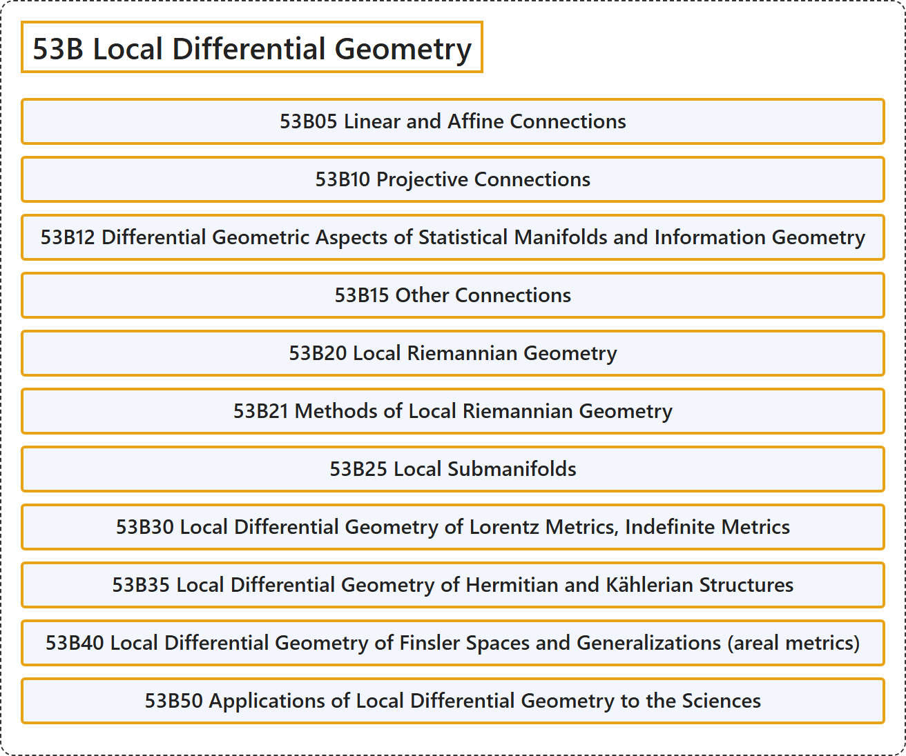

# 53B Local Differential Geometry

## Classification

## Glossary

| Term | Definition | 中文翻译 | Source |
|---|---|---|---|
| **53B Local Differential Geometry** 局部微分几何 | (No definition) | （无定义） | [Associate Editors of Mathematical Reviews and zbMATH, 2020](https://msc2020.org/) |
| **53B05 Linear and Affine Connections** 线性联络与仿射联络 | (No definition) | （无定义） | [Associate Editors of Mathematical Reviews and zbMATH, 2020](https://msc2020.org/) |
| **53B10 Projective Connections** 射影联络 | (No definition) | （无定义） | [Associate Editors of Mathematical Reviews and zbMATH, 2020](https://msc2020.org/) |
| **53B12 Differential Geometric Aspects of Statistical Manifolds and Information Geometry** 统计流形与信息几何的微分几何方面 | (No definition) | （无定义） | [Associate Editors of Mathematical Reviews and zbMATH, 2020](https://msc2020.org/) |
| **53B15 Other Connections** 其他联络 | (No definition) | （无定义） | [Associate Editors of Mathematical Reviews and zbMATH, 2020](https://msc2020.org/) |
| **53B20 Local Riemannian Geometry** 局部黎曼几何 | (No definition) | （无定义） | [Associate Editors of Mathematical Reviews and zbMATH, 2020](https://msc2020.org/) |
| **53B21 Methods of Local Riemannian Geometry** 局部黎曼几何的方法 | (No definition) | （无定义） | [Associate Editors of Mathematical Reviews and zbMATH, 2020](https://msc2020.org/) |
| **53B25 Local Submanifolds** 局部子流形 | (No definition) | （无定义） | [Associate Editors of Mathematical Reviews and zbMATH, 2020](https://msc2020.org/) |
| **53B30 Local Differential Geometry of Lorentz Metrics, Indefinite Metrics** 洛伦兹度量、不定度量的局部微分几何 | (No definition) | （无定义） | [Associate Editors of Mathematical Reviews and zbMATH, 2020](https://msc2020.org/) |
| **53B35 Local Differential Geometry of Hermitian and Kählerian Structures** 厄米结构与凯勒结构的局部微分几何 | (No definition) | （无定义） | [Associate Editors of Mathematical Reviews and zbMATH, 2020](https://msc2020.org/) |
| **53B40 Local Differential Geometry of Finsler Spaces and Generalizations (areal metrics)** 芬斯勒空间及其推广（面度量）的局部微分几何 | (No definition) | （无定义） | [Associate Editors of Mathematical Reviews and zbMATH, 2020](https://msc2020.org/) |
| **53B50 Applications of Local Differential Geometry to the Sciences** 局部微分几何在科学中的应用 | (No definition) | （无定义） | [Associate Editors of Mathematical Reviews and zbMATH, 2020](https://msc2020.org/) |

## References

Associate Editors of Mathematical Reviews and zbMATH. (2020). *MSC2020: Mathematics Subject Classification system*. Retrieved October 27, 2026, from <https://msc2020.org/>
