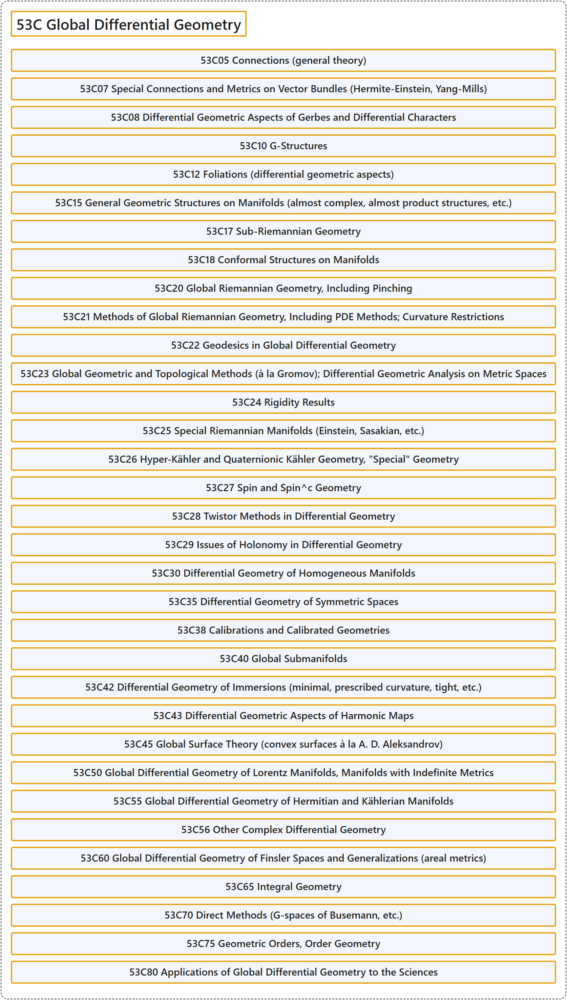

# 53C Global Differential Geometry

## Classification

## Glossary

| Term | Definition | 中文翻译 | Source |
|---|---|---|---|
| **53C Global Differential Geometry** 整体微分几何 | (No definition) | （无定义） | [Associate Editors of Mathematical Reviews and zbMATH, 2020](https://msc2020.org/) |
| **53C05 Connections (general theory)** 联络（一般理论） | (No definition) | （无定义） | [Associate Editors of Mathematical Reviews and zbMATH, 2020](https://msc2020.org/) |
| **53C07 Special Connections and Metrics on Vector Bundles (Hermite-Einstein, Yang-Mills)** 向量丛上的特殊联络与度量（埃尔米特-爱因斯坦、杨-米尔斯） | (No definition) | （无定义） | [Associate Editors of Mathematical Reviews and zbMATH, 2020](https://msc2020.org/) |
| **53C08 Differential Geometric Aspects of Gerbes and Differential Characters** 格尔贝与微分特征的微分几何方面 | (No definition) | （无定义） | [Associate Editors of Mathematical Reviews and zbMATH, 2020](https://msc2020.org/) |
| **53C10 G-Structures** G-结构 | (No definition) | （无定义） | [Associate Editors of Mathematical Reviews and zbMATH, 2020](https://msc2020.org/) |
| **53C12 Foliations (differential geometric aspects)** 叶状结构（微分几何方面） | (No definition) | （无定义） | [Associate Editors of Mathematical Reviews and zbMATH, 2020](https://msc2020.org/) |
| **53C15 General Geometric Structures on Manifolds (almost complex, almost product structures, etc.)** 流形上的一般几何结构（几乎复结构、几乎积结构等） | (No definition) | （无定义） | [Associate Editors of Mathematical Reviews and zbMATH, 2020](https://msc2020.org/) |
| **53C17 Sub-Riemannian Geometry** 次黎曼几何 | (No definition) | （无定义） | [Associate Editors of Mathematical Reviews and zbMATH, 2020](https://msc2020.org/) |
| **53C18 Conformal Structures on Manifolds** 流形上的共形结构 | (No definition) | （无定义） | [Associate Editors of Mathematical Reviews and zbMATH, 2020](https://msc2020.org/) |
| **53C20 Global Riemannian Geometry, Including Pinching** 整体黎曼几何，包括挤压 | (No definition) | （无定义） | [Associate Editors of Mathematical Reviews and zbMATH, 2020](https://msc2020.org/) |
| **53C21 Methods of Global Riemannian Geometry, Including PDE Methods; Curvature Restrictions** 整体黎曼几何的方法，包括 PDE 方法；曲率限制 | (No definition) | （无定义） | [Associate Editors of Mathematical Reviews and zbMATH, 2020](https://msc2020.org/) |
| **53C22 Geodesics in Global Differential Geometry** 整体微分几何中的测地线 | (No definition) | （无定义） | [Associate Editors of Mathematical Reviews and zbMATH, 2020](https://msc2020.org/) |
| **53C23 Global Geometric and Topological Methods (à la Gromov); Differential Geometric Analysis on Metric Spaces** 整体几何与拓扑方法（格罗莫夫风格）；度量空间上的微分几何分析 | (No definition) | （无定义） | [Associate Editors of Mathematical Reviews and zbMATH, 2020](https://msc2020.org/) |
| **53C24 Rigidity Results** 刚性结果 | (No definition) | （无定义） | [Associate Editors of Mathematical Reviews and zbMATH, 2020](https://msc2020.org/) |
| **53C25 Special Riemannian Manifolds (Einstein, Sasakian, etc.)** 特殊黎曼流形（爱因斯坦、佐佐木等） | (No definition) | （无定义） | [Associate Editors of Mathematical Reviews and zbMATH, 2020](https://msc2020.org/) |
| **53C26 Hyper-Kähler and Quaternionic Kähler Geometry, "Special" Geometry** 超凯勒几何与四元数凯勒几何、“特殊”几何 | (No definition) | （无定义） | [Associate Editors of Mathematical Reviews and zbMATH, 2020](https://msc2020.org/) |
| **53C27 Spin and Spin^c Geometry** 旋量几何与 Spin^c 几何 | (No definition) | （无定义） | [Associate Editors of Mathematical Reviews and zbMATH, 2020](https://msc2020.org/) |
| **53C28 Twistor Methods in Differential Geometry** 微分几何中的扭量方法 | (No definition) | （无定义） | [Associate Editors of Mathematical Reviews and zbMATH, 2020](https://msc2020.org/) |
| **53C29 Issues of Holonomy in Differential Geometry** 微分几何中的和乐问题 | (No definition) | （无定义） | [Associate Editors of Mathematical Reviews and zbMATH, 2020](https://msc2020.org/) |
| **53C30 Differential Geometry of Homogeneous Manifolds** 齐性流形的微分几何 | (No definition) | （无定义） | [Associate Editors of Mathematical Reviews and zbMATH, 2020](https://msc2020.org/) |
| **53C35 Differential Geometry of Symmetric Spaces** 对称空间的微分几何 | (No definition) | （无定义） | [Associate Editors of Mathematical Reviews and zbMATH, 2020](https://msc2020.org/) |
| **53C38 Calibrations and Calibrated Geometries** 校准与校准几何 | (No definition) | （无定义） | [Associate Editors of Mathematical Reviews and zbMATH, 2020](https://msc2020.org/) |
| **53C40 Global Submanifolds** 整体子流形 | (No definition) | （无定义） | [Associate Editors of Mathematical Reviews and zbMATH, 2020](https://msc2020.org/) |
| **53C42 Differential Geometry of Immersions (minimal, prescribed curvature, tight, etc.)** 浸入的微分几何（极小、给定曲率、紧等） | (No definition) | （无定义） | [Associate Editors of Mathematical Reviews and zbMATH, 2020](https://msc2020.org/) |
| **53C43 Differential Geometric Aspects of Harmonic Maps** 调和映射的微分几何方面 | (No definition) | （无定义） | [Associate Editors of Mathematical Reviews and zbMATH, 2020](https://msc2020.org/) |
| **53C45 Global Surface Theory (convex surfaces à la A. D. Aleksandrov)** 整体曲面理论（亚历山德罗夫风格的凸曲面） | (No definition) | （无定义） | [Associate Editors of Mathematical Reviews and zbMATH, 2020](https://msc2020.org/) |
| **53C50 Global Differential Geometry of Lorentz Manifolds, Manifolds with Indefinite Metrics** 洛伦兹流形、具有不定度量的流形的整体微分几何 | (No definition) | （无定义） | [Associate Editors of Mathematical Reviews and zbMATH, 2020](https://msc2020.org/) |
| **53C55 Global Differential Geometry of Hermitian and Kählerian Manifolds** 厄米流形与凯勒流形的整体微分几何 | (No definition) | （无定义） | [Associate Editors of Mathematical Reviews and zbMATH, 2020](https://msc2020.org/) |
| **53C56 Other Complex Differential Geometry** 其他复微分几何 | (No definition) | （无定义） | [Associate Editors of Mathematical Reviews and zbMATH, 2020](https://msc2020.org/) |
| **53C60 Global Differential Geometry of Finsler Spaces and Generalizations (areal metrics)** 芬斯勒空间及其推广（面度量）的整体微分几何 | (No definition) | （无定义） | [Associate Editors of Mathematical Reviews and zbMATH, 2020](https://msc2020.org/) |
| **53C65 Integral Geometry** 积分几何 | (No definition) | （无定义） | [Associate Editors of Mathematical Reviews and zbMATH, 2020](https://msc2020.org/) |
| **53C70 Direct Methods (G-spaces of Busemann, etc.)** 直接方法（布泽曼 G-空间等） | (No definition) | （无定义） | [Associate Editors of Mathematical Reviews and zbMATH, 2020](https://msc2020.org/) |
| **53C75 Geometric Orders, Order Geometry** 几何序、序几何 | (No definition) | （无定义） | [Associate Editors of Mathematical Reviews and zbMATH, 2020](https://msc2020.org/) |
| **53C80 Applications of Global Differential Geometry to the Sciences** 整体微分几何在科学中的应用 | (No definition) | （无定义） | [Associate Editors of Mathematical Reviews and zbMATH, 2020](https://msc2020.org/) |

## References

Associate Editors of Mathematical Reviews and zbMATH. (2020). *MSC2020: Mathematics Subject Classification system*. Retrieved October 27, 2026, from <https://msc2020.org/>
