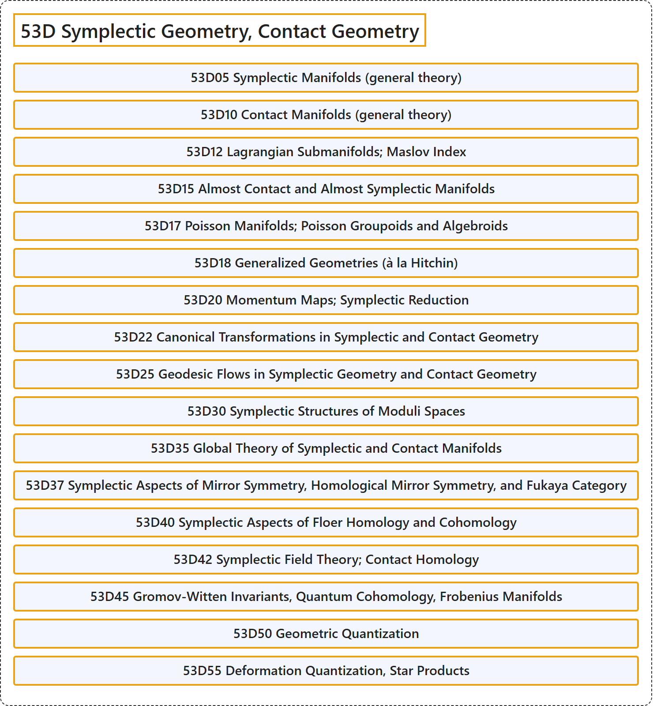

# 53D Symplectic Geometry, Contact Geometry

## Classification

## Glossary

| Term | Definition | 中文翻译 | Source |
|---|---|---|---|
| **53D Symplectic Geometry, Contact Geometry** 辛几何、接触几何 | (No definition) | （无定义） | [Associate Editors of Mathematical Reviews and zbMATH, 2020](https://msc2020.org/) |
| **53D05 Symplectic Manifolds (general theory)** 辛流形（一般理论） | (No definition) | （无定义） | [Associate Editors of Mathematical Reviews and zbMATH, 2020](https://msc2020.org/) |
| **53D10 Contact Manifolds (general theory)** 接触流形（一般理论） | (No definition) | （无定义） | [Associate Editors of Mathematical Reviews and zbMATH, 2020](https://msc2020.org/) |
| **53D12 Lagrangian Submanifolds; Maslov Index** 拉格朗日子流形；马斯洛夫指数 | (No definition) | （无定义） | [Associate Editors of Mathematical Reviews and zbMATH, 2020](https://msc2020.org/) |
| **53D15 Almost Contact and Almost Symplectic Manifolds** 几乎接触流形与几乎辛流形 | (No definition) | （无定义） | [Associate Editors of Mathematical Reviews and zbMATH, 2020](https://msc2020.org/) |
| **53D17 Poisson Manifolds; Poisson Groupoids and Algebroids** 泊松流形；泊松群胚与代数胚 | (No definition) | （无定义） | [Associate Editors of Mathematical Reviews and zbMATH, 2020](https://msc2020.org/) |
| **53D18 Generalized Geometries (à la Hitchin)** 广义几何（希钦风格） | (No definition) | （无定义） | [Associate Editors of Mathematical Reviews and zbMATH, 2020](https://msc2020.org/) |
| **53D20 Momentum Maps; Symplectic Reduction** 动量映射；辛约化 | (No definition) | （无定义） | [Associate Editors of Mathematical Reviews and zbMATH, 2020](https://msc2020.org/) |
| **53D22 Canonical Transformations in Symplectic and Contact Geometry** 辛几何与接触几何中的正则变换 | (No definition) | （无定义） | [Associate Editors of Mathematical Reviews and zbMATH, 2020](https://msc2020.org/) |
| **53D25 Geodesic Flows in Symplectic Geometry and Contact Geometry** 辛几何与接触几何中的测地流 | (No definition) | （无定义） | [Associate Editors of Mathematical Reviews and zbMATH, 2020](https://msc2020.org/) |
| **53D30 Symplectic Structures of Moduli Spaces** 模空间的辛结构 | (No definition) | （无定义） | [Associate Editors of Mathematical Reviews and zbMATH, 2020](https://msc2020.org/) |
| **53D35 Global Theory of Symplectic and Contact Manifolds** 辛流形与接触流形的整体理论 | (No definition) | （无定义） | [Associate Editors of Mathematical Reviews and zbMATH, 2020](https://msc2020.org/) |
| **53D37 Symplectic Aspects of Mirror Symmetry, Homological Mirror Symmetry, and Fukaya Category** 镜像对称的辛方面、同调镜像对称与深谷范畴 | (No definition) | （无定义） | [Associate Editors of Mathematical Reviews and zbMATH, 2020](https://msc2020.org/) |
| **53D40 Symplectic Aspects of Floer Homology and Cohomology** 弗洛尔同调与上同调的辛方面 | (No definition) | （无定义） | [Associate Editors of Mathematical Reviews and zbMATH, 2020](https://msc2020.org/) |
| **53D42 Symplectic Field Theory; Contact Homology** 辛场论；接触同调 | (No definition) | （无定义） | [Associate Editors of Mathematical Reviews and zbMATH, 2020](https://msc2020.org/) |
| **53D45 Gromov-Witten Invariants, Quantum Cohomology, Frobenius Manifolds** 格罗莫夫-威滕不变量、量子上同调、弗罗贝尼乌斯流形 | (No definition) | （无定义） | [Associate Editors of Mathematical Reviews and zbMATH, 2020](https://msc2020.org/) |
| **53D50 Geometric Quantization** 几何量子化 | (No definition) | （无定义） | [Associate Editors of Mathematical Reviews and zbMATH, 2020](https://msc2020.org/) |
| **53D55 Deformation Quantization, Star Products** 形变量子化、星积 | (No definition) | （无定义） | [Associate Editors of Mathematical Reviews and zbMATH, 2020](https://msc2020.org/) |

## References

Associate Editors of Mathematical Reviews and zbMATH. (2020). *MSC2020: Mathematics Subject Classification system*. Retrieved October 27, 2026, from <https://msc2020.org/>
