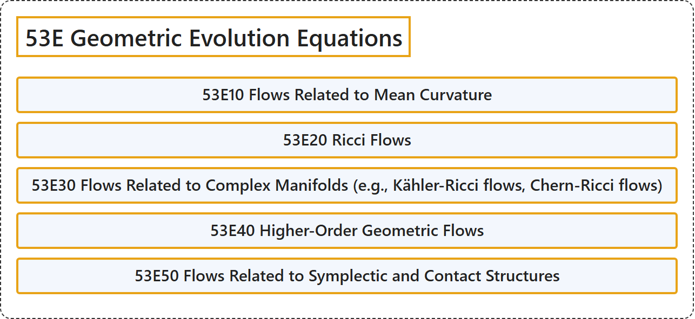

# 53E Geometric Evolution Equations

## Classification

## Glossary

| Term | Definition | 中文翻译 | Source |
|---|---|---|---|
| **53E Geometric Evolution Equations** 几何发展方程 | (No definition) | （无定义） | [Associate Editors of Mathematical Reviews and zbMATH, 2020](https://msc2020.org/) |
| **53E10 Flows Related to Mean Curvature** 与平均曲率有关的流 | (No definition) | （无定义） | [Associate Editors of Mathematical Reviews and zbMATH, 2020](https://msc2020.org/) |
| **53E20 Ricci Flows** 里奇流 | (No definition) | （无定义） | [Associate Editors of Mathematical Reviews and zbMATH, 2020](https://msc2020.org/) |
| **53E30 Flows Related to Complex Manifolds (e.g., Kähler-Ricci flows, Chern-Ricci flows)** 与复流形有关的流（如凯勒-里奇流、陈-里奇流） | (No definition) | （无定义） | [Associate Editors of Mathematical Reviews and zbMATH, 2020](https://msc2020.org/) |
| **53E40 Higher-Order Geometric Flows** 高阶几何流 | (No definition) | （无定义） | [Associate Editors of Mathematical Reviews and zbMATH, 2020](https://msc2020.org/) |
| **53E50 Flows Related to Symplectic and Contact Structures** 与辛结构和接触结构有关的流 | (No definition) | （无定义） | [Associate Editors of Mathematical Reviews and zbMATH, 2020](https://msc2020.org/) |

## References

Associate Editors of Mathematical Reviews and zbMATH. (2020). *MSC2020: Mathematics Subject Classification system*. Retrieved October 27, 2026, from <https://msc2020.org/>
