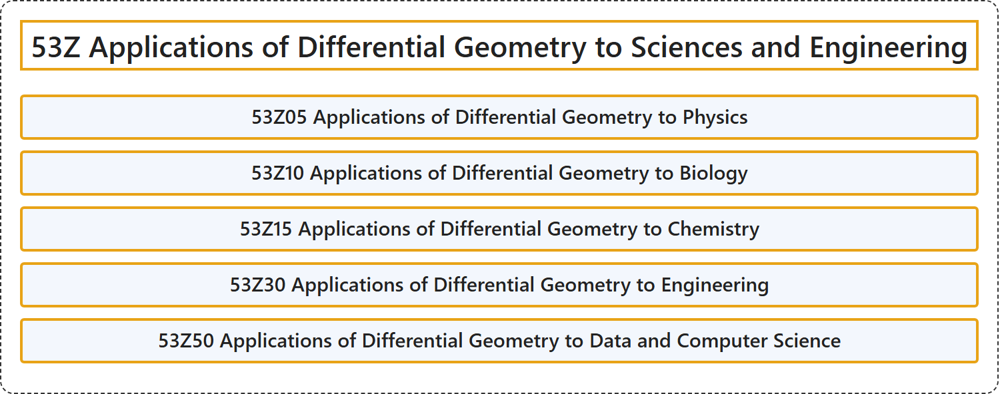

# 53Z Applications of Differential Geometry to Sciences and Engineering

## Classification

## Glossary

| Term | Definition | 中文翻译 | Source |
|---|---|---|---|
| **53Z Applications of Differential Geometry to Sciences and Engineering** 微分几何在科学与工程中的应用 | (No definition) | （无定义） | [Associate Editors of Mathematical Reviews and zbMATH, 2020](https://msc2020.org/) |
| **53Z05 Applications of Differential Geometry to Physics** 微分几何在物理学中的应用 | (No definition) | （无定义） | [Associate Editors of Mathematical Reviews and zbMATH, 2020](https://msc2020.org/) |
| **53Z10 Applications of Differential Geometry to Biology** 微分几何在生物学中的应用 | (No definition) | （无定义） | [Associate Editors of Mathematical Reviews and zbMATH, 2020](https://msc2020.org/) |
| **53Z15 Applications of Differential Geometry to Chemistry** 微分几何在化学中的应用 | (No definition) | （无定义） | [Associate Editors of Mathematical Reviews and zbMATH, 2020](https://msc2020.org/) |
| **53Z30 Applications of Differential Geometry to Engineering** 微分几何在工程中的应用 | (No definition) | （无定义） | [Associate Editors of Mathematical Reviews and zbMATH, 2020](https://msc2020.org/) |
| **53Z50 Applications of Differential Geometry to Data and Computer Science** 微分几何在数据与计算机科学中的应用 | (No definition) | （无定义） | [Associate Editors of Mathematical Reviews and zbMATH, 2020](https://msc2020.org/) |

## References

Associate Editors of Mathematical Reviews and zbMATH. (2020). *MSC2020: Mathematics Subject Classification system*. Retrieved October 27, 2026, from <https://msc2020.org/>
