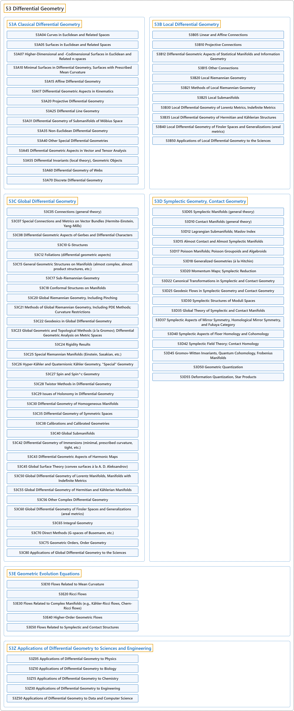

# 53 Differential Geometry

## Classification

## Glossary

| Term | Definition | 中文翻译 | Source |
|---|---|---|---|
| **53 Differential Geometry** 微分几何 | "Differential geometry is the **study of Riemannian manifolds**." | 微分几何是**对黎曼流形的研究**。 | [Weisstein, n.d., "Differential geometry" entry, para. 1](https://mathworld.wolfram.com/DifferentialGeometry.html#:~:text=Differential%20geometry%20is%20the%20study%20of%20Riemannian%20manifolds) |
| **[53A Classical Differential Geometry](53a-classical-differential-geometry.md)** 经典微分几何 | (No definition) | （无定义） | [Associate Editors of Mathematical Reviews and zbMATH, 2020](https://msc2020.org/) |
| **[53B Local Differential Geometry](53b-local-differential-geometry.md)** 局部微分几何 | (No definition) | （无定义） | [Associate Editors of Mathematical Reviews and zbMATH, 2020](https://msc2020.org/) |
| **[53C Global Differential Geometry](53c-global-differential-geometry.md)** 整体微分几何 | (No definition) | （无定义） | [Associate Editors of Mathematical Reviews and zbMATH, 2020](https://msc2020.org/) |
| **[53D Symplectic Geometry, Contact Geometry](53d-symplectic-geometry-contact-geometry.md)** 辛几何、接触几何 | (No definition) | （无定义） | [Associate Editors of Mathematical Reviews and zbMATH, 2020](https://msc2020.org/) |
| **[53E Geometric Evolution Equations](53e-geometric-evolution-equations.md)** 几何发展方程 | (No definition) | （无定义） | [Associate Editors of Mathematical Reviews and zbMATH, 2020](https://msc2020.org/) |
| **[53Z Applications of Differential Geometry to Sciences and Engineering](53z-applications-of-differential-geometry-to-sciences-and-engine.md)** 微分几何在科学与工程中的应用 | (No definition) | （无定义） | [Associate Editors of Mathematical Reviews and zbMATH, 2020](https://msc2020.org/) |

## References

Associate Editors of Mathematical Reviews and zbMATH. (2020). *MSC2020: Mathematics Subject Classification system*. Retrieved October 27, 2026, from <https://msc2020.org/>

Weisstein, E. W. (n.d.). *Differential geometry*. MathWorld: A Wolfram Resource. Retrieved October 27, 2026, from <https://mathworld.wolfram.com/DifferentialGeometry.html>
