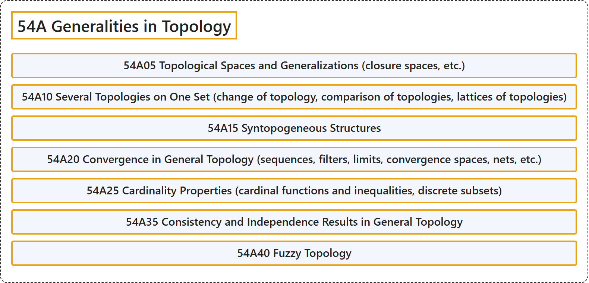

# 54A Generalities in Topology

## Classification

## Glossary

| Term | Definition | 中文翻译 | Source |
|---|---|---|---|
| **54A Generalities in Topology** 拓扑学概论 | (No definition) | （无定义） | [Associate Editors of Mathematical Reviews and zbMATH, 2020](https://msc2020.org/) |
| **54A05 Topological Spaces and Generalizations (closure spaces, etc.)** 拓扑空间及其推广（闭包空间等） | (No definition) | （无定义） | [Associate Editors of Mathematical Reviews and zbMATH, 2020](https://msc2020.org/) |
| **54A10 Several Topologies on One Set (change of topology, comparison of topologies, lattices of topologies)** 同一集合上的多个拓扑（拓扑的改变、拓扑的比较、拓扑格） | (No definition) | （无定义） | [Associate Editors of Mathematical Reviews and zbMATH, 2020](https://msc2020.org/) |
| **54A15 Syntopogeneous Structures** 合拓扑结构 | (No definition) | （无定义） | [Associate Editors of Mathematical Reviews and zbMATH, 2020](https://msc2020.org/) |
| **54A20 Convergence in General Topology (sequences, filters, limits, convergence spaces, nets, etc.)** 一般拓扑中的收敛（序列、滤子、极限、收敛空间、网等） | (No definition) | （无定义） | [Associate Editors of Mathematical Reviews and zbMATH, 2020](https://msc2020.org/) |
| **54A25 Cardinality Properties (cardinal functions and inequalities, discrete subsets)** 基数性质（基数函数与不等式、离散子集） | (No definition) | （无定义） | [Associate Editors of Mathematical Reviews and zbMATH, 2020](https://msc2020.org/) |
| **54A35 Consistency and Independence Results in General Topology** 一般拓扑中的相容性与独立性结果 | (No definition) | （无定义） | [Associate Editors of Mathematical Reviews and zbMATH, 2020](https://msc2020.org/) |
| **54A40 Fuzzy Topology** 模糊拓扑 | (No definition) | （无定义） | [Associate Editors of Mathematical Reviews and zbMATH, 2020](https://msc2020.org/) |

## References

Associate Editors of Mathematical Reviews and zbMATH. (2020). *MSC2020: Mathematics Subject Classification system*. Retrieved October 27, 2026, from <https://msc2020.org/>
