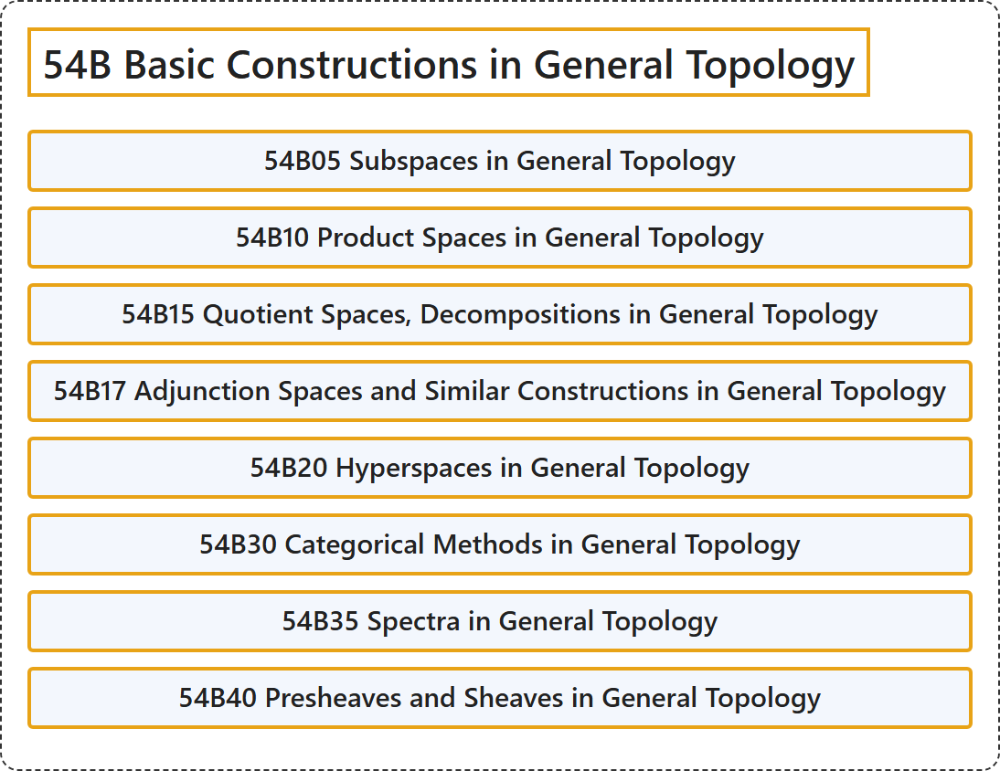

# 54B Basic Constructions in General Topology

## Classification

## Glossary

| Term | Definition | 中文翻译 | Source |
|---|---|---|---|
| **54B Basic Constructions in General Topology** 一般拓扑中的基本构造 | (No definition) | （无定义） | [Associate Editors of Mathematical Reviews and zbMATH, 2020](https://msc2020.org/) |
| **54B05 Subspaces in General Topology** 一般拓扑中的子空间 | (No definition) | （无定义） | [Associate Editors of Mathematical Reviews and zbMATH, 2020](https://msc2020.org/) |
| **54B10 Product Spaces in General Topology** 一般拓扑中的积空间 | (No definition) | （无定义） | [Associate Editors of Mathematical Reviews and zbMATH, 2020](https://msc2020.org/) |
| **54B15 Quotient Spaces, Decompositions in General Topology** 一般拓扑中的商空间、分解 | (No definition) | （无定义） | [Associate Editors of Mathematical Reviews and zbMATH, 2020](https://msc2020.org/) |
| **54B17 Adjunction Spaces and Similar Constructions in General Topology** 一般拓扑中的附着空间及类似构造 | (No definition) | （无定义） | [Associate Editors of Mathematical Reviews and zbMATH, 2020](https://msc2020.org/) |
| **54B20 Hyperspaces in General Topology** 一般拓扑中的超空间 | (No definition) | （无定义） | [Associate Editors of Mathematical Reviews and zbMATH, 2020](https://msc2020.org/) |
| **54B30 Categorical Methods in General Topology** 一般拓扑中的范畴方法 | (No definition) | （无定义） | [Associate Editors of Mathematical Reviews and zbMATH, 2020](https://msc2020.org/) |
| **54B35 Spectra in General Topology** 一般拓扑中的谱 | (No definition) | （无定义） | [Associate Editors of Mathematical Reviews and zbMATH, 2020](https://msc2020.org/) |
| **54B40 Presheaves and Sheaves in General Topology** 一般拓扑中的预层与层 | (No definition) | （无定义） | [Associate Editors of Mathematical Reviews and zbMATH, 2020](https://msc2020.org/) |

## References

Associate Editors of Mathematical Reviews and zbMATH. (2020). *MSC2020: Mathematics Subject Classification system*. Retrieved October 27, 2026, from <https://msc2020.org/>
