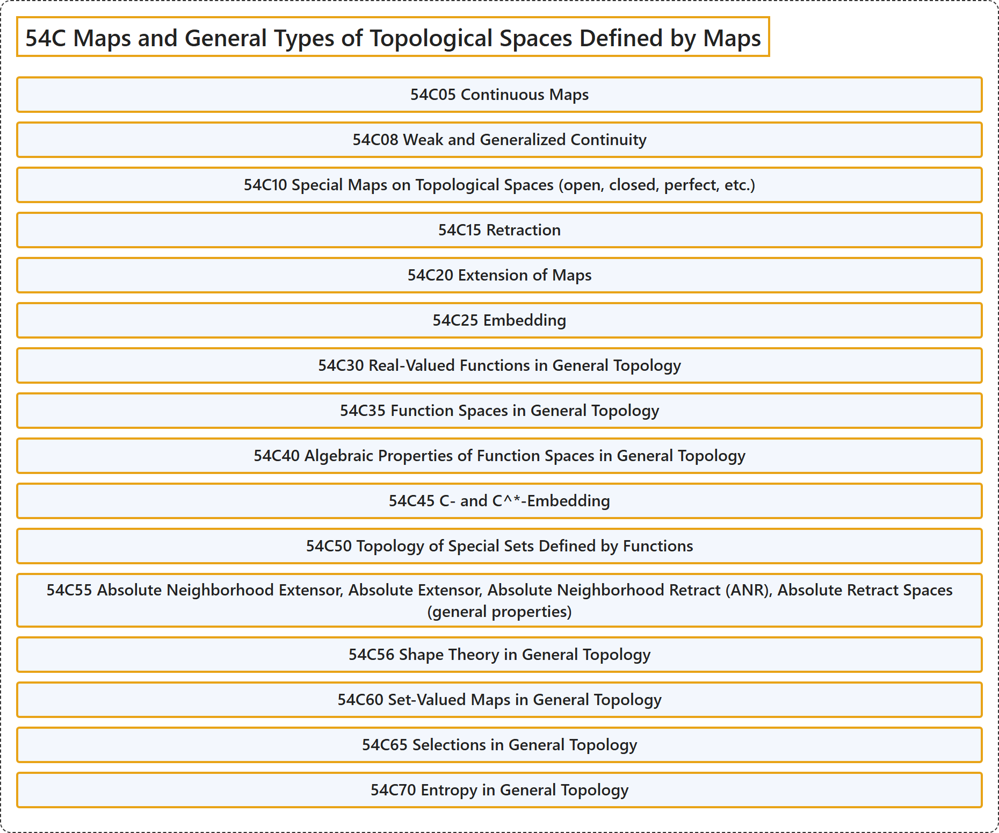

# 54C Maps and General Types of Topological Spaces Defined by Maps

## Classification

## Glossary

| Term | Definition | 中文翻译 | Source |
|---|---|---|---|
| **54C Maps and General Types of Topological Spaces Defined by Maps** 映射与由映射定义的一般类型拓扑空间 | (No definition) | （无定义） | [Associate Editors of Mathematical Reviews and zbMATH, 2020](https://msc2020.org/) |
| **54C05 Continuous Maps** 连续映射 | (No definition) | （无定义） | [Associate Editors of Mathematical Reviews and zbMATH, 2020](https://msc2020.org/) |
| **54C08 Weak and Generalized Continuity** 弱连续性与广义连续性 | (No definition) | （无定义） | [Associate Editors of Mathematical Reviews and zbMATH, 2020](https://msc2020.org/) |
| **54C10 Special Maps on Topological Spaces (open, closed, perfect, etc.)** 拓扑空间上的特殊映射（开映射、闭映射、完备映射等） | (No definition) | （无定义） | [Associate Editors of Mathematical Reviews and zbMATH, 2020](https://msc2020.org/) |
| **54C15 Retraction** 收缩 | (No definition) | （无定义） | [Associate Editors of Mathematical Reviews and zbMATH, 2020](https://msc2020.org/) |
| **54C20 Extension of Maps** 映射的扩张 | (No definition) | （无定义） | [Associate Editors of Mathematical Reviews and zbMATH, 2020](https://msc2020.org/) |
| **54C25 Embedding** 嵌入 | (No definition) | （无定义） | [Associate Editors of Mathematical Reviews and zbMATH, 2020](https://msc2020.org/) |
| **54C30 Real-Valued Functions in General Topology** 一般拓扑中的实值函数 | (No definition) | （无定义） | [Associate Editors of Mathematical Reviews and zbMATH, 2020](https://msc2020.org/) |
| **54C35 Function Spaces in General Topology** 一般拓扑中的函数空间 | (No definition) | （无定义） | [Associate Editors of Mathematical Reviews and zbMATH, 2020](https://msc2020.org/) |
| **54C40 Algebraic Properties of Function Spaces in General Topology** 一般拓扑中函数空间的代数性质 | (No definition) | （无定义） | [Associate Editors of Mathematical Reviews and zbMATH, 2020](https://msc2020.org/) |
| **54C45 C- and C^\*-Embedding** C-嵌入与 C^*-嵌入 | (No definition) | （无定义） | [Associate Editors of Mathematical Reviews and zbMATH, 2020](https://msc2020.org/) |
| **54C50 Topology of Special Sets Defined by Functions** 由函数定义的特殊集合的拓扑 | (No definition) | （无定义） | [Associate Editors of Mathematical Reviews and zbMATH, 2020](https://msc2020.org/) |
| **54C55 Absolute Neighborhood Extensor, Absolute Extensor, Absolute Neighborhood Retract (ANR), Absolute Retract Spaces (general properties)** 绝对邻域扩张子、绝对扩张子、绝对邻域收缩核（ANR）、绝对收缩核空间（一般性质） | (No definition) | （无定义） | [Associate Editors of Mathematical Reviews and zbMATH, 2020](https://msc2020.org/) |
| **54C56 Shape Theory in General Topology** 一般拓扑中的形状理论 | (No definition) | （无定义） | [Associate Editors of Mathematical Reviews and zbMATH, 2020](https://msc2020.org/) |
| **54C60 Set-Valued Maps in General Topology** 一般拓扑中的集值映射 | (No definition) | （无定义） | [Associate Editors of Mathematical Reviews and zbMATH, 2020](https://msc2020.org/) |
| **54C65 Selections in General Topology** 一般拓扑中的选择 | (No definition) | （无定义） | [Associate Editors of Mathematical Reviews and zbMATH, 2020](https://msc2020.org/) |
| **54C70 Entropy in General Topology** 一般拓扑中的熵 | (No definition) | （无定义） | [Associate Editors of Mathematical Reviews and zbMATH, 2020](https://msc2020.org/) |

## References

Associate Editors of Mathematical Reviews and zbMATH. (2020). *MSC2020: Mathematics Subject Classification system*. Retrieved October 27, 2026, from <https://msc2020.org/>
