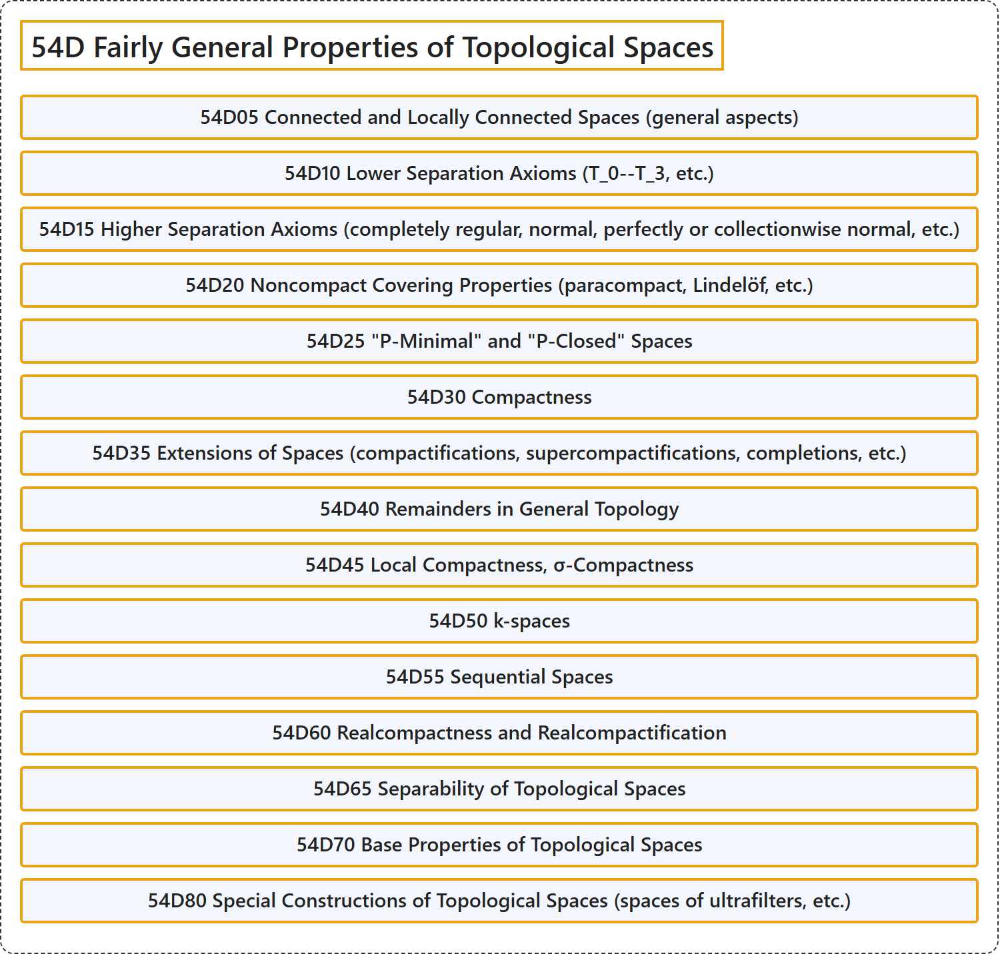

# 54D Fairly General Properties of Topological Spaces

## Classification

## Glossary

| Term | Definition | 中文翻译 | Source |
|---|---|---|---|
| **54D Fairly General Properties of Topological Spaces** 拓扑空间的较一般性质 | (No definition) | （无定义） | [Associate Editors of Mathematical Reviews and zbMATH, 2020](https://msc2020.org/) |
| **54D05 Connected and Locally Connected Spaces (general aspects)** 连通空间与局部连通空间（一般方面） | (No definition) | （无定义） | [Associate Editors of Mathematical Reviews and zbMATH, 2020](https://msc2020.org/) |
| **54D10 Lower Separation Axioms (T_0--T_3, etc.)** 低分离公理（T_0--T_3 等） | (No definition) | （无定义） | [Associate Editors of Mathematical Reviews and zbMATH, 2020](https://msc2020.org/) |
| **54D15 Higher Separation Axioms (completely regular, normal, perfectly or collectionwise normal, etc.)** 高分离公理（完全正则、正规、完美正规或集体正规等） | (No definition) | （无定义） | [Associate Editors of Mathematical Reviews and zbMATH, 2020](https://msc2020.org/) |
| **54D20 Noncompact Covering Properties (paracompact, Lindelöf, etc.)** 非紧覆盖性质（仿紧、林德勒夫等） | (No definition) | （无定义） | [Associate Editors of Mathematical Reviews and zbMATH, 2020](https://msc2020.org/) |
| **54D25 "P-Minimal" and "P-Closed" Spaces** “P-极小”空间与“P-闭”空间 | (No definition) | （无定义） | [Associate Editors of Mathematical Reviews and zbMATH, 2020](https://msc2020.org/) |
| **54D30 Compactness** 紧性 | (No definition) | （无定义） | [Associate Editors of Mathematical Reviews and zbMATH, 2020](https://msc2020.org/) |
| **54D35 Extensions of Spaces (compactifications, supercompactifications, completions, etc.)** 空间的扩张（紧化、超紧化、完备化等） | (No definition) | （无定义） | [Associate Editors of Mathematical Reviews and zbMATH, 2020](https://msc2020.org/) |
| **54D40 Remainders in General Topology** 一般拓扑中的余集 | (No definition) | （无定义） | [Associate Editors of Mathematical Reviews and zbMATH, 2020](https://msc2020.org/) |
| **54D45 Local Compactness, σ-Compactness** 局部紧性、σ-紧性 | (No definition) | （无定义） | [Associate Editors of Mathematical Reviews and zbMATH, 2020](https://msc2020.org/) |
| **54D50 k-spaces** k-空间 | (No definition) | （无定义） | [Associate Editors of Mathematical Reviews and zbMATH, 2020](https://msc2020.org/) |
| **54D55 Sequential Spaces** 序列空间 | (No definition) | （无定义） | [Associate Editors of Mathematical Reviews and zbMATH, 2020](https://msc2020.org/) |
| **54D60 Realcompactness and Realcompactification** 实紧性与实紧化 | (No definition) | （无定义） | [Associate Editors of Mathematical Reviews and zbMATH, 2020](https://msc2020.org/) |
| **54D65 Separability of Topological Spaces** 拓扑空间的可分性 | (No definition) | （无定义） | [Associate Editors of Mathematical Reviews and zbMATH, 2020](https://msc2020.org/) |
| **54D70 Base Properties of Topological Spaces** 拓扑空间的基性质 | (No definition) | （无定义） | [Associate Editors of Mathematical Reviews and zbMATH, 2020](https://msc2020.org/) |
| **54D80 Special Constructions of Topological Spaces (spaces of ultrafilters, etc.)** 拓扑空间的特殊构造（超滤子空间等） | (No definition) | （无定义） | [Associate Editors of Mathematical Reviews and zbMATH, 2020](https://msc2020.org/) |

## References

Associate Editors of Mathematical Reviews and zbMATH. (2020). *MSC2020: Mathematics Subject Classification system*. Retrieved October 27, 2026, from <https://msc2020.org/>
