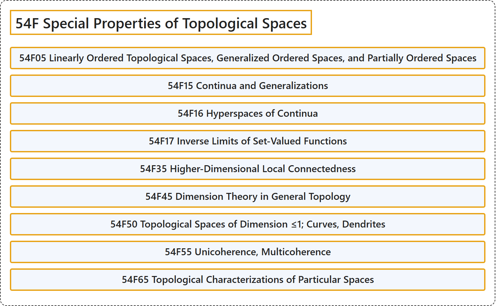

# 54F Special Properties of Topological Spaces

## Classification

## Glossary

| Term | Definition | 中文翻译 | Source |
|---|---|---|---|
| **54F Special Properties of Topological Spaces** 拓扑空间的特殊性质 | (No definition) | （无定义） | [Associate Editors of Mathematical Reviews and zbMATH, 2020](https://msc2020.org/) |
| **54F05 Linearly Ordered Topological Spaces, Generalized Ordered Spaces, and Partially Ordered Spaces** 线性序拓扑空间、广义序空间与偏序空间 | (No definition) | （无定义） | [Associate Editors of Mathematical Reviews and zbMATH, 2020](https://msc2020.org/) |
| **54F15 Continua and Generalizations** 连续统及其推广 | (No definition) | （无定义） | [Associate Editors of Mathematical Reviews and zbMATH, 2020](https://msc2020.org/) |
| **54F16 Hyperspaces of Continua** 连续统的超空间 | (No definition) | （无定义） | [Associate Editors of Mathematical Reviews and zbMATH, 2020](https://msc2020.org/) |
| **54F17 Inverse Limits of Set-Valued Functions** 集值函数的逆极限 | (No definition) | （无定义） | [Associate Editors of Mathematical Reviews and zbMATH, 2020](https://msc2020.org/) |
| **54F35 Higher-Dimensional Local Connectedness** 高维局部连通性 | (No definition) | （无定义） | [Associate Editors of Mathematical Reviews and zbMATH, 2020](https://msc2020.org/) |
| **54F45 Dimension Theory in General Topology** 一般拓扑中的维数论 | (No definition) | （无定义） | [Associate Editors of Mathematical Reviews and zbMATH, 2020](https://msc2020.org/) |
| **54F50 Topological Spaces of Dimension ≤1; Curves, Dendrites** 维数 ≤1 的拓扑空间；曲线、树状图 | (No definition) | （无定义） | [Associate Editors of Mathematical Reviews and zbMATH, 2020](https://msc2020.org/) |
| **54F55 Unicoherence, Multicoherence** 单相干性、多相干性 | (No definition) | （无定义） | [Associate Editors of Mathematical Reviews and zbMATH, 2020](https://msc2020.org/) |
| **54F65 Topological Characterizations of Particular Spaces** 特定空间的拓扑刻画 | (No definition) | （无定义） | [Associate Editors of Mathematical Reviews and zbMATH, 2020](https://msc2020.org/) |

## References

Associate Editors of Mathematical Reviews and zbMATH. (2020). *MSC2020: Mathematics Subject Classification system*. Retrieved October 27, 2026, from <https://msc2020.org/>
