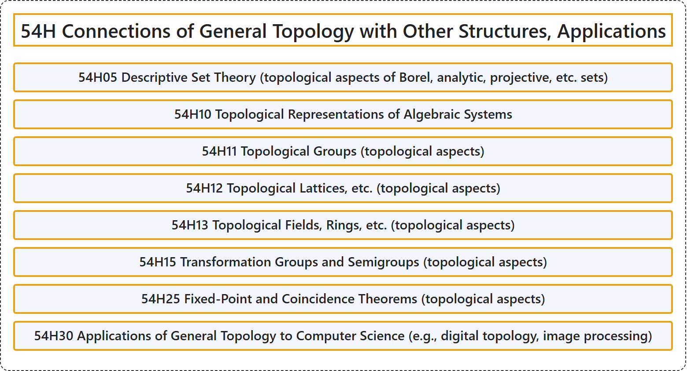

# 54H Connections of General Topology with Other Structures, Applications

## Classification

## Glossary

| Term | Definition | 中文翻译 | Source |
|---|---|---|---|
| **54H Connections of General Topology with Other Structures, Applications** 一般拓扑与其他结构的联系、应用 | (No definition) | （无定义） | [Associate Editors of Mathematical Reviews and zbMATH, 2020](https://msc2020.org/) |
| **54H05 Descriptive Set Theory (topological aspects of Borel, analytic, projective, etc. sets)** 描述集合论（博雷尔集、解析集、射影集等的拓扑方面） | (No definition) | （无定义） | [Associate Editors of Mathematical Reviews and zbMATH, 2020](https://msc2020.org/) |
| **54H10 Topological Representations of Algebraic Systems** 代数系统的拓扑表示 | (No definition) | （无定义） | [Associate Editors of Mathematical Reviews and zbMATH, 2020](https://msc2020.org/) |
| **54H11 Topological Groups (topological aspects)** 拓扑群（拓扑方面） | (No definition) | （无定义） | [Associate Editors of Mathematical Reviews and zbMATH, 2020](https://msc2020.org/) |
| **54H12 Topological Lattices, etc. (topological aspects)** 拓扑格等（拓扑方面） | (No definition) | （无定义） | [Associate Editors of Mathematical Reviews and zbMATH, 2020](https://msc2020.org/) |
| **54H13 Topological Fields, Rings, etc. (topological aspects)** 拓扑域、拓扑环等（拓扑方面） | (No definition) | （无定义） | [Associate Editors of Mathematical Reviews and zbMATH, 2020](https://msc2020.org/) |
| **54H15 Transformation Groups and Semigroups (topological aspects)** 变换群与半群（拓扑方面） | (No definition) | （无定义） | [Associate Editors of Mathematical Reviews and zbMATH, 2020](https://msc2020.org/) |
| **54H25 Fixed-Point and Coincidence Theorems (topological aspects)** 不动点定理与重合点定理（拓扑方面） | (No definition) | （无定义） | [Associate Editors of Mathematical Reviews and zbMATH, 2020](https://msc2020.org/) |
| **54H30 Applications of General Topology to Computer Science (e.g., digital topology, image processing)** 一般拓扑在计算机科学中的应用（如数字拓扑、图像处理） | (No definition) | （无定义） | [Associate Editors of Mathematical Reviews and zbMATH, 2020](https://msc2020.org/) |

## References

Associate Editors of Mathematical Reviews and zbMATH. (2020). *MSC2020: Mathematics Subject Classification system*. Retrieved October 27, 2026, from <https://msc2020.org/>
