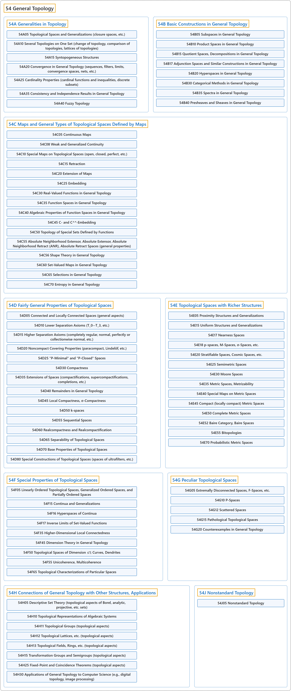

# 54 General Topology

## Classification

## Glossary

| Term | Definition | 中文翻译 | Source |
|---|---|---|---|
| **54 General Topology** 一般拓扑 | (context) "Topology is the mathematical study of **the properties that are preserved through deformations, twistings, and stretchings of objects**." | （语境）拓扑学是对**物体经过变形、扭曲和拉伸后仍保持的性质**所作的数学研究。 | [Weisstein, n.d., "Topology" entry, para. 1](https://mathworld.wolfram.com/Topology.html#:~:text=Topology%20is%20the%20mathematical%20study%20of%20the%20properties) |
| **[54A Generalities in Topology](54a-generalities-in-topology.md)** 拓扑学概论 | (No definition) | （无定义） | [Associate Editors of Mathematical Reviews and zbMATH, 2020](https://msc2020.org/) |
| **[54B Basic Constructions in General Topology](54b-basic-constructions-in-general-topology.md)** 一般拓扑中的基本构造 | (No definition) | （无定义） | [Associate Editors of Mathematical Reviews and zbMATH, 2020](https://msc2020.org/) |
| **[54C Maps and General Types of Topological Spaces Defined by Maps](54c-maps-and-general-types-of-topological-spaces-defined-by-maps.md)** 映射与由映射定义的一般类型拓扑空间 | (No definition) | （无定义） | [Associate Editors of Mathematical Reviews and zbMATH, 2020](https://msc2020.org/) |
| **[54D Fairly General Properties of Topological Spaces](54d-fairly-general-properties-of-topological-spaces.md)** 拓扑空间的较一般性质 | (No definition) | （无定义） | [Associate Editors of Mathematical Reviews and zbMATH, 2020](https://msc2020.org/) |
| **[54E Topological Spaces with Richer Structures](54e-topological-spaces-with-richer-structures.md)** 带更丰富结构的拓扑空间 | (No definition) | （无定义） | [Associate Editors of Mathematical Reviews and zbMATH, 2020](https://msc2020.org/) |
| **[54F Special Properties of Topological Spaces](54f-special-properties-of-topological-spaces.md)** 拓扑空间的特殊性质 | (No definition) | （无定义） | [Associate Editors of Mathematical Reviews and zbMATH, 2020](https://msc2020.org/) |
| **[54G Peculiar Topological Spaces](54g-peculiar-topological-spaces.md)** 特异拓扑空间 | (No definition) | （无定义） | [Associate Editors of Mathematical Reviews and zbMATH, 2020](https://msc2020.org/) |
| **[54H Connections of General Topology with Other Structures, Applications](54h-connections-of-general-topology-with-other-structures-applic.md)** 一般拓扑与其他结构的联系、应用 | (No definition) | （无定义） | [Associate Editors of Mathematical Reviews and zbMATH, 2020](https://msc2020.org/) |
| **[54J Nonstandard Topology](54j-nonstandard-topology.md)** 非标准拓扑 | (No definition) | （无定义） | [Associate Editors of Mathematical Reviews and zbMATH, 2020](https://msc2020.org/) |

## References

Associate Editors of Mathematical Reviews and zbMATH. (2020). *MSC2020: Mathematics Subject Classification system*. Retrieved October 27, 2026, from <https://msc2020.org/>

Weisstein, E. W. (n.d.). *Topology*. MathWorld: A Wolfram Resource. Retrieved October 27, 2026, from <https://mathworld.wolfram.com/Topology.html>
