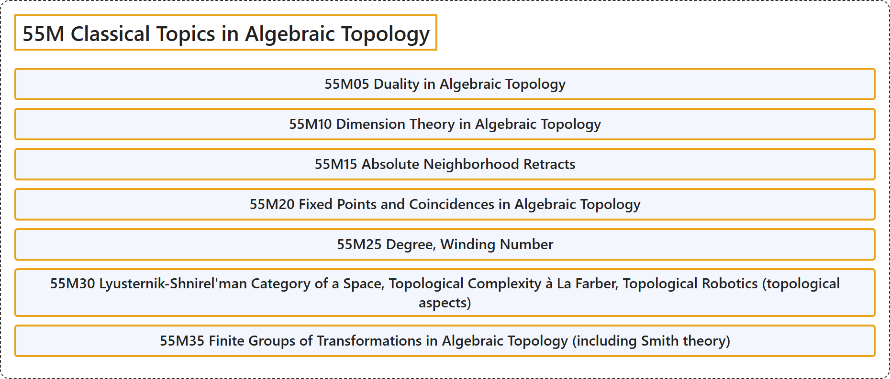

# 55M Classical Topics in Algebraic Topology

## Classification

## Glossary

| Term | Definition | 中文翻译 | Source |
|---|---|---|---|
| **55M Classical Topics in Algebraic Topology** 代数拓扑的经典专题 | (No definition) | （无定义） | [Associate Editors of Mathematical Reviews and zbMATH, 2020](https://msc2020.org/) |
| **55M05 Duality in Algebraic Topology** 代数拓扑中的对偶 | (No definition) | （无定义） | [Associate Editors of Mathematical Reviews and zbMATH, 2020](https://msc2020.org/) |
| **55M10 Dimension Theory in Algebraic Topology** 代数拓扑中的维数论 | (No definition) | （无定义） | [Associate Editors of Mathematical Reviews and zbMATH, 2020](https://msc2020.org/) |
| **55M15 Absolute Neighborhood Retracts** 绝对邻域收缩核 | (No definition) | （无定义） | [Associate Editors of Mathematical Reviews and zbMATH, 2020](https://msc2020.org/) |
| **55M20 Fixed Points and Coincidences in Algebraic Topology** 代数拓扑中的不动点与重合点 | (No definition) | （无定义） | [Associate Editors of Mathematical Reviews and zbMATH, 2020](https://msc2020.org/) |
| **55M25 Degree, Winding Number** 度、环绕数 | (No definition) | （无定义） | [Associate Editors of Mathematical Reviews and zbMATH, 2020](https://msc2020.org/) |
| **55M30 Lyusternik-Shnirel'man Category of a Space, Topological Complexity à La Farber, Topological Robotics (topological aspects)** 空间的吕斯捷尔尼克-施尼雷尔曼范畴、法尔伯风格的拓扑复杂度、拓扑机器人学（拓扑方面） | (No definition) | （无定义） | [Associate Editors of Mathematical Reviews and zbMATH, 2020](https://msc2020.org/) |
| **55M35 Finite Groups of Transformations in Algebraic Topology (including Smith theory)** 代数拓扑中的有限变换群（包括史密斯理论） | (No definition) | （无定义） | [Associate Editors of Mathematical Reviews and zbMATH, 2020](https://msc2020.org/) |

## References

Associate Editors of Mathematical Reviews and zbMATH. (2020). *MSC2020: Mathematics Subject Classification system*. Retrieved October 27, 2026, from <https://msc2020.org/>
