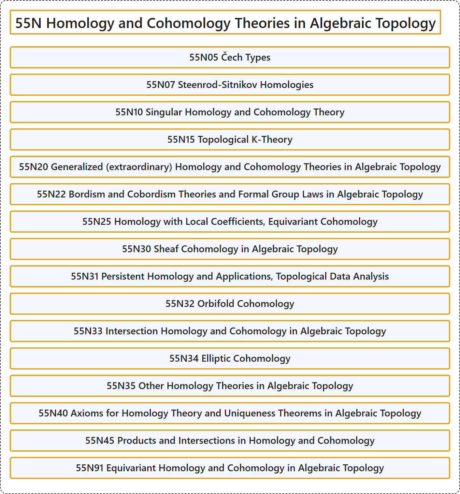

# 55N Homology and Cohomology Theories in Algebraic Topology

## Classification

## Glossary

| Term | Definition | 中文翻译 | Source |
|---|---|---|---|
| **55N Homology and Cohomology Theories in Algebraic Topology** 代数拓扑中的同调与上同调理论 | (No definition) | （无定义） | [Associate Editors of Mathematical Reviews and zbMATH, 2020](https://msc2020.org/) |
| **55N05 Čech Types** 切赫型 | (No definition) | （无定义） | [Associate Editors of Mathematical Reviews and zbMATH, 2020](https://msc2020.org/) |
| **55N07 Steenrod-Sitnikov Homologies** 斯廷罗德-西特尼科夫同调 | (No definition) | （无定义） | [Associate Editors of Mathematical Reviews and zbMATH, 2020](https://msc2020.org/) |
| **55N10 Singular Homology and Cohomology Theory** 奇异同调与上同调理论 | (No definition) | （无定义） | [Associate Editors of Mathematical Reviews and zbMATH, 2020](https://msc2020.org/) |
| **55N15 Topological K-Theory** 拓扑 K-理论 | (No definition) | （无定义） | [Associate Editors of Mathematical Reviews and zbMATH, 2020](https://msc2020.org/) |
| **55N20 Generalized (extraordinary) Homology and Cohomology Theories in Algebraic Topology** 代数拓扑中的广义（非常）同调与上同调理论 | (No definition) | （无定义） | [Associate Editors of Mathematical Reviews and zbMATH, 2020](https://msc2020.org/) |
| **55N22 Bordism and Cobordism Theories and Formal Group Laws in Algebraic Topology** 代数拓扑中的配边与上配边理论及形式群律 | (No definition) | （无定义） | [Associate Editors of Mathematical Reviews and zbMATH, 2020](https://msc2020.org/) |
| **55N25 Homology with Local Coefficients, Equivariant Cohomology** 局部系数同调、等变上同调 | (No definition) | （无定义） | [Associate Editors of Mathematical Reviews and zbMATH, 2020](https://msc2020.org/) |
| **55N30 Sheaf Cohomology in Algebraic Topology** 代数拓扑中的层上同调 | (No definition) | （无定义） | [Associate Editors of Mathematical Reviews and zbMATH, 2020](https://msc2020.org/) |
| **55N31 Persistent Homology and Applications, Topological Data Analysis** 持续同调及其应用、拓扑数据分析 | (No definition) | （无定义） | [Associate Editors of Mathematical Reviews and zbMATH, 2020](https://msc2020.org/) |
| **55N32 Orbifold Cohomology** 轨形上同调 | (No definition) | （无定义） | [Associate Editors of Mathematical Reviews and zbMATH, 2020](https://msc2020.org/) |
| **55N33 Intersection Homology and Cohomology in Algebraic Topology** 代数拓扑中的相交同调与上同调 | (No definition) | （无定义） | [Associate Editors of Mathematical Reviews and zbMATH, 2020](https://msc2020.org/) |
| **55N34 Elliptic Cohomology** 椭圆上同调 | (No definition) | （无定义） | [Associate Editors of Mathematical Reviews and zbMATH, 2020](https://msc2020.org/) |
| **55N35 Other Homology Theories in Algebraic Topology** 代数拓扑中的其他同调理论 | (No definition) | （无定义） | [Associate Editors of Mathematical Reviews and zbMATH, 2020](https://msc2020.org/) |
| **55N40 Axioms for Homology Theory and Uniqueness Theorems in Algebraic Topology** 代数拓扑中的同调理论公理与唯一性定理 | (No definition) | （无定义） | [Associate Editors of Mathematical Reviews and zbMATH, 2020](https://msc2020.org/) |
| **55N45 Products and Intersections in Homology and Cohomology** 同调与上同调中的积与相交 | (No definition) | （无定义） | [Associate Editors of Mathematical Reviews and zbMATH, 2020](https://msc2020.org/) |
| **55N91 Equivariant Homology and Cohomology in Algebraic Topology** 代数拓扑中的等变同调与上同调 | (No definition) | （无定义） | [Associate Editors of Mathematical Reviews and zbMATH, 2020](https://msc2020.org/) |

## References

Associate Editors of Mathematical Reviews and zbMATH. (2020). *MSC2020: Mathematics Subject Classification system*. Retrieved October 27, 2026, from <https://msc2020.org/>
