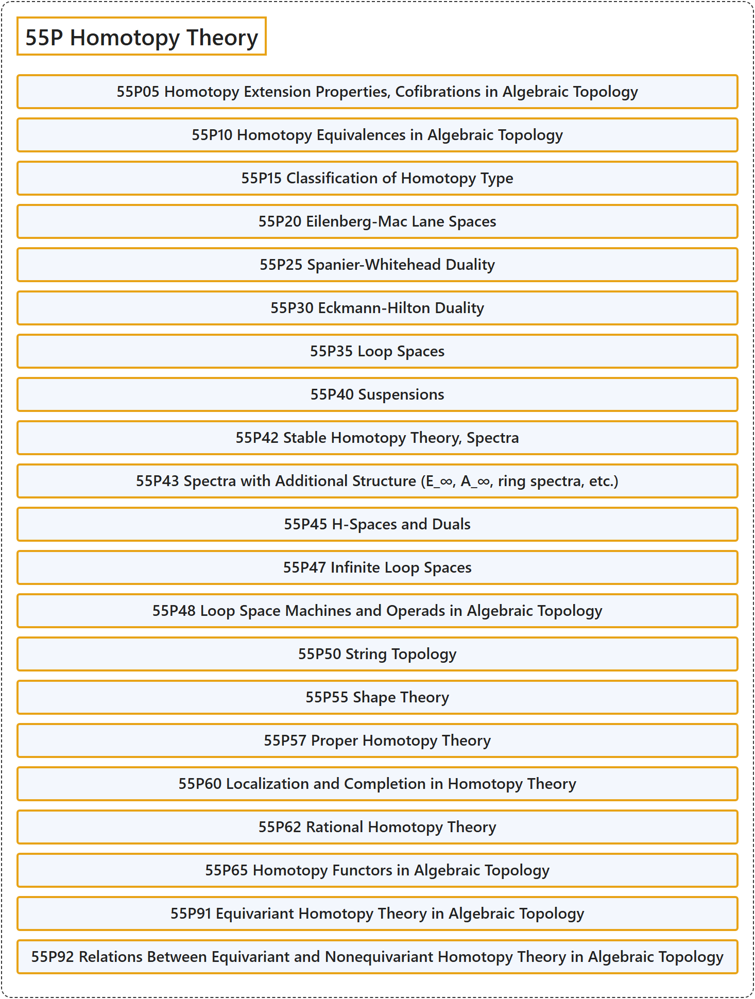

# 55P Homotopy Theory

## Classification

## Glossary

| Term | Definition | 中文翻译 | Source |
|---|---|---|---|
| **55P Homotopy Theory** 同伦论 | (No definition) | （无定义） | [Associate Editors of Mathematical Reviews and zbMATH, 2020](https://msc2020.org/) |
| **55P05 Homotopy Extension Properties, Cofibrations in Algebraic Topology** 代数拓扑中的同伦扩张性质、上纤维化 | (No definition) | （无定义） | [Associate Editors of Mathematical Reviews and zbMATH, 2020](https://msc2020.org/) |
| **55P10 Homotopy Equivalences in Algebraic Topology** 代数拓扑中的同伦等价 | (No definition) | （无定义） | [Associate Editors of Mathematical Reviews and zbMATH, 2020](https://msc2020.org/) |
| **55P15 Classification of Homotopy Type** 同伦型的分类 | (No definition) | （无定义） | [Associate Editors of Mathematical Reviews and zbMATH, 2020](https://msc2020.org/) |
| **55P20 Eilenberg-Mac Lane Spaces** 艾伦伯格-麦克莱恩空间 | (No definition) | （无定义） | [Associate Editors of Mathematical Reviews and zbMATH, 2020](https://msc2020.org/) |
| **55P25 Spanier-Whitehead Duality** 斯帕尼尔-怀特黑德对偶 | (No definition) | （无定义） | [Associate Editors of Mathematical Reviews and zbMATH, 2020](https://msc2020.org/) |
| **55P30 Eckmann-Hilton Duality** 埃克曼-希尔顿对偶 | (No definition) | （无定义） | [Associate Editors of Mathematical Reviews and zbMATH, 2020](https://msc2020.org/) |
| **55P35 Loop Spaces** 圈空间 | (No definition) | （无定义） | [Associate Editors of Mathematical Reviews and zbMATH, 2020](https://msc2020.org/) |
| **55P40 Suspensions** 纬悬 | (No definition) | （无定义） | [Associate Editors of Mathematical Reviews and zbMATH, 2020](https://msc2020.org/) |
| **55P42 Stable Homotopy Theory, Spectra** 稳定同伦论、谱 | (No definition) | （无定义） | [Associate Editors of Mathematical Reviews and zbMATH, 2020](https://msc2020.org/) |
| **55P43 Spectra with Additional Structure (E_∞, A_∞, ring spectra, etc.)** 带附加结构的谱（E_∞、A_∞、环谱等） | (No definition) | （无定义） | [Associate Editors of Mathematical Reviews and zbMATH, 2020](https://msc2020.org/) |
| **55P45 H-Spaces and Duals** H-空间及其对偶 | (No definition) | （无定义） | [Associate Editors of Mathematical Reviews and zbMATH, 2020](https://msc2020.org/) |
| **55P47 Infinite Loop Spaces** 无限圈空间 | (No definition) | （无定义） | [Associate Editors of Mathematical Reviews and zbMATH, 2020](https://msc2020.org/) |
| **55P48 Loop Space Machines and Operads in Algebraic Topology** 代数拓扑中的圈空间机器与操作数 | (No definition) | （无定义） | [Associate Editors of Mathematical Reviews and zbMATH, 2020](https://msc2020.org/) |
| **55P50 String Topology** 弦拓扑 | (No definition) | （无定义） | [Associate Editors of Mathematical Reviews and zbMATH, 2020](https://msc2020.org/) |
| **55P55 Shape Theory** 形状理论 | (No definition) | （无定义） | [Associate Editors of Mathematical Reviews and zbMATH, 2020](https://msc2020.org/) |
| **55P57 Proper Homotopy Theory** 真同伦论 | (No definition) | （无定义） | [Associate Editors of Mathematical Reviews and zbMATH, 2020](https://msc2020.org/) |
| **55P60 Localization and Completion in Homotopy Theory** 同伦论中的局部化与完备化 | (No definition) | （无定义） | [Associate Editors of Mathematical Reviews and zbMATH, 2020](https://msc2020.org/) |
| **55P62 Rational Homotopy Theory** 有理同伦论 | (No definition) | （无定义） | [Associate Editors of Mathematical Reviews and zbMATH, 2020](https://msc2020.org/) |
| **55P65 Homotopy Functors in Algebraic Topology** 代数拓扑中的同伦函子 | (No definition) | （无定义） | [Associate Editors of Mathematical Reviews and zbMATH, 2020](https://msc2020.org/) |
| **55P91 Equivariant Homotopy Theory in Algebraic Topology** 代数拓扑中的等变同伦论 | (No definition) | （无定义） | [Associate Editors of Mathematical Reviews and zbMATH, 2020](https://msc2020.org/) |
| **55P92 Relations Between Equivariant and Nonequivariant Homotopy Theory in Algebraic Topology** 代数拓扑中等变同伦论与非等变同伦论之间的关系 | (No definition) | （无定义） | [Associate Editors of Mathematical Reviews and zbMATH, 2020](https://msc2020.org/) |

## References

Associate Editors of Mathematical Reviews and zbMATH. (2020). *MSC2020: Mathematics Subject Classification system*. Retrieved October 27, 2026, from <https://msc2020.org/>
