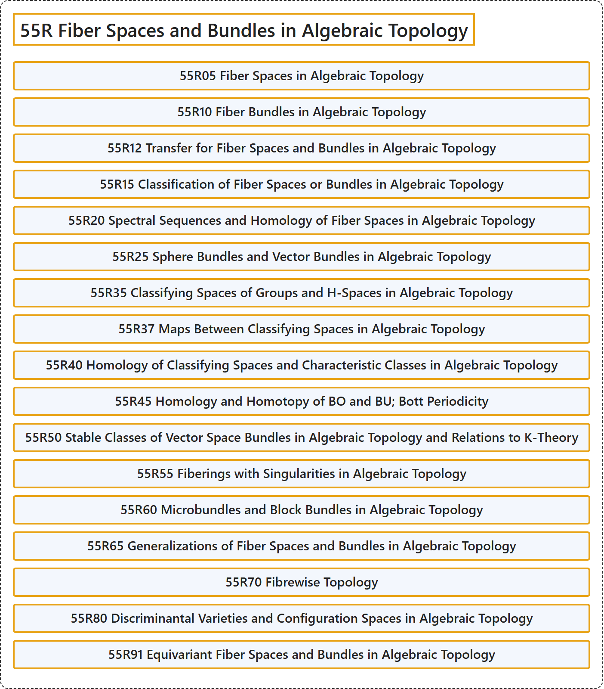

# 55R Fiber Spaces and Bundles in Algebraic Topology

## Classification

## Glossary

| Term | Definition | 中文翻译 | Source |
|---|---|---|---|
| **55R Fiber Spaces and Bundles in Algebraic Topology** 代数拓扑中的纤维空间与丛 | (No definition) | （无定义） | [Associate Editors of Mathematical Reviews and zbMATH, 2020](https://msc2020.org/) |
| **55R05 Fiber Spaces in Algebraic Topology** 代数拓扑中的纤维空间 | (No definition) | （无定义） | [Associate Editors of Mathematical Reviews and zbMATH, 2020](https://msc2020.org/) |
| **55R10 Fiber Bundles in Algebraic Topology** 代数拓扑中的纤维丛 | (No definition) | （无定义） | [Associate Editors of Mathematical Reviews and zbMATH, 2020](https://msc2020.org/) |
| **55R12 Transfer for Fiber Spaces and Bundles in Algebraic Topology** 代数拓扑中纤维空间与纤维丛的转移 | (No definition) | （无定义） | [Associate Editors of Mathematical Reviews and zbMATH, 2020](https://msc2020.org/) |
| **55R15 Classification of Fiber Spaces or Bundles in Algebraic Topology** 代数拓扑中纤维空间或纤维丛的分类 | (No definition) | （无定义） | [Associate Editors of Mathematical Reviews and zbMATH, 2020](https://msc2020.org/) |
| **55R20 Spectral Sequences and Homology of Fiber Spaces in Algebraic Topology** 代数拓扑中的谱序列与纤维空间的同调 | (No definition) | （无定义） | [Associate Editors of Mathematical Reviews and zbMATH, 2020](https://msc2020.org/) |
| **55R25 Sphere Bundles and Vector Bundles in Algebraic Topology** 代数拓扑中的球面丛与向量丛 | (No definition) | （无定义） | [Associate Editors of Mathematical Reviews and zbMATH, 2020](https://msc2020.org/) |
| **55R35 Classifying Spaces of Groups and H-Spaces in Algebraic Topology** 代数拓扑中群与 H-空间的分类空间 | (No definition) | （无定义） | [Associate Editors of Mathematical Reviews and zbMATH, 2020](https://msc2020.org/) |
| **55R37 Maps Between Classifying Spaces in Algebraic Topology** 代数拓扑中分类空间之间的映射 | (No definition) | （无定义） | [Associate Editors of Mathematical Reviews and zbMATH, 2020](https://msc2020.org/) |
| **55R40 Homology of Classifying Spaces and Characteristic Classes in Algebraic Topology** 代数拓扑中分类空间的同调与示性类 | (No definition) | （无定义） | [Associate Editors of Mathematical Reviews and zbMATH, 2020](https://msc2020.org/) |
| **55R45 Homology and Homotopy of BO and BU; Bott Periodicity** BO 与 BU 的同调与同伦；博特周期性 | (No definition) | （无定义） | [Associate Editors of Mathematical Reviews and zbMATH, 2020](https://msc2020.org/) |
| **55R50 Stable Classes of Vector Space Bundles in Algebraic Topology and Relations to K-Theory** 代数拓扑中向量空间丛的稳定类及与 K-理论的关系 | (No definition) | （无定义） | [Associate Editors of Mathematical Reviews and zbMATH, 2020](https://msc2020.org/) |
| **55R55 Fiberings with Singularities in Algebraic Topology** 代数拓扑中带奇点的纤维化 | (No definition) | （无定义） | [Associate Editors of Mathematical Reviews and zbMATH, 2020](https://msc2020.org/) |
| **55R60 Microbundles and Block Bundles in Algebraic Topology** 代数拓扑中的微丛与块丛 | (No definition) | （无定义） | [Associate Editors of Mathematical Reviews and zbMATH, 2020](https://msc2020.org/) |
| **55R65 Generalizations of Fiber Spaces and Bundles in Algebraic Topology** 代数拓扑中纤维空间与纤维丛的推广 | (No definition) | （无定义） | [Associate Editors of Mathematical Reviews and zbMATH, 2020](https://msc2020.org/) |
| **55R70 Fibrewise Topology** 纤维式拓扑 | (No definition) | （无定义） | [Associate Editors of Mathematical Reviews and zbMATH, 2020](https://msc2020.org/) |
| **55R80 Discriminantal Varieties and Configuration Spaces in Algebraic Topology** 代数拓扑中的判别簇与构形空间 | (No definition) | （无定义） | [Associate Editors of Mathematical Reviews and zbMATH, 2020](https://msc2020.org/) |
| **55R91 Equivariant Fiber Spaces and Bundles in Algebraic Topology** 代数拓扑中的等变纤维空间与纤维丛 | (No definition) | （无定义） | [Associate Editors of Mathematical Reviews and zbMATH, 2020](https://msc2020.org/) |

## References

Associate Editors of Mathematical Reviews and zbMATH. (2020). *MSC2020: Mathematics Subject Classification system*. Retrieved October 27, 2026, from <https://msc2020.org/>
