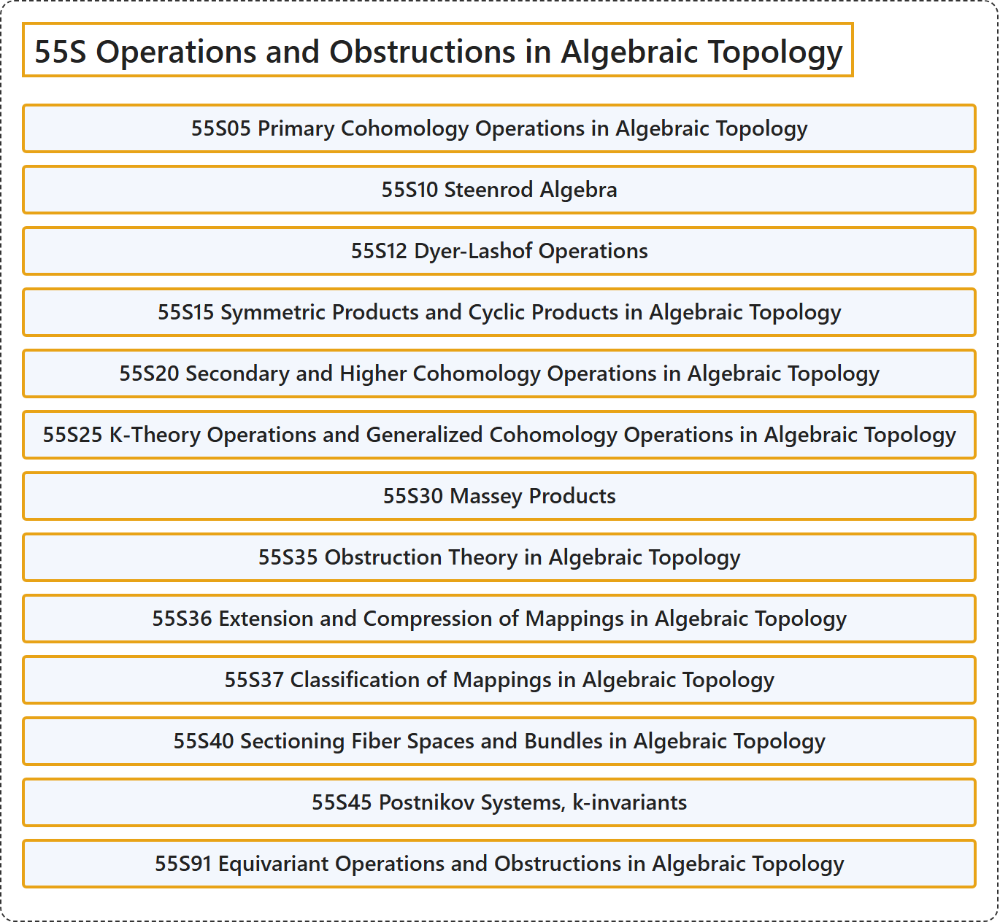

# 55S Operations and Obstructions in Algebraic Topology

## Classification

## Glossary

| Term | Definition | 中文翻译 | Source |
|---|---|---|---|
| **55S Operations and Obstructions in Algebraic Topology** 代数拓扑中的运算与障碍 | (No definition) | （无定义） | [Associate Editors of Mathematical Reviews and zbMATH, 2020](https://msc2020.org/) |
| **55S05 Primary Cohomology Operations in Algebraic Topology** 代数拓扑中的初等上同调运算 | (No definition) | （无定义） | [Associate Editors of Mathematical Reviews and zbMATH, 2020](https://msc2020.org/) |
| **55S10 Steenrod Algebra** 斯廷罗德代数 | (No definition) | （无定义） | [Associate Editors of Mathematical Reviews and zbMATH, 2020](https://msc2020.org/) |
| **55S12 Dyer-Lashof Operations** 戴尔-拉舍夫运算 | (No definition) | （无定义） | [Associate Editors of Mathematical Reviews and zbMATH, 2020](https://msc2020.org/) |
| **55S15 Symmetric Products and Cyclic Products in Algebraic Topology** 代数拓扑中的对称积与循环积 | (No definition) | （无定义） | [Associate Editors of Mathematical Reviews and zbMATH, 2020](https://msc2020.org/) |
| **55S20 Secondary and Higher Cohomology Operations in Algebraic Topology** 代数拓扑中的二次及高次上同调运算 | (No definition) | （无定义） | [Associate Editors of Mathematical Reviews and zbMATH, 2020](https://msc2020.org/) |
| **55S25 K-Theory Operations and Generalized Cohomology Operations in Algebraic Topology** 代数拓扑中的 K-理论运算与广义上同调运算 | (No definition) | （无定义） | [Associate Editors of Mathematical Reviews and zbMATH, 2020](https://msc2020.org/) |
| **55S30 Massey Products** 马西积 | (No definition) | （无定义） | [Associate Editors of Mathematical Reviews and zbMATH, 2020](https://msc2020.org/) |
| **55S35 Obstruction Theory in Algebraic Topology** 代数拓扑中的障碍理论 | (No definition) | （无定义） | [Associate Editors of Mathematical Reviews and zbMATH, 2020](https://msc2020.org/) |
| **55S36 Extension and Compression of Mappings in Algebraic Topology** 代数拓扑中映射的扩张与压缩 | (No definition) | （无定义） | [Associate Editors of Mathematical Reviews and zbMATH, 2020](https://msc2020.org/) |
| **55S37 Classification of Mappings in Algebraic Topology** 代数拓扑中映射的分类 | (No definition) | （无定义） | [Associate Editors of Mathematical Reviews and zbMATH, 2020](https://msc2020.org/) |
| **55S40 Sectioning Fiber Spaces and Bundles in Algebraic Topology** 纤维空间与纤维丛的截面化 | (No definition) | （无定义） | [Associate Editors of Mathematical Reviews and zbMATH, 2020](https://msc2020.org/) |
| **55S45 Postnikov Systems, k-invariants** 波斯特尼科夫系统、k-不变量 | (No definition) | （无定义） | [Associate Editors of Mathematical Reviews and zbMATH, 2020](https://msc2020.org/) |
| **55S91 Equivariant Operations and Obstructions in Algebraic Topology** 代数拓扑中的等变运算与障碍 | (No definition) | （无定义） | [Associate Editors of Mathematical Reviews and zbMATH, 2020](https://msc2020.org/) |

## References

Associate Editors of Mathematical Reviews and zbMATH. (2020). *MSC2020: Mathematics Subject Classification system*. Retrieved October 27, 2026, from <https://msc2020.org/>
