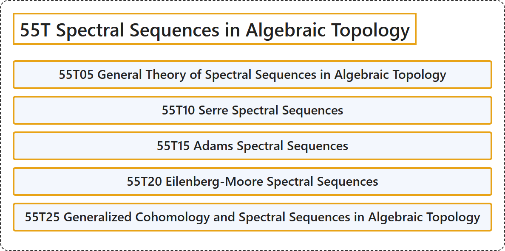

# 55T Spectral Sequences in Algebraic Topology

## Classification

## Glossary

| Term | Definition | 中文翻译 | Source |
|---|---|---|---|
| **55T Spectral Sequences in Algebraic Topology** 代数拓扑中的谱序列 | (No definition) | （无定义） | [Associate Editors of Mathematical Reviews and zbMATH, 2020](https://msc2020.org/) |
| **55T05 General Theory of Spectral Sequences in Algebraic Topology** 代数拓扑中谱序列的一般理论 | (No definition) | （无定义） | [Associate Editors of Mathematical Reviews and zbMATH, 2020](https://msc2020.org/) |
| **55T10 Serre Spectral Sequences** 塞尔谱序列 | (No definition) | （无定义） | [Associate Editors of Mathematical Reviews and zbMATH, 2020](https://msc2020.org/) |
| **55T15 Adams Spectral Sequences** 亚当斯谱序列 | (No definition) | （无定义） | [Associate Editors of Mathematical Reviews and zbMATH, 2020](https://msc2020.org/) |
| **55T20 Eilenberg-Moore Spectral Sequences** 艾伦伯格-摩尔谱序列 | (No definition) | （无定义） | [Associate Editors of Mathematical Reviews and zbMATH, 2020](https://msc2020.org/) |
| **55T25 Generalized Cohomology and Spectral Sequences in Algebraic Topology** 代数拓扑中的广义上同调与谱序列 | (No definition) | （无定义） | [Associate Editors of Mathematical Reviews and zbMATH, 2020](https://msc2020.org/) |

## References

Associate Editors of Mathematical Reviews and zbMATH. (2020). *MSC2020: Mathematics Subject Classification system*. Retrieved October 27, 2026, from <https://msc2020.org/>
