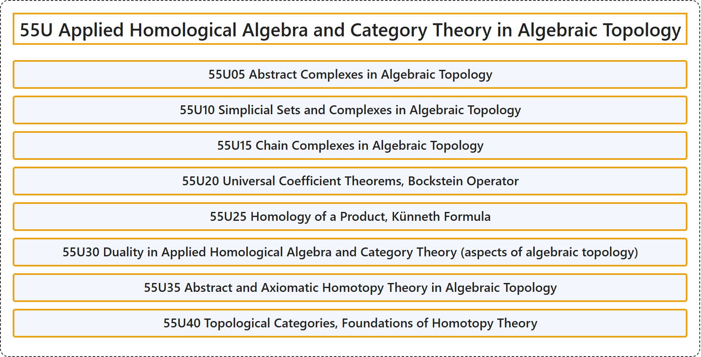

# 55U Applied Homological Algebra and Category Theory in Algebraic Topology

## Classification

## Glossary

| Term | Definition | 中文翻译 | Source |
|---|---|---|---|
| **55U Applied Homological Algebra and Category Theory in Algebraic Topology** 代数拓扑中的应用同调代数与范畴论 | (No definition) | （无定义） | [Associate Editors of Mathematical Reviews and zbMATH, 2020](https://msc2020.org/) |
| **55U05 Abstract Complexes in Algebraic Topology** 代数拓扑中的抽象复形 | (No definition) | （无定义） | [Associate Editors of Mathematical Reviews and zbMATH, 2020](https://msc2020.org/) |
| **55U10 Simplicial Sets and Complexes in Algebraic Topology** 代数拓扑中的单纯集与单纯复形 | (No definition) | （无定义） | [Associate Editors of Mathematical Reviews and zbMATH, 2020](https://msc2020.org/) |
| **55U15 Chain Complexes in Algebraic Topology** 代数拓扑中的链复形 | (No definition) | （无定义） | [Associate Editors of Mathematical Reviews and zbMATH, 2020](https://msc2020.org/) |
| **55U20 Universal Coefficient Theorems, Bockstein Operator** 普遍系数定理、博克斯坦算子 | (No definition) | （无定义） | [Associate Editors of Mathematical Reviews and zbMATH, 2020](https://msc2020.org/) |
| **55U25 Homology of a Product, Künneth Formula** 积的同调、屈内特公式 | (No definition) | （无定义） | [Associate Editors of Mathematical Reviews and zbMATH, 2020](https://msc2020.org/) |
| **55U30 Duality in Applied Homological Algebra and Category Theory (aspects of algebraic topology)** 应用同调代数与范畴论中的对偶（代数拓扑方面） | (No definition) | （无定义） | [Associate Editors of Mathematical Reviews and zbMATH, 2020](https://msc2020.org/) |
| **55U35 Abstract and Axiomatic Homotopy Theory in Algebraic Topology** 代数拓扑中的抽象与公理化同伦论 | (No definition) | （无定义） | [Associate Editors of Mathematical Reviews and zbMATH, 2020](https://msc2020.org/) |
| **55U40 Topological Categories, Foundations of Homotopy Theory** 拓扑范畴、同伦论基础 | (No definition) | （无定义） | [Associate Editors of Mathematical Reviews and zbMATH, 2020](https://msc2020.org/) |

## References

Associate Editors of Mathematical Reviews and zbMATH. (2020). *MSC2020: Mathematics Subject Classification system*. Retrieved October 27, 2026, from <https://msc2020.org/>
