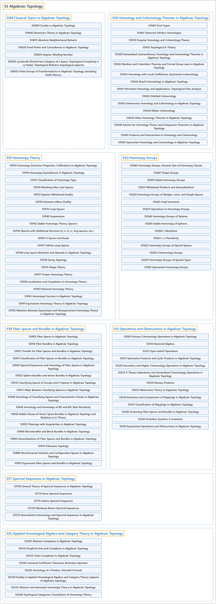

# 55 Algebraic Topology

## Classification

## Glossary

| Term | Definition | 中文翻译 | Source |
|---|---|---|---|
| **55 Algebraic Topology** 代数拓扑 | "Algebraic topology is the study of **intrinsic qualitative aspects of spatial objects** (e.g., surfaces, spheres, tori, circles, knots, links, configuration spaces, etc.) that **remain invariant under both-directions continuous one-to-one (homeomorphic) transformations**." | 代数拓扑研究**空间对象的内在定性特征**（如曲面、球面、环面、圆、纽结、链环、构形空间等），这些特征**在双向连续的一一（同胚）变换下保持不变**。 | [Weisstein, n.d., "Algebraic topology" entry, para. 1](https://mathworld.wolfram.com/AlgebraicTopology.html#:~:text=Algebraic%20topology%20is%20the%20study%20of%20intrinsic%20qualitative%20aspects) |
| **[55M Classical Topics in Algebraic Topology](55m-classical-topics-in-algebraic-topology.md)** 代数拓扑的经典专题 | (No definition) | （无定义） | [Associate Editors of Mathematical Reviews and zbMATH, 2020](https://msc2020.org/) |
| **[55N Homology and Cohomology Theories in Algebraic Topology](55n-homology-and-cohomology-theories-in-algebraic-topology.md)** 代数拓扑中的同调与上同调理论 | (No definition) | （无定义） | [Associate Editors of Mathematical Reviews and zbMATH, 2020](https://msc2020.org/) |
| **[55P Homotopy Theory](55p-homotopy-theory.md)** 同伦论 | (No definition) | （无定义） | [Associate Editors of Mathematical Reviews and zbMATH, 2020](https://msc2020.org/) |
| **[55Q Homotopy Groups](55q-homotopy-groups.md)** 同伦群 | (No definition) | （无定义） | [Associate Editors of Mathematical Reviews and zbMATH, 2020](https://msc2020.org/) |
| **[55R Fiber Spaces and Bundles in Algebraic Topology](55r-fiber-spaces-and-bundles-in-algebraic-topology.md)** 代数拓扑中的纤维空间与丛 | (No definition) | （无定义） | [Associate Editors of Mathematical Reviews and zbMATH, 2020](https://msc2020.org/) |
| **[55S Operations and Obstructions in Algebraic Topology](55s-operations-and-obstructions-in-algebraic-topology.md)** 代数拓扑中的运算与障碍 | (No definition) | （无定义） | [Associate Editors of Mathematical Reviews and zbMATH, 2020](https://msc2020.org/) |
| **[55T Spectral Sequences in Algebraic Topology](55t-spectral-sequences-in-algebraic-topology.md)** 代数拓扑中的谱序列 | (No definition) | （无定义） | [Associate Editors of Mathematical Reviews and zbMATH, 2020](https://msc2020.org/) |
| **[55U Applied Homological Algebra and Category Theory in Algebraic Topology](55u-applied-homological-algebra-and-category-theory-in-algebraic.md)** 代数拓扑中的应用同调代数与范畴论 | (No definition) | （无定义） | [Associate Editors of Mathematical Reviews and zbMATH, 2020](https://msc2020.org/) |

## References

Associate Editors of Mathematical Reviews and zbMATH. (2020). *MSC2020: Mathematics Subject Classification system*. Retrieved October 27, 2026, from <https://msc2020.org/>

Weisstein, E. W. (n.d.). *Algebraic topology*. MathWorld: A Wolfram Resource. Retrieved October 27, 2026, from <https://mathworld.wolfram.com/AlgebraicTopology.html>
