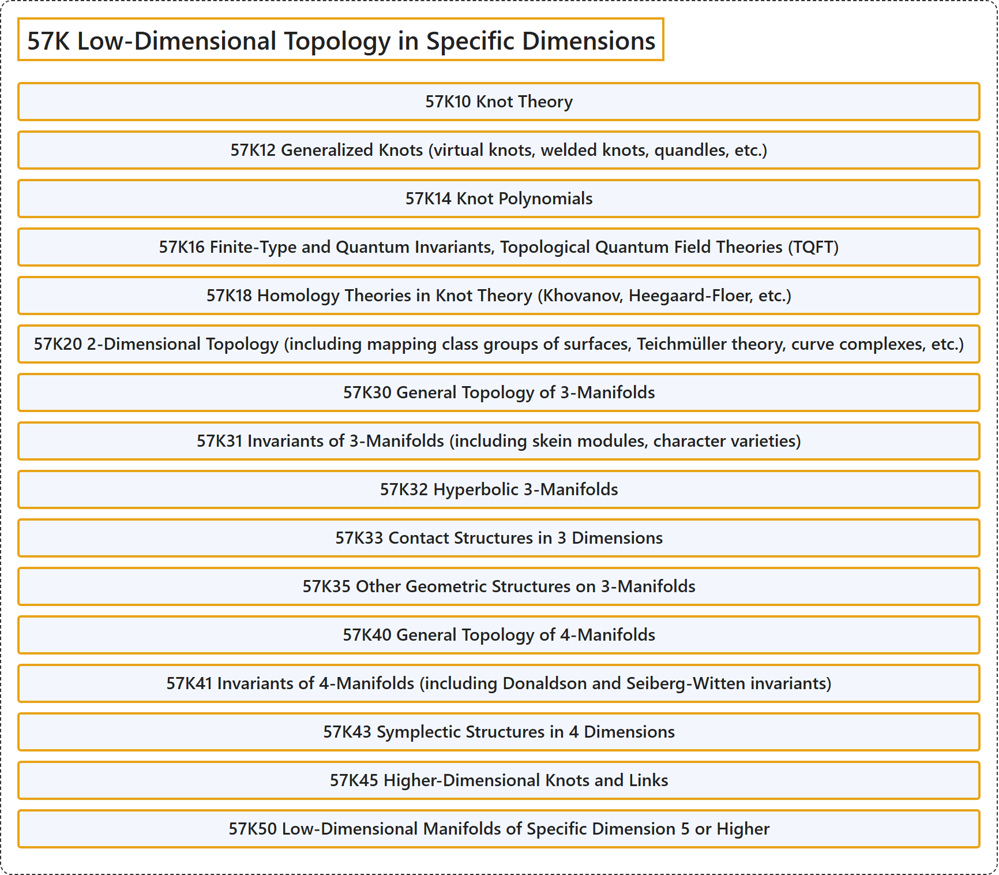

# 57K Low-Dimensional Topology in Specific Dimensions

## Classification

## Glossary

| Term | Definition | 中文翻译 | Source |
|---|---|---|---|
| **57K Low-Dimensional Topology in Specific Dimensions** 特定维数的低维拓扑 | (No definition) | （无定义） | [Associate Editors of Mathematical Reviews and zbMATH, 2020](https://msc2020.org/) |
| **57K10 Knot Theory** 纽结理论 | (No definition) | （无定义） | [Associate Editors of Mathematical Reviews and zbMATH, 2020](https://msc2020.org/) |
| **57K12 Generalized Knots (virtual knots, welded knots, quandles, etc.)** 广义纽结（虚纽结、焊接纽结、拟群等） | (No definition) | （无定义） | [Associate Editors of Mathematical Reviews and zbMATH, 2020](https://msc2020.org/) |
| **57K14 Knot Polynomials** 纽结多项式 | (No definition) | （无定义） | [Associate Editors of Mathematical Reviews and zbMATH, 2020](https://msc2020.org/) |
| **57K16 Finite-Type and Quantum Invariants, Topological Quantum Field Theories (TQFT)** 有限型不变量与量子不变量、拓扑量子场论（TQFT） | (No definition) | （无定义） | [Associate Editors of Mathematical Reviews and zbMATH, 2020](https://msc2020.org/) |
| **57K18 Homology Theories in Knot Theory (Khovanov, Heegaard-Floer, etc.)** 纽结理论中的同调理论（霍瓦诺夫、海加德-弗洛尔等） | (No definition) | （无定义） | [Associate Editors of Mathematical Reviews and zbMATH, 2020](https://msc2020.org/) |
| **57K20 2-Dimensional Topology (including mapping class groups of surfaces, Teichmüller theory, curve complexes, etc.)** 二维拓扑（包括曲面的映射类群、泰希米勒理论、曲线复形等） | (No definition) | （无定义） | [Associate Editors of Mathematical Reviews and zbMATH, 2020](https://msc2020.org/) |
| **57K30 General Topology of 3-Manifolds** 三维流形的一般拓扑 | (No definition) | （无定义） | [Associate Editors of Mathematical Reviews and zbMATH, 2020](https://msc2020.org/) |
| **57K31 Invariants of 3-Manifolds (including skein modules, character varieties)** 三维流形的不变量（包括纽结模、特征簇） | (No definition) | （无定义） | [Associate Editors of Mathematical Reviews and zbMATH, 2020](https://msc2020.org/) |
| **57K32 Hyperbolic 3-Manifolds** 双曲三维流形 | (No definition) | （无定义） | [Associate Editors of Mathematical Reviews and zbMATH, 2020](https://msc2020.org/) |
| **57K33 Contact Structures in 3 Dimensions** 三维接触结构 | (No definition) | （无定义） | [Associate Editors of Mathematical Reviews and zbMATH, 2020](https://msc2020.org/) |
| **57K35 Other Geometric Structures on 3-Manifolds** 三维流形上的其他几何结构 | (No definition) | （无定义） | [Associate Editors of Mathematical Reviews and zbMATH, 2020](https://msc2020.org/) |
| **57K40 General Topology of 4-Manifolds** 四维流形的一般拓扑 | (No definition) | （无定义） | [Associate Editors of Mathematical Reviews and zbMATH, 2020](https://msc2020.org/) |
| **57K41 Invariants of 4-Manifolds (including Donaldson and Seiberg-Witten invariants)** 四维流形的不变量（包括唐纳森不变量与塞伯格-威滕不变量） | (No definition) | （无定义） | [Associate Editors of Mathematical Reviews and zbMATH, 2020](https://msc2020.org/) |
| **57K43 Symplectic Structures in 4 Dimensions** 四维辛结构 | (No definition) | （无定义） | [Associate Editors of Mathematical Reviews and zbMATH, 2020](https://msc2020.org/) |
| **57K45 Higher-Dimensional Knots and Links** 高维纽结与链环 | (No definition) | （无定义） | [Associate Editors of Mathematical Reviews and zbMATH, 2020](https://msc2020.org/) |
| **57K50 Low-Dimensional Manifolds of Specific Dimension 5 or Higher** 5 维或更高特定维数的低维流形 | (No definition) | （无定义） | [Associate Editors of Mathematical Reviews and zbMATH, 2020](https://msc2020.org/) |

## References

Associate Editors of Mathematical Reviews and zbMATH. (2020). *MSC2020: Mathematics Subject Classification system*. Retrieved October 27, 2026, from <https://msc2020.org/>
