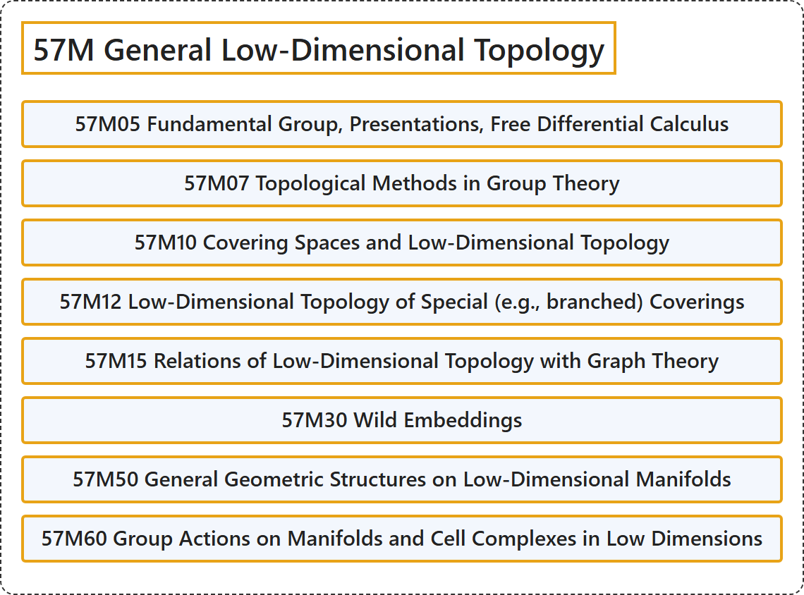

# 57M General Low-Dimensional Topology

## Classification

## Glossary

| Term | Definition | 中文翻译 | Source |
|---|---|---|---|
| **57M General Low-Dimensional Topology** 一般低维拓扑 | (No definition) | （无定义） | [Associate Editors of Mathematical Reviews and zbMATH, 2020](https://msc2020.org/) |
| **57M05 Fundamental Group, Presentations, Free Differential Calculus** 基本群、表示、自由微分演算 | (No definition) | （无定义） | [Associate Editors of Mathematical Reviews and zbMATH, 2020](https://msc2020.org/) |
| **57M07 Topological Methods in Group Theory** 群论中的拓扑方法 | (No definition) | （无定义） | [Associate Editors of Mathematical Reviews and zbMATH, 2020](https://msc2020.org/) |
| **57M10 Covering Spaces and Low-Dimensional Topology** 覆叠空间与低维拓扑 | (No definition) | （无定义） | [Associate Editors of Mathematical Reviews and zbMATH, 2020](https://msc2020.org/) |
| **57M12 Low-Dimensional Topology of Special (e.g., branched) Coverings** 特殊（如分歧）覆叠的低维拓扑 | (No definition) | （无定义） | [Associate Editors of Mathematical Reviews and zbMATH, 2020](https://msc2020.org/) |
| **57M15 Relations of Low-Dimensional Topology with Graph Theory** 低维拓扑与图论的关系 | (No definition) | （无定义） | [Associate Editors of Mathematical Reviews and zbMATH, 2020](https://msc2020.org/) |
| **57M30 Wild Embeddings** 野嵌入 | (No definition) | （无定义） | [Associate Editors of Mathematical Reviews and zbMATH, 2020](https://msc2020.org/) |
| **57M50 General Geometric Structures on Low-Dimensional Manifolds** 低维流形上的一般几何结构 | (No definition) | （无定义） | [Associate Editors of Mathematical Reviews and zbMATH, 2020](https://msc2020.org/) |
| **57M60 Group Actions on Manifolds and Cell Complexes in Low Dimensions** 低维流形与胞腔复形上的群作用 | (No definition) | （无定义） | [Associate Editors of Mathematical Reviews and zbMATH, 2020](https://msc2020.org/) |

## References

Associate Editors of Mathematical Reviews and zbMATH. (2020). *MSC2020: Mathematics Subject Classification system*. Retrieved October 27, 2026, from <https://msc2020.org/>
