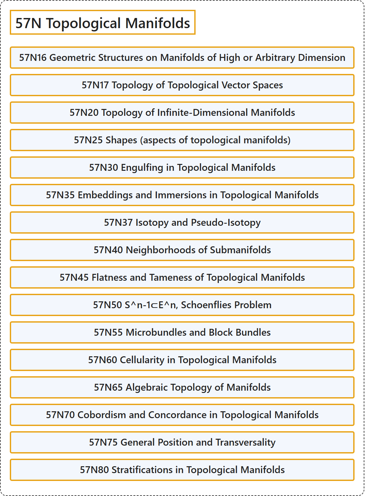

# 57N Topological Manifolds

## Classification

## Glossary

| Term | Definition | 中文翻译 | Source |
|---|---|---|---|
| **57N Topological Manifolds** 拓扑流形 | (No definition) | （无定义） | [Associate Editors of Mathematical Reviews and zbMATH, 2020](https://msc2020.org/) |
| **57N16 Geometric Structures on Manifolds of High or Arbitrary Dimension** 高维或任意维流形上的几何结构 | (No definition) | （无定义） | [Associate Editors of Mathematical Reviews and zbMATH, 2020](https://msc2020.org/) |
| **57N17 Topology of Topological Vector Spaces** 拓扑向量空间的拓扑 | (No definition) | （无定义） | [Associate Editors of Mathematical Reviews and zbMATH, 2020](https://msc2020.org/) |
| **57N20 Topology of Infinite-Dimensional Manifolds** 无限维流形的拓扑 | (No definition) | （无定义） | [Associate Editors of Mathematical Reviews and zbMATH, 2020](https://msc2020.org/) |
| **57N25 Shapes (aspects of topological manifolds)** 形状（拓扑流形方面） | (No definition) | （无定义） | [Associate Editors of Mathematical Reviews and zbMATH, 2020](https://msc2020.org/) |
| **57N30 Engulfing in Topological Manifolds** 拓扑流形中的吞没 | (No definition) | （无定义） | [Associate Editors of Mathematical Reviews and zbMATH, 2020](https://msc2020.org/) |
| **57N35 Embeddings and Immersions in Topological Manifolds** 拓扑流形中的嵌入与浸入 | (No definition) | （无定义） | [Associate Editors of Mathematical Reviews and zbMATH, 2020](https://msc2020.org/) |
| **57N37 Isotopy and Pseudo-Isotopy** 同痕与伪同痕 | (No definition) | （无定义） | [Associate Editors of Mathematical Reviews and zbMATH, 2020](https://msc2020.org/) |
| **57N40 Neighborhoods of Submanifolds** 子流形的邻域 | (No definition) | （无定义） | [Associate Editors of Mathematical Reviews and zbMATH, 2020](https://msc2020.org/) |
| **57N45 Flatness and Tameness of Topological Manifolds** 拓扑流形的平坦性与驯顺性 | (No definition) | （无定义） | [Associate Editors of Mathematical Reviews and zbMATH, 2020](https://msc2020.org/) |
| **57N50 S^n-1⊂E^n, Schoenflies Problem** S^n-1⊂E^n、舍恩弗利斯问题 | (No definition) | （无定义） | [Associate Editors of Mathematical Reviews and zbMATH, 2020](https://msc2020.org/) |
| **57N55 Microbundles and Block Bundles** 微丛与块丛 | (No definition) | （无定义） | [Associate Editors of Mathematical Reviews and zbMATH, 2020](https://msc2020.org/) |
| **57N60 Cellularity in Topological Manifolds** 拓扑流形中的胞状性 | (No definition) | （无定义） | [Associate Editors of Mathematical Reviews and zbMATH, 2020](https://msc2020.org/) |
| **57N65 Algebraic Topology of Manifolds** 流形的代数拓扑 | (No definition) | （无定义） | [Associate Editors of Mathematical Reviews and zbMATH, 2020](https://msc2020.org/) |
| **57N70 Cobordism and Concordance in Topological Manifolds** 拓扑流形中的配边与协边 | (No definition) | （无定义） | [Associate Editors of Mathematical Reviews and zbMATH, 2020](https://msc2020.org/) |
| **57N75 General Position and Transversality** 一般位置与横截性 | (No definition) | （无定义） | [Associate Editors of Mathematical Reviews and zbMATH, 2020](https://msc2020.org/) |
| **57N80 Stratifications in Topological Manifolds** 拓扑流形中的分层 | (No definition) | （无定义） | [Associate Editors of Mathematical Reviews and zbMATH, 2020](https://msc2020.org/) |

## References

Associate Editors of Mathematical Reviews and zbMATH. (2020). *MSC2020: Mathematics Subject Classification system*. Retrieved October 27, 2026, from <https://msc2020.org/>
