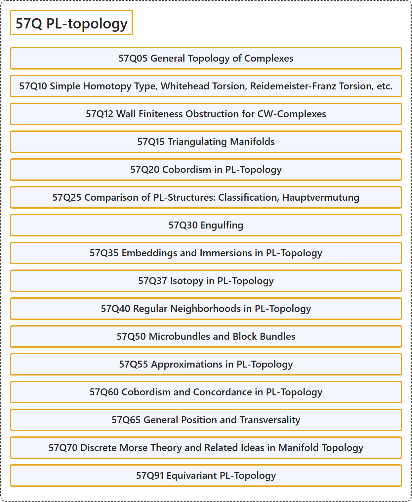

# 57Q PL-topology

## Classification

## Glossary

| Term | Definition | 中文翻译 | Source |
|---|---|---|---|
| **57Q PL-topology** PL 拓扑 | (No definition) | （无定义） | [Associate Editors of Mathematical Reviews and zbMATH, 2020](https://msc2020.org/) |
| **57Q05 General Topology of Complexes** 复形的一般拓扑 | (No definition) | （无定义） | [Associate Editors of Mathematical Reviews and zbMATH, 2020](https://msc2020.org/) |
| **57Q10 Simple Homotopy Type, Whitehead Torsion, Reidemeister-Franz Torsion, etc.** 单纯同伦型、怀特黑德挠率、赖德迈斯特-弗朗茨挠率等 | (No definition) | （无定义） | [Associate Editors of Mathematical Reviews and zbMATH, 2020](https://msc2020.org/) |
| **57Q12 Wall Finiteness Obstruction for CW-Complexes** CW 复形的沃尔有限性障碍 | (No definition) | （无定义） | [Associate Editors of Mathematical Reviews and zbMATH, 2020](https://msc2020.org/) |
| **57Q15 Triangulating Manifolds** 流形的三角剖分 | (No definition) | （无定义） | [Associate Editors of Mathematical Reviews and zbMATH, 2020](https://msc2020.org/) |
| **57Q20 Cobordism in PL-Topology** PL 拓扑中的配边 | (No definition) | （无定义） | [Associate Editors of Mathematical Reviews and zbMATH, 2020](https://msc2020.org/) |
| **57Q25 Comparison of PL-Structures: Classification, Hauptvermutung** PL 结构的比较：分类、基本猜想 | (No definition) | （无定义） | [Associate Editors of Mathematical Reviews and zbMATH, 2020](https://msc2020.org/) |
| **57Q30 Engulfing** 吞没 | (No definition) | （无定义） | [Associate Editors of Mathematical Reviews and zbMATH, 2020](https://msc2020.org/) |
| **57Q35 Embeddings and Immersions in PL-Topology** PL 拓扑中的嵌入与浸入 | (No definition) | （无定义） | [Associate Editors of Mathematical Reviews and zbMATH, 2020](https://msc2020.org/) |
| **57Q37 Isotopy in PL-Topology** PL 拓扑中的同痕 | (No definition) | （无定义） | [Associate Editors of Mathematical Reviews and zbMATH, 2020](https://msc2020.org/) |
| **57Q40 Regular Neighborhoods in PL-Topology** PL 拓扑中的正则邻域 | (No definition) | （无定义） | [Associate Editors of Mathematical Reviews and zbMATH, 2020](https://msc2020.org/) |
| **57Q50 Microbundles and Block Bundles** 微丛与块丛 | (No definition) | （无定义） | [Associate Editors of Mathematical Reviews and zbMATH, 2020](https://msc2020.org/) |
| **57Q55 Approximations in PL-Topology** PL 拓扑中的逼近 | (No definition) | （无定义） | [Associate Editors of Mathematical Reviews and zbMATH, 2020](https://msc2020.org/) |
| **57Q60 Cobordism and Concordance in PL-Topology** PL 拓扑中的配边与协边 | (No definition) | （无定义） | [Associate Editors of Mathematical Reviews and zbMATH, 2020](https://msc2020.org/) |
| **57Q65 General Position and Transversality** 一般位置与横截性 | (No definition) | （无定义） | [Associate Editors of Mathematical Reviews and zbMATH, 2020](https://msc2020.org/) |
| **57Q70 Discrete Morse Theory and Related Ideas in Manifold Topology** 离散莫尔斯理论及流形拓扑中的相关思想 | (No definition) | （无定义） | [Associate Editors of Mathematical Reviews and zbMATH, 2020](https://msc2020.org/) |
| **57Q91 Equivariant PL-Topology** 等变 PL 拓扑 | (No definition) | （无定义） | [Associate Editors of Mathematical Reviews and zbMATH, 2020](https://msc2020.org/) |

## References

Associate Editors of Mathematical Reviews and zbMATH. (2020). *MSC2020: Mathematics Subject Classification system*. Retrieved October 27, 2026, from <https://msc2020.org/>
