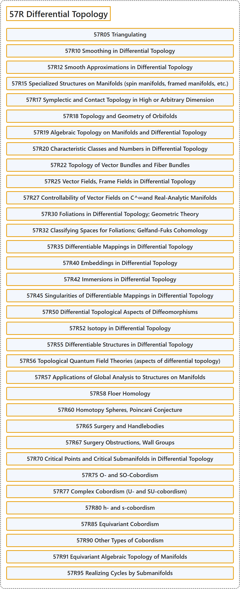

# 57R Differential Topology

## Classification

## Glossary

| Term | Definition | 中文翻译 | Source |
|---|---|---|---|
| **57R Differential Topology** 微分拓扑 | (No definition) | （无定义） | [Associate Editors of Mathematical Reviews and zbMATH, 2020](https://msc2020.org/) |
| **57R05 Triangulating** 三角剖分 | (No definition) | （无定义） | [Associate Editors of Mathematical Reviews and zbMATH, 2020](https://msc2020.org/) |
| **57R10 Smoothing in Differential Topology** 微分拓扑中的光滑化 | (No definition) | （无定义） | [Associate Editors of Mathematical Reviews and zbMATH, 2020](https://msc2020.org/) |
| **57R12 Smooth Approximations in Differential Topology** 微分拓扑中的光滑逼近 | (No definition) | （无定义） | [Associate Editors of Mathematical Reviews and zbMATH, 2020](https://msc2020.org/) |
| **57R15 Specialized Structures on Manifolds (spin manifolds, framed manifolds, etc.)** 流形上的特殊结构（自旋流形、标架流形等） | (No definition) | （无定义） | [Associate Editors of Mathematical Reviews and zbMATH, 2020](https://msc2020.org/) |
| **57R17 Symplectic and Contact Topology in High or Arbitrary Dimension** 高维或任意维的辛拓扑与接触拓扑 | (No definition) | （无定义） | [Associate Editors of Mathematical Reviews and zbMATH, 2020](https://msc2020.org/) |
| **57R18 Topology and Geometry of Orbifolds** 轨形的拓扑与几何 | (No definition) | （无定义） | [Associate Editors of Mathematical Reviews and zbMATH, 2020](https://msc2020.org/) |
| **57R19 Algebraic Topology on Manifolds and Differential Topology** 流形上的代数拓扑与微分拓扑 | (No definition) | （无定义） | [Associate Editors of Mathematical Reviews and zbMATH, 2020](https://msc2020.org/) |
| **57R20 Characteristic Classes and Numbers in Differential Topology** 微分拓扑中的示性类与示性数 | (No definition) | （无定义） | [Associate Editors of Mathematical Reviews and zbMATH, 2020](https://msc2020.org/) |
| **57R22 Topology of Vector Bundles and Fiber Bundles** 向量丛与纤维丛的拓扑 | (No definition) | （无定义） | [Associate Editors of Mathematical Reviews and zbMATH, 2020](https://msc2020.org/) |
| **57R25 Vector Fields, Frame Fields in Differential Topology** 微分拓扑中的向量场、标架场 | (No definition) | （无定义） | [Associate Editors of Mathematical Reviews and zbMATH, 2020](https://msc2020.org/) |
| **57R27 Controllability of Vector Fields on C^∞and Real-Analytic Manifolds** C^∞ 流形与实解析流形上向量场的可控性 | (No definition) | （无定义） | [Associate Editors of Mathematical Reviews and zbMATH, 2020](https://msc2020.org/) |
| **57R30 Foliations in Differential Topology; Geometric Theory** 微分拓扑中的叶状结构；几何理论 | (No definition) | （无定义） | [Associate Editors of Mathematical Reviews and zbMATH, 2020](https://msc2020.org/) |
| **57R32 Classifying Spaces for Foliations; Gelfand-Fuks Cohomology** 叶状结构的分类空间；盖尔方德-富克斯上同调 | (No definition) | （无定义） | [Associate Editors of Mathematical Reviews and zbMATH, 2020](https://msc2020.org/) |
| **57R35 Differentiable Mappings in Differential Topology** 微分拓扑中的可微映射 | (No definition) | （无定义） | [Associate Editors of Mathematical Reviews and zbMATH, 2020](https://msc2020.org/) |
| **57R40 Embeddings in Differential Topology** 微分拓扑中的嵌入 | (No definition) | （无定义） | [Associate Editors of Mathematical Reviews and zbMATH, 2020](https://msc2020.org/) |
| **57R42 Immersions in Differential Topology** 微分拓扑中的浸入 | (No definition) | （无定义） | [Associate Editors of Mathematical Reviews and zbMATH, 2020](https://msc2020.org/) |
| **57R45 Singularities of Differentiable Mappings in Differential Topology** 微分拓扑中可微映射的奇点 | (No definition) | （无定义） | [Associate Editors of Mathematical Reviews and zbMATH, 2020](https://msc2020.org/) |
| **57R50 Differential Topological Aspects of Diffeomorphisms** 微分同胚的微分拓扑方面 | (No definition) | （无定义） | [Associate Editors of Mathematical Reviews and zbMATH, 2020](https://msc2020.org/) |
| **57R52 Isotopy in Differential Topology** 微分拓扑中的同痕 | (No definition) | （无定义） | [Associate Editors of Mathematical Reviews and zbMATH, 2020](https://msc2020.org/) |
| **57R55 Differentiable Structures in Differential Topology** 微分拓扑中的可微结构 | (No definition) | （无定义） | [Associate Editors of Mathematical Reviews and zbMATH, 2020](https://msc2020.org/) |
| **57R56 Topological Quantum Field Theories (aspects of differential topology)** 拓扑量子场论（微分拓扑方面） | (No definition) | （无定义） | [Associate Editors of Mathematical Reviews and zbMATH, 2020](https://msc2020.org/) |
| **57R57 Applications of Global Analysis to Structures on Manifolds** 整体分析在流形结构上的应用 | (No definition) | （无定义） | [Associate Editors of Mathematical Reviews and zbMATH, 2020](https://msc2020.org/) |
| **57R58 Floer Homology** 弗洛尔同调 | (No definition) | （无定义） | [Associate Editors of Mathematical Reviews and zbMATH, 2020](https://msc2020.org/) |
| **57R60 Homotopy Spheres, Poincaré Conjecture** 同伦球面、庞加莱猜想 | (No definition) | （无定义） | [Associate Editors of Mathematical Reviews and zbMATH, 2020](https://msc2020.org/) |
| **57R65 Surgery and Handlebodies** 手术与柄体 | (No definition) | （无定义） | [Associate Editors of Mathematical Reviews and zbMATH, 2020](https://msc2020.org/) |
| **57R67 Surgery Obstructions, Wall Groups** 手术障碍、沃尔群 | (No definition) | （无定义） | [Associate Editors of Mathematical Reviews and zbMATH, 2020](https://msc2020.org/) |
| **57R70 Critical Points and Critical Submanifolds in Differential Topology** 微分拓扑中的临界点与临界子流形 | (No definition) | （无定义） | [Associate Editors of Mathematical Reviews and zbMATH, 2020](https://msc2020.org/) |
| **57R75 O- and SO-Cobordism** O-配边与 SO-配边 | (No definition) | （无定义） | [Associate Editors of Mathematical Reviews and zbMATH, 2020](https://msc2020.org/) |
| **57R77 Complex Cobordism (U- and SU-cobordism)** 复配边（U-配边与 SU-配边） | (No definition) | （无定义） | [Associate Editors of Mathematical Reviews and zbMATH, 2020](https://msc2020.org/) |
| **57R80 h- and s-cobordism** h-配边与 s-配边 | (No definition) | （无定义） | [Associate Editors of Mathematical Reviews and zbMATH, 2020](https://msc2020.org/) |
| **57R85 Equivariant Cobordism** 等变配边 | (No definition) | （无定义） | [Associate Editors of Mathematical Reviews and zbMATH, 2020](https://msc2020.org/) |
| **57R90 Other Types of Cobordism** 其他类型的配边 | (No definition) | （无定义） | [Associate Editors of Mathematical Reviews and zbMATH, 2020](https://msc2020.org/) |
| **57R91 Equivariant Algebraic Topology of Manifolds** 流形的等变代数拓扑 | (No definition) | （无定义） | [Associate Editors of Mathematical Reviews and zbMATH, 2020](https://msc2020.org/) |
| **57R95 Realizing Cycles by Submanifolds** 由子流形实现闭链 | (No definition) | （无定义） | [Associate Editors of Mathematical Reviews and zbMATH, 2020](https://msc2020.org/) |

## References

Associate Editors of Mathematical Reviews and zbMATH. (2020). *MSC2020: Mathematics Subject Classification system*. Retrieved October 27, 2026, from <https://msc2020.org/>
