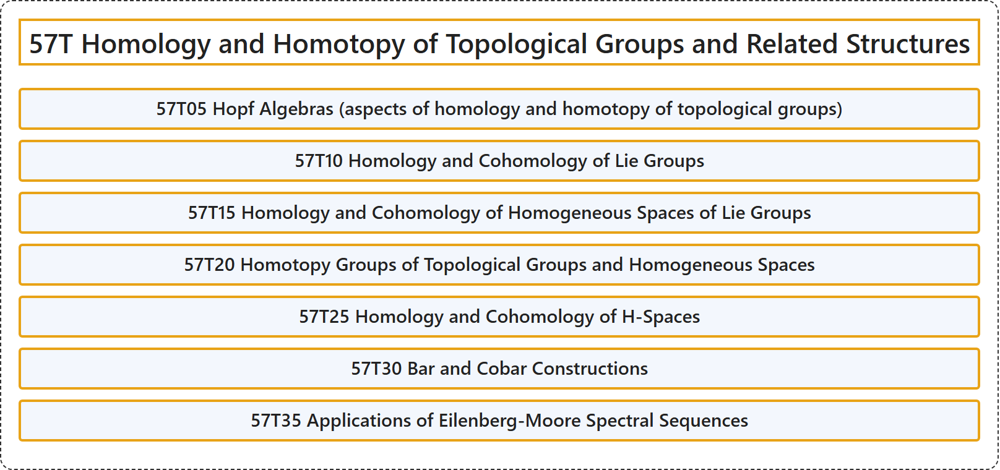

# 57T Homology and Homotopy of Topological Groups and Related Structures

## Classification

## Glossary

| Term | Definition | 中文翻译 | Source |
|---|---|---|---|
| **57T Homology and Homotopy of Topological Groups and Related Structures** 拓扑群及相关结构的同调与同伦 | (No definition) | （无定义） | [Associate Editors of Mathematical Reviews and zbMATH, 2020](https://msc2020.org/) |
| **57T05 Hopf Algebras (aspects of homology and homotopy of topological groups)** 霍普夫代数（拓扑群的同调与同伦方面） | (No definition) | （无定义） | [Associate Editors of Mathematical Reviews and zbMATH, 2020](https://msc2020.org/) |
| **57T10 Homology and Cohomology of Lie Groups** 李群的同调与上同调 | (No definition) | （无定义） | [Associate Editors of Mathematical Reviews and zbMATH, 2020](https://msc2020.org/) |
| **57T15 Homology and Cohomology of Homogeneous Spaces of Lie Groups** 李群齐性空间的同调与上同调 | (No definition) | （无定义） | [Associate Editors of Mathematical Reviews and zbMATH, 2020](https://msc2020.org/) |
| **57T20 Homotopy Groups of Topological Groups and Homogeneous Spaces** 拓扑群与齐性空间的同伦群 | (No definition) | （无定义） | [Associate Editors of Mathematical Reviews and zbMATH, 2020](https://msc2020.org/) |
| **57T25 Homology and Cohomology of H-Spaces** H-空间的同调与上同调 | (No definition) | （无定义） | [Associate Editors of Mathematical Reviews and zbMATH, 2020](https://msc2020.org/) |
| **57T30 Bar and Cobar Constructions** 巴构造与余巴构造 | (No definition) | （无定义） | [Associate Editors of Mathematical Reviews and zbMATH, 2020](https://msc2020.org/) |
| **57T35 Applications of Eilenberg-Moore Spectral Sequences** 艾伦伯格-摩尔谱序列的应用 | (No definition) | （无定义） | [Associate Editors of Mathematical Reviews and zbMATH, 2020](https://msc2020.org/) |

## References

Associate Editors of Mathematical Reviews and zbMATH. (2020). *MSC2020: Mathematics Subject Classification system*. Retrieved October 27, 2026, from <https://msc2020.org/>
