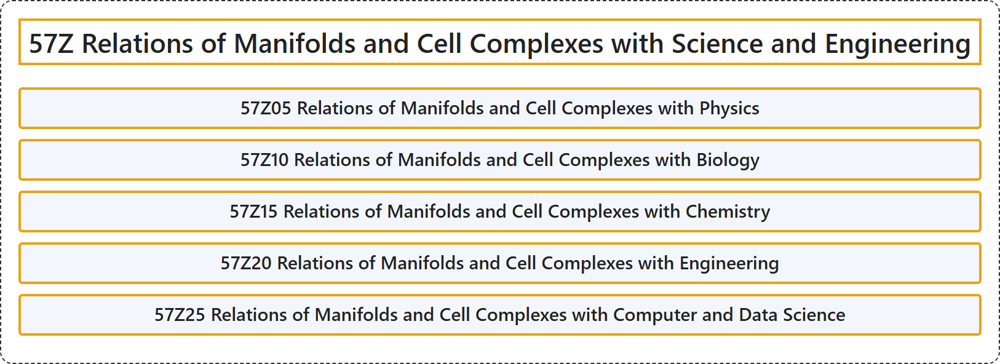

# 57Z Relations of Manifolds and Cell Complexes with Science and Engineering

## Classification

## Glossary

| Term | Definition | 中文翻译 | Source |
|---|---|---|---|
| **57Z Relations of Manifolds and Cell Complexes with Science and Engineering** 流形与胞腔复形同科学与工程的关系 | (No definition) | （无定义） | [Associate Editors of Mathematical Reviews and zbMATH, 2020](https://msc2020.org/) |
| **57Z05 Relations of Manifolds and Cell Complexes with Physics** 流形与胞腔复形和物理学的关系 | (No definition) | （无定义） | [Associate Editors of Mathematical Reviews and zbMATH, 2020](https://msc2020.org/) |
| **57Z10 Relations of Manifolds and Cell Complexes with Biology** 流形与胞腔复形和生物学的关系 | (No definition) | （无定义） | [Associate Editors of Mathematical Reviews and zbMATH, 2020](https://msc2020.org/) |
| **57Z15 Relations of Manifolds and Cell Complexes with Chemistry** 流形与胞腔复形和化学的关系 | (No definition) | （无定义） | [Associate Editors of Mathematical Reviews and zbMATH, 2020](https://msc2020.org/) |
| **57Z20 Relations of Manifolds and Cell Complexes with Engineering** 流形与胞腔复形和工程的关系 | (No definition) | （无定义） | [Associate Editors of Mathematical Reviews and zbMATH, 2020](https://msc2020.org/) |
| **57Z25 Relations of Manifolds and Cell Complexes with Computer and Data Science** 流形与胞腔复形和计算机及数据科学的关系 | (No definition) | （无定义） | [Associate Editors of Mathematical Reviews and zbMATH, 2020](https://msc2020.org/) |

## References

Associate Editors of Mathematical Reviews and zbMATH. (2020). *MSC2020: Mathematics Subject Classification system*. Retrieved October 27, 2026, from <https://msc2020.org/>
