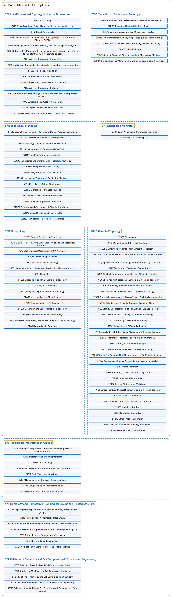

# 57 Manifolds and Cell Complexes

## Classification

## Glossary

| Term | Definition | 中文翻译 | Source |
|---|---|---|---|
| **57 Manifolds and Cell Complexes** 流形与胞腔复形 | "More concisely, **any object that can be 'charted'** is a manifold." | 更简洁地说，**任何可以“绘制成图册”的对象**都是流形。 | [Weisstein, n.d., "Manifold" entry, para. 2](https://mathworld.wolfram.com/Manifold.html#:~:text=More%20concisely%2C%20any%20object%20that%20can%20be) |
| **[57K Low-Dimensional Topology in Specific Dimensions](57k-low-dimensional-topology-in-specific-dimensions.md)** 特定维数的低维拓扑 | (No definition) | （无定义） | [Associate Editors of Mathematical Reviews and zbMATH, 2020](https://msc2020.org/) |
| **[57M General Low-Dimensional Topology](57m-general-low-dimensional-topology.md)** 一般低维拓扑 | (No definition) | （无定义） | [Associate Editors of Mathematical Reviews and zbMATH, 2020](https://msc2020.org/) |
| **[57N Topological Manifolds](57n-topological-manifolds.md)** 拓扑流形 | (No definition) | （无定义） | [Associate Editors of Mathematical Reviews and zbMATH, 2020](https://msc2020.org/) |
| **[57P Generalized Manifolds](57p-generalized-manifolds.md)** 广义流形 | (No definition) | （无定义） | [Associate Editors of Mathematical Reviews and zbMATH, 2020](https://msc2020.org/) |
| **[57Q PL-topology](57q-pl-topology.md)** PL 拓扑 | (No definition) | （无定义） | [Associate Editors of Mathematical Reviews and zbMATH, 2020](https://msc2020.org/) |
| **[57R Differential Topology](57r-differential-topology.md)** 微分拓扑 | (No definition) | （无定义） | [Associate Editors of Mathematical Reviews and zbMATH, 2020](https://msc2020.org/) |
| **[57S Topological Transformation Groups](57s-topological-transformation-groups.md)** 拓扑变换群 | (No definition) | （无定义） | [Associate Editors of Mathematical Reviews and zbMATH, 2020](https://msc2020.org/) |
| **[57T Homology and Homotopy of Topological Groups and Related Structures](57t-homology-and-homotopy-of-topological-groups-and-related-stru.md)** 拓扑群及相关结构的同调与同伦 | (No definition) | （无定义） | [Associate Editors of Mathematical Reviews and zbMATH, 2020](https://msc2020.org/) |
| **[57Z Relations of Manifolds and Cell Complexes with Science and Engineering](57z-relations-of-manifolds-and-cell-complexes-with-science-and-e.md)** 流形与胞腔复形同科学与工程的关系 | (No definition) | （无定义） | [Associate Editors of Mathematical Reviews and zbMATH, 2020](https://msc2020.org/) |

## References

Associate Editors of Mathematical Reviews and zbMATH. (2020). *MSC2020: Mathematics Subject Classification system*. Retrieved October 27, 2026, from <https://msc2020.org/>

Weisstein, E. W. (n.d.). *Manifold*. MathWorld: A Wolfram Resource. Retrieved October 27, 2026, from <https://mathworld.wolfram.com/Manifold.html>
