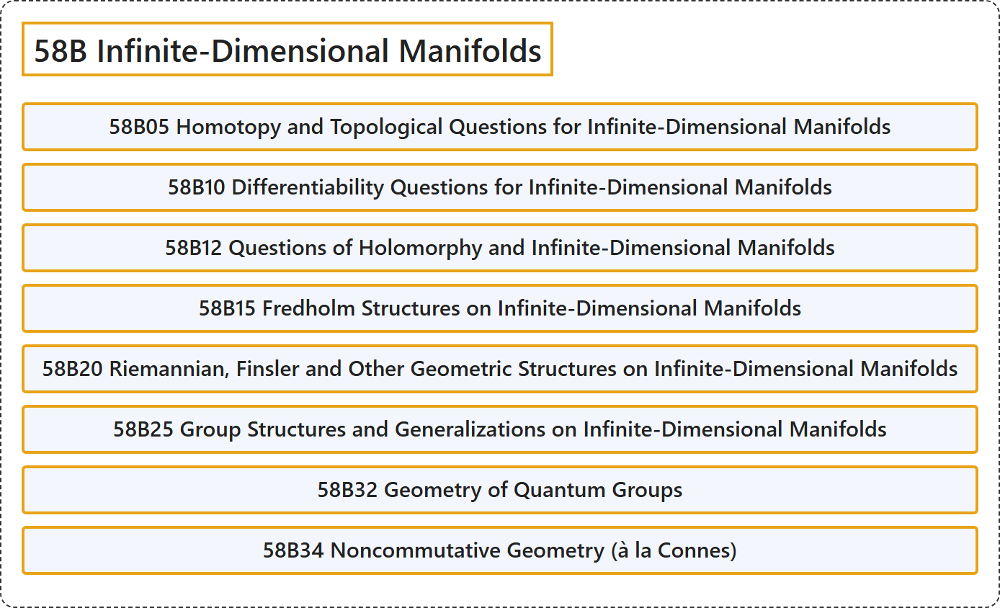

# 58B Infinite-Dimensional Manifolds

## Classification

## Glossary

| Term | Definition | 中文翻译 | Source |
|---|---|---|---|
| **58B Infinite-Dimensional Manifolds** 无穷维流形 | (No definition) | （无定义） | [Associate Editors of Mathematical Reviews and zbMATH, 2020](https://msc2020.org/) |
| **58B05 Homotopy and Topological Questions for Infinite-Dimensional Manifolds** 无限维流形的同伦与拓扑问题 | (No definition) | （无定义） | [Associate Editors of Mathematical Reviews and zbMATH, 2020](https://msc2020.org/) |
| **58B10 Differentiability Questions for Infinite-Dimensional Manifolds** 无限维流形的可微性问题 | (No definition) | （无定义） | [Associate Editors of Mathematical Reviews and zbMATH, 2020](https://msc2020.org/) |
| **58B12 Questions of Holomorphy and Infinite-Dimensional Manifolds** 全纯性问题与无限维流形 | (No definition) | （无定义） | [Associate Editors of Mathematical Reviews and zbMATH, 2020](https://msc2020.org/) |
| **58B15 Fredholm Structures on Infinite-Dimensional Manifolds** 无限维流形上的弗雷德霍姆结构 | (No definition) | （无定义） | [Associate Editors of Mathematical Reviews and zbMATH, 2020](https://msc2020.org/) |
| **58B20 Riemannian, Finsler and Other Geometric Structures on Infinite-Dimensional Manifolds** 无限维流形上的黎曼结构、芬斯勒结构及其他几何结构 | (No definition) | （无定义） | [Associate Editors of Mathematical Reviews and zbMATH, 2020](https://msc2020.org/) |
| **58B25 Group Structures and Generalizations on Infinite-Dimensional Manifolds** 无限维流形上的群结构及其推广 | (No definition) | （无定义） | [Associate Editors of Mathematical Reviews and zbMATH, 2020](https://msc2020.org/) |
| **58B32 Geometry of Quantum Groups** 量子群的几何 | (No definition) | （无定义） | [Associate Editors of Mathematical Reviews and zbMATH, 2020](https://msc2020.org/) |
| **58B34 Noncommutative Geometry (à la Connes)** 非交换几何（孔涅风格） | (No definition) | （无定义） | [Associate Editors of Mathematical Reviews and zbMATH, 2020](https://msc2020.org/) |

## References

Associate Editors of Mathematical Reviews and zbMATH. (2020). *MSC2020: Mathematics Subject Classification system*. Retrieved October 27, 2026, from <https://msc2020.org/>
