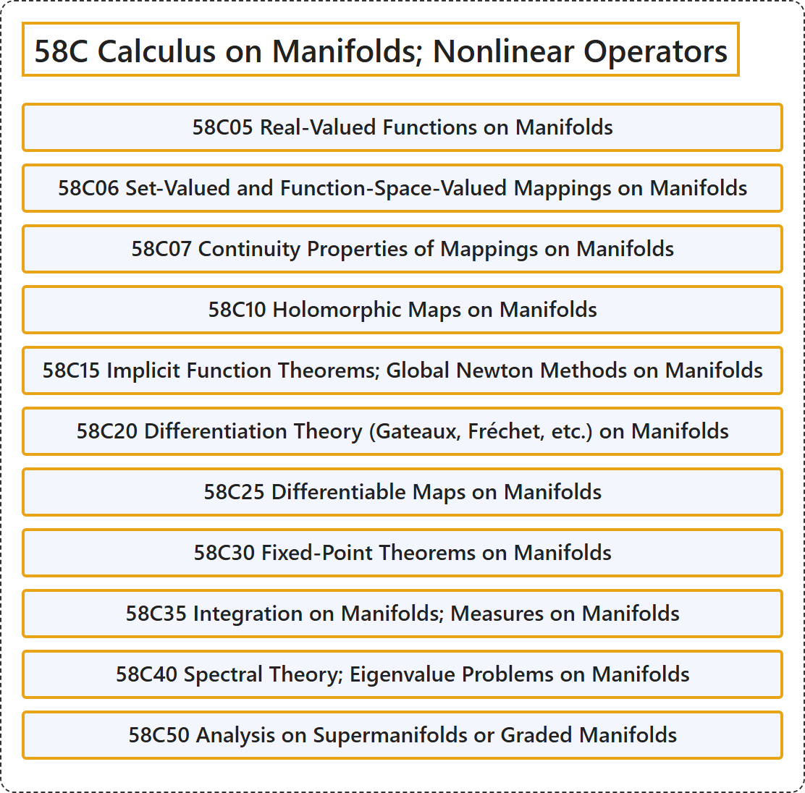

# 58C Calculus on Manifolds; Nonlinear Operators

## Classification

## Glossary

| Term | Definition | 中文翻译 | Source |
|---|---|---|---|
| **58C Calculus on Manifolds; Nonlinear Operators** 流形上的微积分；非线性算子 | (No definition) | （无定义） | [Associate Editors of Mathematical Reviews and zbMATH, 2020](https://msc2020.org/) |
| **58C05 Real-Valued Functions on Manifolds** 流形上的实值函数 | (No definition) | （无定义） | [Associate Editors of Mathematical Reviews and zbMATH, 2020](https://msc2020.org/) |
| **58C06 Set-Valued and Function-Space-Valued Mappings on Manifolds** 流形上的集值映射与函数空间值映射 | (No definition) | （无定义） | [Associate Editors of Mathematical Reviews and zbMATH, 2020](https://msc2020.org/) |
| **58C07 Continuity Properties of Mappings on Manifolds** 流形上映射的连续性 | (No definition) | （无定义） | [Associate Editors of Mathematical Reviews and zbMATH, 2020](https://msc2020.org/) |
| **58C10 Holomorphic Maps on Manifolds** 流形上的全纯映射 | (No definition) | （无定义） | [Associate Editors of Mathematical Reviews and zbMATH, 2020](https://msc2020.org/) |
| **58C15 Implicit Function Theorems; Global Newton Methods on Manifolds** 隐函数定理；流形上的整体牛顿方法 | (No definition) | （无定义） | [Associate Editors of Mathematical Reviews and zbMATH, 2020](https://msc2020.org/) |
| **58C20 Differentiation Theory (Gateaux, Fréchet, etc.) on Manifolds** 流形上的微分理论（加托、弗雷歇等） | (No definition) | （无定义） | [Associate Editors of Mathematical Reviews and zbMATH, 2020](https://msc2020.org/) |
| **58C25 Differentiable Maps on Manifolds** 流形上的可微映射 | (No definition) | （无定义） | [Associate Editors of Mathematical Reviews and zbMATH, 2020](https://msc2020.org/) |
| **58C30 Fixed-Point Theorems on Manifolds** 流形上的不动点定理 | (No definition) | （无定义） | [Associate Editors of Mathematical Reviews and zbMATH, 2020](https://msc2020.org/) |
| **58C35 Integration on Manifolds; Measures on Manifolds** 流形上的积分；流形上的测度 | (No definition) | （无定义） | [Associate Editors of Mathematical Reviews and zbMATH, 2020](https://msc2020.org/) |
| **58C40 Spectral Theory; Eigenvalue Problems on Manifolds** 流形上的谱理论；特征值问题 | (No definition) | （无定义） | [Associate Editors of Mathematical Reviews and zbMATH, 2020](https://msc2020.org/) |
| **58C50 Analysis on Supermanifolds or Graded Manifolds** 超流形或分次流形上的分析 | (No definition) | （无定义） | [Associate Editors of Mathematical Reviews and zbMATH, 2020](https://msc2020.org/) |

## References

Associate Editors of Mathematical Reviews and zbMATH. (2020). *MSC2020: Mathematics Subject Classification system*. Retrieved October 27, 2026, from <https://msc2020.org/>
