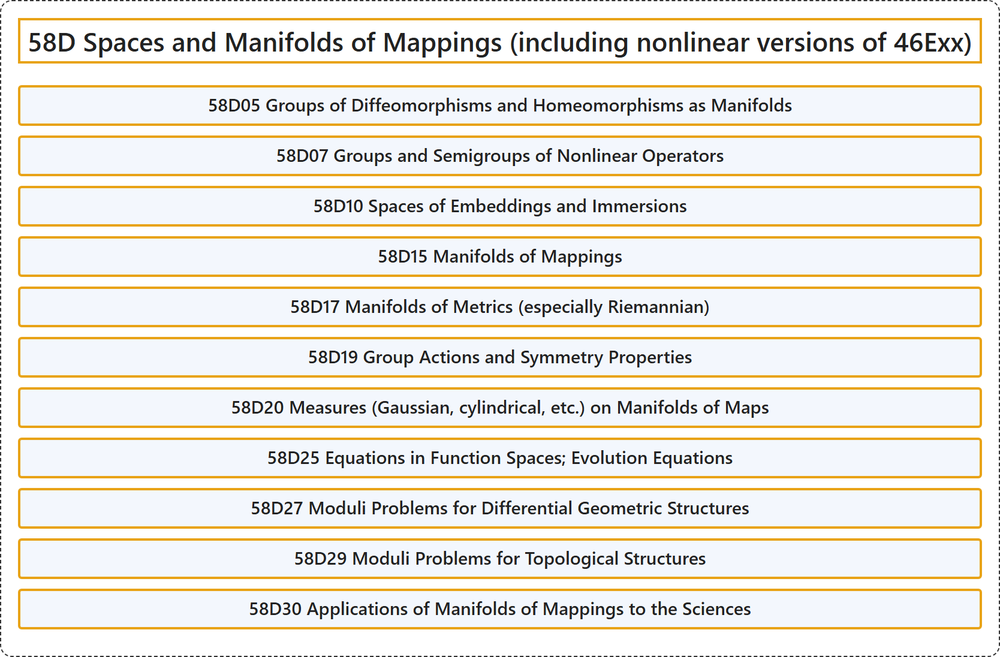

# 58D Spaces and Manifolds of Mappings (including nonlinear versions of 46Exx)

## Classification

## Glossary

| Term | Definition | 中文翻译 | Source |
|---|---|---|---|
| **58D Spaces and Manifolds of Mappings (including nonlinear versions of 46Exx)** 映射的空间与流形（包括 46Exx 的非线性版本） | (No definition) | （无定义） | [Associate Editors of Mathematical Reviews and zbMATH, 2020](https://msc2020.org/) |
| **58D05 Groups of Diffeomorphisms and Homeomorphisms as Manifolds** 作为流形的微分同胚群与同胚群 | (No definition) | （无定义） | [Associate Editors of Mathematical Reviews and zbMATH, 2020](https://msc2020.org/) |
| **58D07 Groups and Semigroups of Nonlinear Operators** 非线性算子的群与半群 | (No definition) | （无定义） | [Associate Editors of Mathematical Reviews and zbMATH, 2020](https://msc2020.org/) |
| **58D10 Spaces of Embeddings and Immersions** 嵌入与浸入的空间 | (No definition) | （无定义） | [Associate Editors of Mathematical Reviews and zbMATH, 2020](https://msc2020.org/) |
| **58D15 Manifolds of Mappings** 映射的流形 | (No definition) | （无定义） | [Associate Editors of Mathematical Reviews and zbMATH, 2020](https://msc2020.org/) |
| **58D17 Manifolds of Metrics (especially Riemannian)** 度量（尤其是黎曼度量）的流形 | (No definition) | （无定义） | [Associate Editors of Mathematical Reviews and zbMATH, 2020](https://msc2020.org/) |
| **58D19 Group Actions and Symmetry Properties** 群作用与对称性质 | (No definition) | （无定义） | [Associate Editors of Mathematical Reviews and zbMATH, 2020](https://msc2020.org/) |
| **58D20 Measures (Gaussian, cylindrical, etc.) on Manifolds of Maps** 映射流形上的测度（高斯测度、柱测度等） | (No definition) | （无定义） | [Associate Editors of Mathematical Reviews and zbMATH, 2020](https://msc2020.org/) |
| **58D25 Equations in Function Spaces; Evolution Equations** 函数空间中的方程；发展方程 | (No definition) | （无定义） | [Associate Editors of Mathematical Reviews and zbMATH, 2020](https://msc2020.org/) |
| **58D27 Moduli Problems for Differential Geometric Structures** 微分几何结构的模问题 | (No definition) | （无定义） | [Associate Editors of Mathematical Reviews and zbMATH, 2020](https://msc2020.org/) |
| **58D29 Moduli Problems for Topological Structures** 拓扑结构的模问题 | (No definition) | （无定义） | [Associate Editors of Mathematical Reviews and zbMATH, 2020](https://msc2020.org/) |
| **58D30 Applications of Manifolds of Mappings to the Sciences** 映射流形在科学中的应用 | (No definition) | （无定义） | [Associate Editors of Mathematical Reviews and zbMATH, 2020](https://msc2020.org/) |

## References

Associate Editors of Mathematical Reviews and zbMATH. (2020). *MSC2020: Mathematics Subject Classification system*. Retrieved October 27, 2026, from <https://msc2020.org/>
