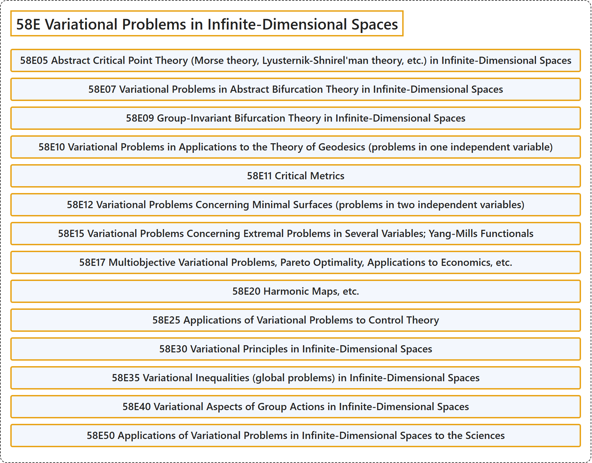

# 58E Variational Problems in Infinite-Dimensional Spaces

## Classification

## Glossary

| Term | Definition | 中文翻译 | Source |
|---|---|---|---|
| **58E Variational Problems in Infinite-Dimensional Spaces** 无穷维空间中的变分问题 | (No definition) | （无定义） | [Associate Editors of Mathematical Reviews and zbMATH, 2020](https://msc2020.org/) |
| **58E05 Abstract Critical Point Theory (Morse theory, Lyusternik-Shnirel'man theory, etc.) in Infinite-Dimensional Spaces** 无限维空间中的抽象临界点理论（莫尔斯理论、吕斯捷尔尼克-施尼雷尔曼理论等） | (No definition) | （无定义） | [Associate Editors of Mathematical Reviews and zbMATH, 2020](https://msc2020.org/) |
| **58E07 Variational Problems in Abstract Bifurcation Theory in Infinite-Dimensional Spaces** 无限维空间中抽象分支理论的变分问题 | (No definition) | （无定义） | [Associate Editors of Mathematical Reviews and zbMATH, 2020](https://msc2020.org/) |
| **58E09 Group-Invariant Bifurcation Theory in Infinite-Dimensional Spaces** 无限维空间中的群不变分支理论 | (No definition) | （无定义） | [Associate Editors of Mathematical Reviews and zbMATH, 2020](https://msc2020.org/) |
| **58E10 Variational Problems in Applications to the Theory of Geodesics (problems in one independent variable)** 测地线理论应用中的变分问题（一个自变量的问题） | (No definition) | （无定义） | [Associate Editors of Mathematical Reviews and zbMATH, 2020](https://msc2020.org/) |
| **58E11 Critical Metrics** 临界度量 | (No definition) | （无定义） | [Associate Editors of Mathematical Reviews and zbMATH, 2020](https://msc2020.org/) |
| **58E12 Variational Problems Concerning Minimal Surfaces (problems in two independent variables)** 关于极小曲面的变分问题（两个自变量的问题） | (No definition) | （无定义） | [Associate Editors of Mathematical Reviews and zbMATH, 2020](https://msc2020.org/) |
| **58E15 Variational Problems Concerning Extremal Problems in Several Variables; Yang-Mills Functionals** 关于多变量极值问题的变分问题；杨-米尔斯泛函 | (No definition) | （无定义） | [Associate Editors of Mathematical Reviews and zbMATH, 2020](https://msc2020.org/) |
| **58E17 Multiobjective Variational Problems, Pareto Optimality, Applications to Economics, etc.** 多目标变分问题、帕累托最优性、在经济学中的应用等 | (No definition) | （无定义） | [Associate Editors of Mathematical Reviews and zbMATH, 2020](https://msc2020.org/) |
| **58E20 Harmonic Maps, etc.** 调和映射等 | (No definition) | （无定义） | [Associate Editors of Mathematical Reviews and zbMATH, 2020](https://msc2020.org/) |
| **58E25 Applications of Variational Problems to Control Theory** 变分问题在控制论中的应用 | (No definition) | （无定义） | [Associate Editors of Mathematical Reviews and zbMATH, 2020](https://msc2020.org/) |
| **58E30 Variational Principles in Infinite-Dimensional Spaces** 无限维空间中的变分原理 | (No definition) | （无定义） | [Associate Editors of Mathematical Reviews and zbMATH, 2020](https://msc2020.org/) |
| **58E35 Variational Inequalities (global problems) in Infinite-Dimensional Spaces** 无限维空间中的变分不等式（整体问题） | (No definition) | （无定义） | [Associate Editors of Mathematical Reviews and zbMATH, 2020](https://msc2020.org/) |
| **58E40 Variational Aspects of Group Actions in Infinite-Dimensional Spaces** 无限维空间中群作用的变分方面 | (No definition) | （无定义） | [Associate Editors of Mathematical Reviews and zbMATH, 2020](https://msc2020.org/) |
| **58E50 Applications of Variational Problems in Infinite-Dimensional Spaces to the Sciences** 无限维空间中变分问题在科学中的应用 | (No definition) | （无定义） | [Associate Editors of Mathematical Reviews and zbMATH, 2020](https://msc2020.org/) |

## References

Associate Editors of Mathematical Reviews and zbMATH. (2020). *MSC2020: Mathematics Subject Classification system*. Retrieved October 27, 2026, from <https://msc2020.org/>
