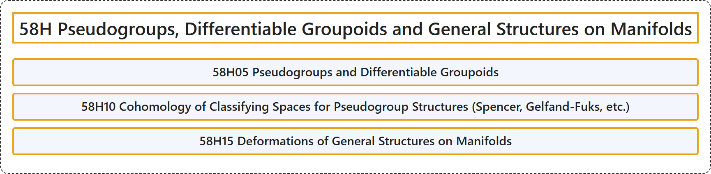

# 58H Pseudogroups, Differentiable Groupoids and General Structures on Manifolds

## Classification

## Glossary

| Term | Definition | 中文翻译 | Source |
|---|---|---|---|
| **58H Pseudogroups, Differentiable Groupoids and General Structures on Manifolds** 伪群、可微广群与流形上的一般结构 | (No definition) | （无定义） | [Associate Editors of Mathematical Reviews and zbMATH, 2020](https://msc2020.org/) |
| **58H05 Pseudogroups and Differentiable Groupoids** 伪群与可微群胚 | (No definition) | （无定义） | [Associate Editors of Mathematical Reviews and zbMATH, 2020](https://msc2020.org/) |
| **58H10 Cohomology of Classifying Spaces for Pseudogroup Structures (Spencer, Gelfand-Fuks, etc.)** 伪群结构分类空间的上同调（斯潘塞、盖尔方德-富克斯等） | (No definition) | （无定义） | [Associate Editors of Mathematical Reviews and zbMATH, 2020](https://msc2020.org/) |
| **58H15 Deformations of General Structures on Manifolds** 流形上一般结构的形变 | (No definition) | （无定义） | [Associate Editors of Mathematical Reviews and zbMATH, 2020](https://msc2020.org/) |

## References

Associate Editors of Mathematical Reviews and zbMATH. (2020). *MSC2020: Mathematics Subject Classification system*. Retrieved October 27, 2026, from <https://msc2020.org/>
