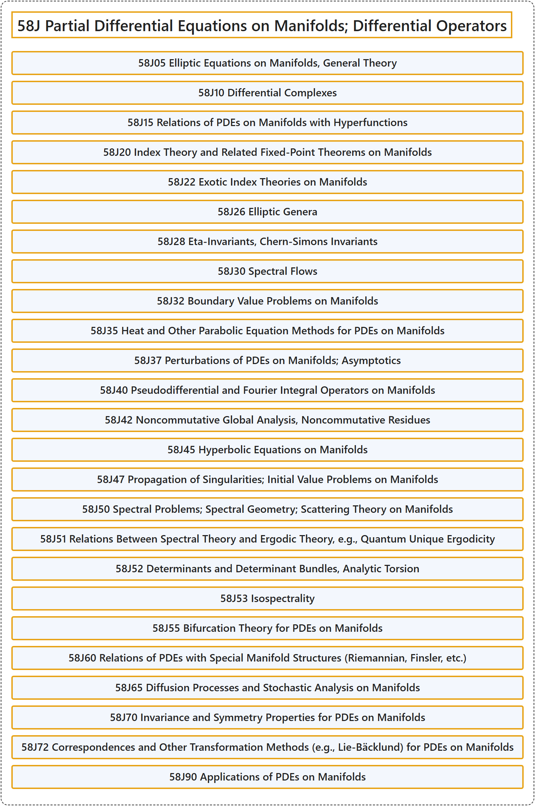

# 58J Partial Differential Equations on Manifolds; Differential Operators

## Classification

## Glossary

| Term | Definition | 中文翻译 | Source |
|---|---|---|---|
| **58J Partial Differential Equations on Manifolds; Differential Operators** 流形上的偏微分方程；微分算子 | (No definition) | （无定义） | [Associate Editors of Mathematical Reviews and zbMATH, 2020](https://msc2020.org/) |
| **58J05 Elliptic Equations on Manifolds, General Theory** 流形上的椭圆方程，一般理论 | (No definition) | （无定义） | [Associate Editors of Mathematical Reviews and zbMATH, 2020](https://msc2020.org/) |
| **58J10 Differential Complexes** 微分复形 | (No definition) | （无定义） | [Associate Editors of Mathematical Reviews and zbMATH, 2020](https://msc2020.org/) |
| **58J15 Relations of PDEs on Manifolds with Hyperfunctions** 流形上 PDE 与超函数的关系 | (No definition) | （无定义） | [Associate Editors of Mathematical Reviews and zbMATH, 2020](https://msc2020.org/) |
| **58J20 Index Theory and Related Fixed-Point Theorems on Manifolds** 流形上的指标理论及相关不动点定理 | (No definition) | （无定义） | [Associate Editors of Mathematical Reviews and zbMATH, 2020](https://msc2020.org/) |
| **58J22 Exotic Index Theories on Manifolds** 流形上的奇异指标理论 | (No definition) | （无定义） | [Associate Editors of Mathematical Reviews and zbMATH, 2020](https://msc2020.org/) |
| **58J26 Elliptic Genera** 椭圆亏格 | (No definition) | （无定义） | [Associate Editors of Mathematical Reviews and zbMATH, 2020](https://msc2020.org/) |
| **58J28 Eta-Invariants, Chern-Simons Invariants** Eta 不变量、陈-西蒙斯不变量 | (No definition) | （无定义） | [Associate Editors of Mathematical Reviews and zbMATH, 2020](https://msc2020.org/) |
| **58J30 Spectral Flows** 谱流 | (No definition) | （无定义） | [Associate Editors of Mathematical Reviews and zbMATH, 2020](https://msc2020.org/) |
| **58J32 Boundary Value Problems on Manifolds** 流形上的边值问题 | (No definition) | （无定义） | [Associate Editors of Mathematical Reviews and zbMATH, 2020](https://msc2020.org/) |
| **58J35 Heat and Other Parabolic Equation Methods for PDEs on Manifolds** 流形上 PDE 的热方程及其他抛物型方程方法 | (No definition) | （无定义） | [Associate Editors of Mathematical Reviews and zbMATH, 2020](https://msc2020.org/) |
| **58J37 Perturbations of PDEs on Manifolds; Asymptotics** 流形上 PDE 的扰动；渐近 | (No definition) | （无定义） | [Associate Editors of Mathematical Reviews and zbMATH, 2020](https://msc2020.org/) |
| **58J40 Pseudodifferential and Fourier Integral Operators on Manifolds** 流形上的伪微分算子与傅里叶积分算子 | (No definition) | （无定义） | [Associate Editors of Mathematical Reviews and zbMATH, 2020](https://msc2020.org/) |
| **58J42 Noncommutative Global Analysis, Noncommutative Residues** 非交换整体分析、非交换留数 | (No definition) | （无定义） | [Associate Editors of Mathematical Reviews and zbMATH, 2020](https://msc2020.org/) |
| **58J45 Hyperbolic Equations on Manifolds** 流形上的双曲方程 | (No definition) | （无定义） | [Associate Editors of Mathematical Reviews and zbMATH, 2020](https://msc2020.org/) |
| **58J47 Propagation of Singularities; Initial Value Problems on Manifolds** 奇性的传播；流形上的初值问题 | (No definition) | （无定义） | [Associate Editors of Mathematical Reviews and zbMATH, 2020](https://msc2020.org/) |
| **58J50 Spectral Problems; Spectral Geometry; Scattering Theory on Manifolds** 流形上的谱问题；谱几何；散射理论 | (No definition) | （无定义） | [Associate Editors of Mathematical Reviews and zbMATH, 2020](https://msc2020.org/) |
| **58J51 Relations Between Spectral Theory and Ergodic Theory, e.g., Quantum Unique Ergodicity** 谱理论与遍历理论的关系，如量子唯一遍历性 | (No definition) | （无定义） | [Associate Editors of Mathematical Reviews and zbMATH, 2020](https://msc2020.org/) |
| **58J52 Determinants and Determinant Bundles, Analytic Torsion** 行列式与行列式丛、解析挠率 | (No definition) | （无定义） | [Associate Editors of Mathematical Reviews and zbMATH, 2020](https://msc2020.org/) |
| **58J53 Isospectrality** 等谱性 | (No definition) | （无定义） | [Associate Editors of Mathematical Reviews and zbMATH, 2020](https://msc2020.org/) |
| **58J55 Bifurcation Theory for PDEs on Manifolds** 流形上 PDE 的分支理论 | (No definition) | （无定义） | [Associate Editors of Mathematical Reviews and zbMATH, 2020](https://msc2020.org/) |
| **58J60 Relations of PDEs with Special Manifold Structures (Riemannian, Finsler, etc.)** PDE 与特殊流形结构（黎曼、芬斯勒等）的关系 | (No definition) | （无定义） | [Associate Editors of Mathematical Reviews and zbMATH, 2020](https://msc2020.org/) |
| **58J65 Diffusion Processes and Stochastic Analysis on Manifolds** 流形上的扩散过程与随机分析 | (No definition) | （无定义） | [Associate Editors of Mathematical Reviews and zbMATH, 2020](https://msc2020.org/) |
| **58J70 Invariance and Symmetry Properties for PDEs on Manifolds** 流形上 PDE 的不变性与对称性质 | (No definition) | （无定义） | [Associate Editors of Mathematical Reviews and zbMATH, 2020](https://msc2020.org/) |
| **58J72 Correspondences and Other Transformation Methods (e.g., Lie-Bäcklund) for PDEs on Manifolds** 流形上 PDE 的对应及其他变换方法（如李-贝克隆） | (No definition) | （无定义） | [Associate Editors of Mathematical Reviews and zbMATH, 2020](https://msc2020.org/) |
| **58J90 Applications of PDEs on Manifolds** 流形上 PDE 的应用 | (No definition) | （无定义） | [Associate Editors of Mathematical Reviews and zbMATH, 2020](https://msc2020.org/) |

## References

Associate Editors of Mathematical Reviews and zbMATH. (2020). *MSC2020: Mathematics Subject Classification system*. Retrieved October 27, 2026, from <https://msc2020.org/>
