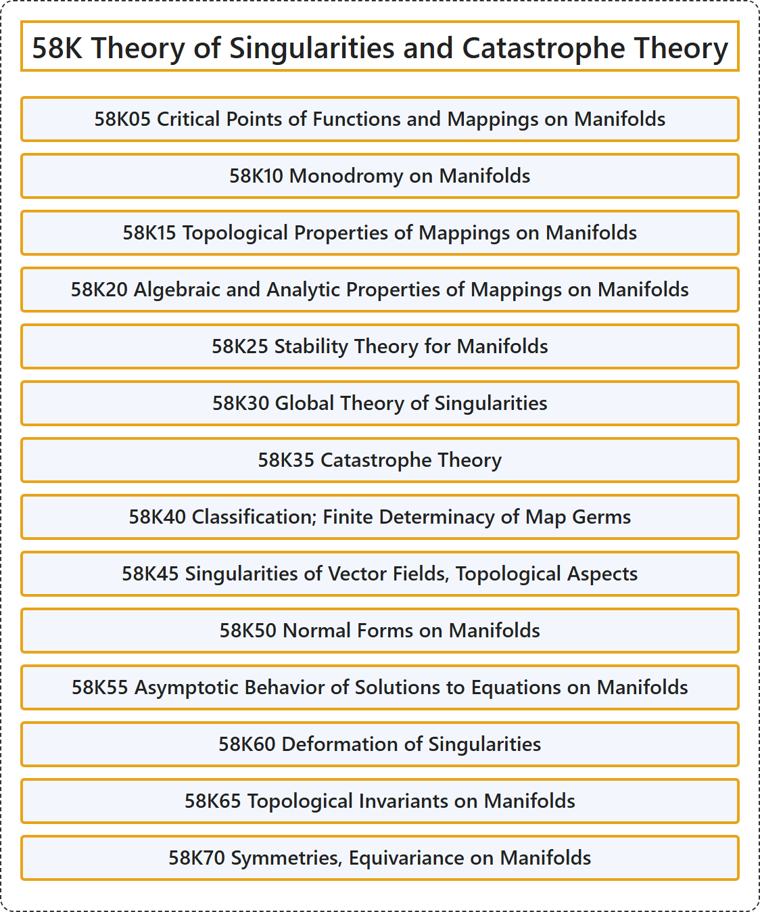

# 58K Theory of Singularities and Catastrophe Theory

## Classification

## Glossary

| Term | Definition | 中文翻译 | Source |
|---|---|---|---|
| **58K Theory of Singularities and Catastrophe Theory** 奇点理论与突变论 | (No definition) | （无定义） | [Associate Editors of Mathematical Reviews and zbMATH, 2020](https://msc2020.org/) |
| **58K05 Critical Points of Functions and Mappings on Manifolds** 流形上函数与映射的临界点 | (No definition) | （无定义） | [Associate Editors of Mathematical Reviews and zbMATH, 2020](https://msc2020.org/) |
| **58K10 Monodromy on Manifolds** 流形上的单值化 | (No definition) | （无定义） | [Associate Editors of Mathematical Reviews and zbMATH, 2020](https://msc2020.org/) |
| **58K15 Topological Properties of Mappings on Manifolds** 流形上映射的拓扑性质 | (No definition) | （无定义） | [Associate Editors of Mathematical Reviews and zbMATH, 2020](https://msc2020.org/) |
| **58K20 Algebraic and Analytic Properties of Mappings on Manifolds** 流形上映射的代数性质与解析性质 | (No definition) | （无定义） | [Associate Editors of Mathematical Reviews and zbMATH, 2020](https://msc2020.org/) |
| **58K25 Stability Theory for Manifolds** 流形的稳定性理论 | (No definition) | （无定义） | [Associate Editors of Mathematical Reviews and zbMATH, 2020](https://msc2020.org/) |
| **58K30 Global Theory of Singularities** 奇点的整体理论 | (No definition) | （无定义） | [Associate Editors of Mathematical Reviews and zbMATH, 2020](https://msc2020.org/) |
| **58K35 Catastrophe Theory** 突变理论 | (No definition) | （无定义） | [Associate Editors of Mathematical Reviews and zbMATH, 2020](https://msc2020.org/) |
| **58K40 Classification; Finite Determinacy of Map Germs** 分类；映射芽的有限决定性 | (No definition) | （无定义） | [Associate Editors of Mathematical Reviews and zbMATH, 2020](https://msc2020.org/) |
| **58K45 Singularities of Vector Fields, Topological Aspects** 向量场的奇点，拓扑方面 | (No definition) | （无定义） | [Associate Editors of Mathematical Reviews and zbMATH, 2020](https://msc2020.org/) |
| **58K50 Normal Forms on Manifolds** 流形上的标准形 | (No definition) | （无定义） | [Associate Editors of Mathematical Reviews and zbMATH, 2020](https://msc2020.org/) |
| **58K55 Asymptotic Behavior of Solutions to Equations on Manifolds** 流形上方程解的渐近行为 | (No definition) | （无定义） | [Associate Editors of Mathematical Reviews and zbMATH, 2020](https://msc2020.org/) |
| **58K60 Deformation of Singularities** 奇点的形变 | (No definition) | （无定义） | [Associate Editors of Mathematical Reviews and zbMATH, 2020](https://msc2020.org/) |
| **58K65 Topological Invariants on Manifolds** 流形上的拓扑不变量 | (No definition) | （无定义） | [Associate Editors of Mathematical Reviews and zbMATH, 2020](https://msc2020.org/) |
| **58K70 Symmetries, Equivariance on Manifolds** 流形上的对称性、等变性 | (No definition) | （无定义） | [Associate Editors of Mathematical Reviews and zbMATH, 2020](https://msc2020.org/) |

## References

Associate Editors of Mathematical Reviews and zbMATH. (2020). *MSC2020: Mathematics Subject Classification system*. Retrieved October 27, 2026, from <https://msc2020.org/>
