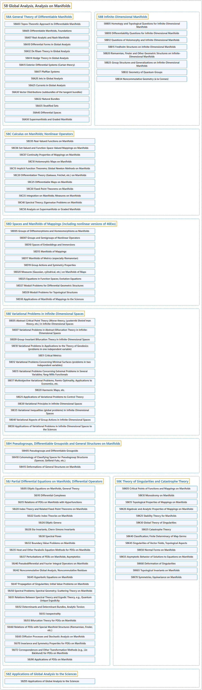

# 58 Global Analysis, Analysis on Manifolds

## Classification

## Glossary

| Term | Definition | 中文翻译 | Source |
|---|---|---|---|
| **58 Global Analysis, Analysis on Manifolds** 整体分析、流形上的分析 | (context) "A manifold without boundary is a T2-space with a second countable topology that is **locally Euclidean** (i.e., around every point, there is a neighborhood that is **topologically the same as the open unit ball in R^n**)." | （语境）无边流形是具有第二可数拓扑、并且**局部是欧几里得的** T2 空间（即每一点周围都有一个邻域，它**在拓扑上与 R^n 中的开单位球相同**）。 | [Weisstein, n.d., "Manifold" entry, para. 1](https://mathworld.wolfram.com/Manifold.html#:~:text=A%20manifold%20without%20boundary%20is%20a) |
| **[58A General Theory of Differentiable Manifolds](58a-general-theory-of-differentiable-manifolds.md)** 可微流形的一般理论 | (No definition) | （无定义） | [Associate Editors of Mathematical Reviews and zbMATH, 2020](https://msc2020.org/) |
| **[58B Infinite-Dimensional Manifolds](58b-infinite-dimensional-manifolds.md)** 无穷维流形 | (No definition) | （无定义） | [Associate Editors of Mathematical Reviews and zbMATH, 2020](https://msc2020.org/) |
| **[58C Calculus on Manifolds; Nonlinear Operators](58c-calculus-on-manifolds-nonlinear-operators.md)** 流形上的微积分；非线性算子 | (No definition) | （无定义） | [Associate Editors of Mathematical Reviews and zbMATH, 2020](https://msc2020.org/) |
| **[58D Spaces and Manifolds of Mappings (including nonlinear versions of 46Exx)](58d-spaces-and-manifolds-of-mappings-including-nonlinear-version.md)** 映射的空间与流形（包括 46Exx 的非线性版本） | (No definition) | （无定义） | [Associate Editors of Mathematical Reviews and zbMATH, 2020](https://msc2020.org/) |
| **[58E Variational Problems in Infinite-Dimensional Spaces](58e-variational-problems-in-infinite-dimensional-spaces.md)** 无穷维空间中的变分问题 | (No definition) | （无定义） | [Associate Editors of Mathematical Reviews and zbMATH, 2020](https://msc2020.org/) |
| **[58H Pseudogroups, Differentiable Groupoids and General Structures on Manifolds](58h-pseudogroups-differentiable-groupoids-and-general-structures.md)** 伪群、可微广群与流形上的一般结构 | (No definition) | （无定义） | [Associate Editors of Mathematical Reviews and zbMATH, 2020](https://msc2020.org/) |
| **[58J Partial Differential Equations on Manifolds; Differential Operators](58j-partial-differential-equations-on-manifolds-differential-ope.md)** 流形上的偏微分方程；微分算子 | (No definition) | （无定义） | [Associate Editors of Mathematical Reviews and zbMATH, 2020](https://msc2020.org/) |
| **[58K Theory of Singularities and Catastrophe Theory](58k-theory-of-singularities-and-catastrophe-theory.md)** 奇点理论与突变论 | (No definition) | （无定义） | [Associate Editors of Mathematical Reviews and zbMATH, 2020](https://msc2020.org/) |
| **[58Z Applications of Global Analysis to the Sciences](58z-applications-of-global-analysis-to-the-sciences.md)** 整体分析在科学中的应用 | (No definition) | （无定义） | [Associate Editors of Mathematical Reviews and zbMATH, 2020](https://msc2020.org/) |

## References

Associate Editors of Mathematical Reviews and zbMATH. (2020). *MSC2020: Mathematics Subject Classification system*. Retrieved October 27, 2026, from <https://msc2020.org/>

Weisstein, E. W. (n.d.). *Manifold*. MathWorld: A Wolfram Resource. Retrieved October 27, 2026, from <https://mathworld.wolfram.com/Manifold.html>
