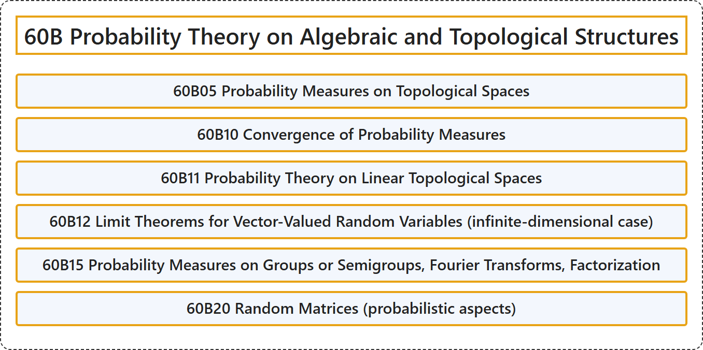

# 60B Probability Theory on Algebraic and Topological Structures

## Classification

## Glossary

| Term | Definition | 中文翻译 | Source |
|---|---|---|---|
| **60B Probability Theory on Algebraic and Topological Structures** 代数与拓扑结构上的概率论 | (No definition) | （无定义） | [Associate Editors of Mathematical Reviews and zbMATH, 2020](https://msc2020.org/) |
| **60B05 Probability Measures on Topological Spaces** 拓扑空间上的概率测度 | (No definition) | （无定义） | [Associate Editors of Mathematical Reviews and zbMATH, 2020](https://msc2020.org/) |
| **60B10 Convergence of Probability Measures** 概率测度的收敛 | (No definition) | （无定义） | [Associate Editors of Mathematical Reviews and zbMATH, 2020](https://msc2020.org/) |
| **60B11 Probability Theory on Linear Topological Spaces** 线性拓扑空间上的概率论 | (No definition) | （无定义） | [Associate Editors of Mathematical Reviews and zbMATH, 2020](https://msc2020.org/) |
| **60B12 Limit Theorems for Vector-Valued Random Variables (infinite-dimensional case)** 向量值随机变量的极限定理（无限维情形） | (No definition) | （无定义） | [Associate Editors of Mathematical Reviews and zbMATH, 2020](https://msc2020.org/) |
| **60B15 Probability Measures on Groups or Semigroups, Fourier Transforms, Factorization** 群或半群上的概率测度、傅里叶变换、因子分解 | (No definition) | （无定义） | [Associate Editors of Mathematical Reviews and zbMATH, 2020](https://msc2020.org/) |
| **60B20 Random Matrices (probabilistic aspects)** 随机矩阵（概率方面） | (No definition) | （无定义） | [Associate Editors of Mathematical Reviews and zbMATH, 2020](https://msc2020.org/) |

## References

Associate Editors of Mathematical Reviews and zbMATH. (2020). *MSC2020: Mathematics Subject Classification system*. Retrieved October 27, 2026, from <https://msc2020.org/>
