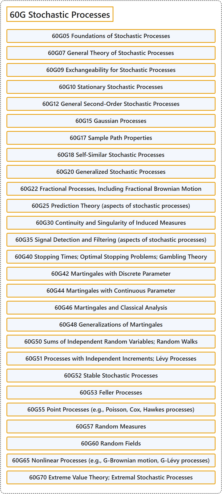

# 60G Stochastic Processes

## Classification

## Glossary

| Term | Definition | 中文翻译 | Source |
|---|---|---|---|
| **60G Stochastic Processes** 随机过程 | (No definition) | （无定义） | [Associate Editors of Mathematical Reviews and zbMATH, 2020](https://msc2020.org/) |
| **60G05 Foundations of Stochastic Processes** 随机过程基础 | (No definition) | （无定义） | [Associate Editors of Mathematical Reviews and zbMATH, 2020](https://msc2020.org/) |
| **60G07 General Theory of Stochastic Processes** 随机过程的一般理论 | (No definition) | （无定义） | [Associate Editors of Mathematical Reviews and zbMATH, 2020](https://msc2020.org/) |
| **60G09 Exchangeability for Stochastic Processes** 随机过程的可交换性 | (No definition) | （无定义） | [Associate Editors of Mathematical Reviews and zbMATH, 2020](https://msc2020.org/) |
| **60G10 Stationary Stochastic Processes** 平稳随机过程 | (No definition) | （无定义） | [Associate Editors of Mathematical Reviews and zbMATH, 2020](https://msc2020.org/) |
| **60G12 General Second-Order Stochastic Processes** 一般二阶随机过程 | (No definition) | （无定义） | [Associate Editors of Mathematical Reviews and zbMATH, 2020](https://msc2020.org/) |
| **60G15 Gaussian Processes** 高斯过程 | (No definition) | （无定义） | [Associate Editors of Mathematical Reviews and zbMATH, 2020](https://msc2020.org/) |
| **60G17 Sample Path Properties** 样本路径性质 | (No definition) | （无定义） | [Associate Editors of Mathematical Reviews and zbMATH, 2020](https://msc2020.org/) |
| **60G18 Self-Similar Stochastic Processes** 自相似随机过程 | (No definition) | （无定义） | [Associate Editors of Mathematical Reviews and zbMATH, 2020](https://msc2020.org/) |
| **60G20 Generalized Stochastic Processes** 广义随机过程 | (No definition) | （无定义） | [Associate Editors of Mathematical Reviews and zbMATH, 2020](https://msc2020.org/) |
| **60G22 Fractional Processes, Including Fractional Brownian Motion** 分数过程，包括分数布朗运动 | (No definition) | （无定义） | [Associate Editors of Mathematical Reviews and zbMATH, 2020](https://msc2020.org/) |
| **60G25 Prediction Theory (aspects of stochastic processes)** 预测理论（随机过程方面） | (No definition) | （无定义） | [Associate Editors of Mathematical Reviews and zbMATH, 2020](https://msc2020.org/) |
| **60G30 Continuity and Singularity of Induced Measures** 诱导测度的连续性与奇异性 | (No definition) | （无定义） | [Associate Editors of Mathematical Reviews and zbMATH, 2020](https://msc2020.org/) |
| **60G35 Signal Detection and Filtering (aspects of stochastic processes)** 信号检测与滤波（随机过程方面） | (No definition) | （无定义） | [Associate Editors of Mathematical Reviews and zbMATH, 2020](https://msc2020.org/) |
| **60G40 Stopping Times; Optimal Stopping Problems; Gambling Theory** 停时；最优停止问题；赌博理论 | (No definition) | （无定义） | [Associate Editors of Mathematical Reviews and zbMATH, 2020](https://msc2020.org/) |
| **60G42 Martingales with Discrete Parameter** 离散参数鞅 | (No definition) | （无定义） | [Associate Editors of Mathematical Reviews and zbMATH, 2020](https://msc2020.org/) |
| **60G44 Martingales with Continuous Parameter** 连续参数鞅 | (No definition) | （无定义） | [Associate Editors of Mathematical Reviews and zbMATH, 2020](https://msc2020.org/) |
| **60G46 Martingales and Classical Analysis** 鞅与经典分析 | (No definition) | （无定义） | [Associate Editors of Mathematical Reviews and zbMATH, 2020](https://msc2020.org/) |
| **60G48 Generalizations of Martingales** 鞅的推广 | (No definition) | （无定义） | [Associate Editors of Mathematical Reviews and zbMATH, 2020](https://msc2020.org/) |
| **60G50 Sums of Independent Random Variables; Random Walks** 独立随机变量之和；随机游动 | (No definition) | （无定义） | [Associate Editors of Mathematical Reviews and zbMATH, 2020](https://msc2020.org/) |
| **60G51 Processes with Independent Increments; Lévy Processes** 独立增量过程；列维过程 | (No definition) | （无定义） | [Associate Editors of Mathematical Reviews and zbMATH, 2020](https://msc2020.org/) |
| **60G52 Stable Stochastic Processes** 稳定随机过程 | (No definition) | （无定义） | [Associate Editors of Mathematical Reviews and zbMATH, 2020](https://msc2020.org/) |
| **60G53 Feller Processes** 费勒过程 | (No definition) | （无定义） | [Associate Editors of Mathematical Reviews and zbMATH, 2020](https://msc2020.org/) |
| **60G55 Point Processes (e.g., Poisson, Cox, Hawkes processes)** 点过程（如泊松过程、考克斯过程、霍克斯过程） | (No definition) | （无定义） | [Associate Editors of Mathematical Reviews and zbMATH, 2020](https://msc2020.org/) |
| **60G57 Random Measures** 随机测度 | (No definition) | （无定义） | [Associate Editors of Mathematical Reviews and zbMATH, 2020](https://msc2020.org/) |
| **60G60 Random Fields** 随机场 | (No definition) | （无定义） | [Associate Editors of Mathematical Reviews and zbMATH, 2020](https://msc2020.org/) |
| **60G65 Nonlinear Processes (e.g., G-Brownian motion, G-Lévy processes)** 非线性过程（如 G-布朗运动、G-列维过程） | (No definition) | （无定义） | [Associate Editors of Mathematical Reviews and zbMATH, 2020](https://msc2020.org/) |
| **60G70 Extreme Value Theory; Extremal Stochastic Processes** 极值理论；极值随机过程 | (No definition) | （无定义） | [Associate Editors of Mathematical Reviews and zbMATH, 2020](https://msc2020.org/) |

## References

Associate Editors of Mathematical Reviews and zbMATH. (2020). *MSC2020: Mathematics Subject Classification system*. Retrieved October 27, 2026, from <https://msc2020.org/>
