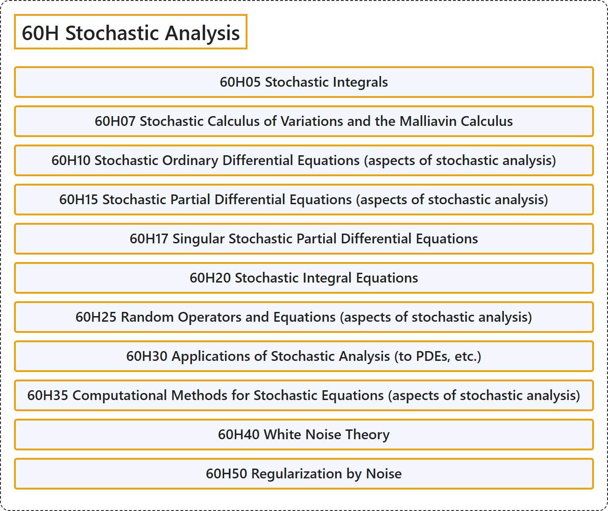

# 60H Stochastic Analysis

## Classification

## Glossary

| Term | Definition | 中文翻译 | Source |
|---|---|---|---|
| **60H Stochastic Analysis** 随机分析 | (No definition) | （无定义） | [Associate Editors of Mathematical Reviews and zbMATH, 2020](https://msc2020.org/) |
| **60H05 Stochastic Integrals** 随机积分 | (No definition) | （无定义） | [Associate Editors of Mathematical Reviews and zbMATH, 2020](https://msc2020.org/) |
| **60H07 Stochastic Calculus of Variations and the Malliavin Calculus** 随机变分法与马利亚万演算 | (No definition) | （无定义） | [Associate Editors of Mathematical Reviews and zbMATH, 2020](https://msc2020.org/) |
| **60H10 Stochastic Ordinary Differential Equations (aspects of stochastic analysis)** 随机常微分方程（随机分析方面） | (No definition) | （无定义） | [Associate Editors of Mathematical Reviews and zbMATH, 2020](https://msc2020.org/) |
| **60H15 Stochastic Partial Differential Equations (aspects of stochastic analysis)** 随机偏微分方程（随机分析方面） | (No definition) | （无定义） | [Associate Editors of Mathematical Reviews and zbMATH, 2020](https://msc2020.org/) |
| **60H17 Singular Stochastic Partial Differential Equations** 奇异随机偏微分方程 | (No definition) | （无定义） | [Associate Editors of Mathematical Reviews and zbMATH, 2020](https://msc2020.org/) |
| **60H20 Stochastic Integral Equations** 随机积分方程 | (No definition) | （无定义） | [Associate Editors of Mathematical Reviews and zbMATH, 2020](https://msc2020.org/) |
| **60H25 Random Operators and Equations (aspects of stochastic analysis)** 随机算子与随机方程（随机分析方面） | (No definition) | （无定义） | [Associate Editors of Mathematical Reviews and zbMATH, 2020](https://msc2020.org/) |
| **60H30 Applications of Stochastic Analysis (to PDEs, etc.)** 随机分析的应用（在 PDE 等中） | (No definition) | （无定义） | [Associate Editors of Mathematical Reviews and zbMATH, 2020](https://msc2020.org/) |
| **60H35 Computational Methods for Stochastic Equations (aspects of stochastic analysis)** 随机方程的计算方法（随机分析方面） | (No definition) | （无定义） | [Associate Editors of Mathematical Reviews and zbMATH, 2020](https://msc2020.org/) |
| **60H40 White Noise Theory** 白噪声理论 | (No definition) | （无定义） | [Associate Editors of Mathematical Reviews and zbMATH, 2020](https://msc2020.org/) |
| **60H50 Regularization by Noise** 噪声正则化 | (No definition) | （无定义） | [Associate Editors of Mathematical Reviews and zbMATH, 2020](https://msc2020.org/) |

## References

Associate Editors of Mathematical Reviews and zbMATH. (2020). *MSC2020: Mathematics Subject Classification system*. Retrieved October 27, 2026, from <https://msc2020.org/>
