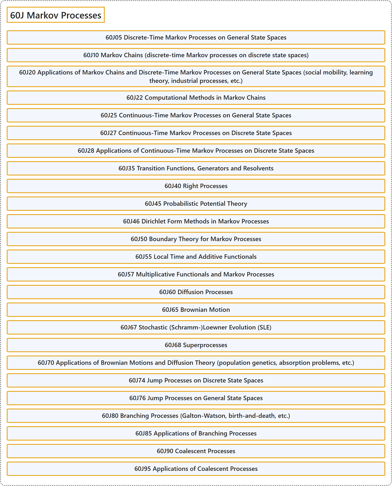

# 60J Markov Processes

## Classification

## Glossary

| Term | Definition | 中文翻译 | Source |
|---|---|---|---|
| **60J Markov Processes** 马尔可夫过程 | (No definition) | （无定义） | [Associate Editors of Mathematical Reviews and zbMATH, 2020](https://msc2020.org/) |
| **60J05 Discrete-Time Markov Processes on General State Spaces** 一般状态空间上的离散时间马尔可夫过程 | (No definition) | （无定义） | [Associate Editors of Mathematical Reviews and zbMATH, 2020](https://msc2020.org/) |
| **60J10 Markov Chains (discrete-time Markov processes on discrete state spaces)** 马尔可夫链（离散状态空间上的离散时间马尔可夫过程） | (No definition) | （无定义） | [Associate Editors of Mathematical Reviews and zbMATH, 2020](https://msc2020.org/) |
| **60J20 Applications of Markov Chains and Discrete-Time Markov Processes on General State Spaces (social mobility, learning theory, industrial processes, etc.)** 马尔可夫链与一般状态空间上离散时间马尔可夫过程的应用（社会流动、学习理论、工业过程等） | (No definition) | （无定义） | [Associate Editors of Mathematical Reviews and zbMATH, 2020](https://msc2020.org/) |
| **60J22 Computational Methods in Markov Chains** 马尔可夫链中的计算方法 | (No definition) | （无定义） | [Associate Editors of Mathematical Reviews and zbMATH, 2020](https://msc2020.org/) |
| **60J25 Continuous-Time Markov Processes on General State Spaces** 一般状态空间上的连续时间马尔可夫过程 | (No definition) | （无定义） | [Associate Editors of Mathematical Reviews and zbMATH, 2020](https://msc2020.org/) |
| **60J27 Continuous-Time Markov Processes on Discrete State Spaces** 离散状态空间上的连续时间马尔可夫过程 | (No definition) | （无定义） | [Associate Editors of Mathematical Reviews and zbMATH, 2020](https://msc2020.org/) |
| **60J28 Applications of Continuous-Time Markov Processes on Discrete State Spaces** 离散状态空间上连续时间马尔可夫过程的应用 | (No definition) | （无定义） | [Associate Editors of Mathematical Reviews and zbMATH, 2020](https://msc2020.org/) |
| **60J35 Transition Functions, Generators and Resolvents** 转移函数、生成元与预解式 | (No definition) | （无定义） | [Associate Editors of Mathematical Reviews and zbMATH, 2020](https://msc2020.org/) |
| **60J40 Right Processes** 右过程 | (No definition) | （无定义） | [Associate Editors of Mathematical Reviews and zbMATH, 2020](https://msc2020.org/) |
| **60J45 Probabilistic Potential Theory** 概率位势论 | (No definition) | （无定义） | [Associate Editors of Mathematical Reviews and zbMATH, 2020](https://msc2020.org/) |
| **60J46 Dirichlet Form Methods in Markov Processes** 马尔可夫过程中的狄利克雷型方法 | (No definition) | （无定义） | [Associate Editors of Mathematical Reviews and zbMATH, 2020](https://msc2020.org/) |
| **60J50 Boundary Theory for Markov Processes** 马尔可夫过程的边界理论 | (No definition) | （无定义） | [Associate Editors of Mathematical Reviews and zbMATH, 2020](https://msc2020.org/) |
| **60J55 Local Time and Additive Functionals** 局部时与可加泛函 | (No definition) | （无定义） | [Associate Editors of Mathematical Reviews and zbMATH, 2020](https://msc2020.org/) |
| **60J57 Multiplicative Functionals and Markov Processes** 乘性泛函与马尔可夫过程 | (No definition) | （无定义） | [Associate Editors of Mathematical Reviews and zbMATH, 2020](https://msc2020.org/) |
| **60J60 Diffusion Processes** 扩散过程 | (No definition) | （无定义） | [Associate Editors of Mathematical Reviews and zbMATH, 2020](https://msc2020.org/) |
| **60J65 Brownian Motion** 布朗运动 | (No definition) | （无定义） | [Associate Editors of Mathematical Reviews and zbMATH, 2020](https://msc2020.org/) |
| **60J67 Stochastic (Schramm-)Loewner Evolution (SLE)** 随机（施拉姆-）勒夫纳演化（SLE） | (No definition) | （无定义） | [Associate Editors of Mathematical Reviews and zbMATH, 2020](https://msc2020.org/) |
| **60J68 Superprocesses** 超过程 | (No definition) | （无定义） | [Associate Editors of Mathematical Reviews and zbMATH, 2020](https://msc2020.org/) |
| **60J70 Applications of Brownian Motions and Diffusion Theory (population genetics, absorption problems, etc.)** 布朗运动与扩散理论的应用（群体遗传学、吸收问题等） | (No definition) | （无定义） | [Associate Editors of Mathematical Reviews and zbMATH, 2020](https://msc2020.org/) |
| **60J74 Jump Processes on Discrete State Spaces** 离散状态空间上的跳过程 | (No definition) | （无定义） | [Associate Editors of Mathematical Reviews and zbMATH, 2020](https://msc2020.org/) |
| **60J76 Jump Processes on General State Spaces** 一般状态空间上的跳过程 | (No definition) | （无定义） | [Associate Editors of Mathematical Reviews and zbMATH, 2020](https://msc2020.org/) |
| **60J80 Branching Processes (Galton-Watson, birth-and-death, etc.)** 分支过程（高尔顿-沃森过程、生灭过程等） | (No definition) | （无定义） | [Associate Editors of Mathematical Reviews and zbMATH, 2020](https://msc2020.org/) |
| **60J85 Applications of Branching Processes** 分支过程的应用 | (No definition) | （无定义） | [Associate Editors of Mathematical Reviews and zbMATH, 2020](https://msc2020.org/) |
| **60J90 Coalescent Processes** 合并过程 | (No definition) | （无定义） | [Associate Editors of Mathematical Reviews and zbMATH, 2020](https://msc2020.org/) |
| **60J95 Applications of Coalescent Processes** 合并过程的应用 | (No definition) | （无定义） | [Associate Editors of Mathematical Reviews and zbMATH, 2020](https://msc2020.org/) |

## References

Associate Editors of Mathematical Reviews and zbMATH. (2020). *MSC2020: Mathematics Subject Classification system*. Retrieved October 27, 2026, from <https://msc2020.org/>
