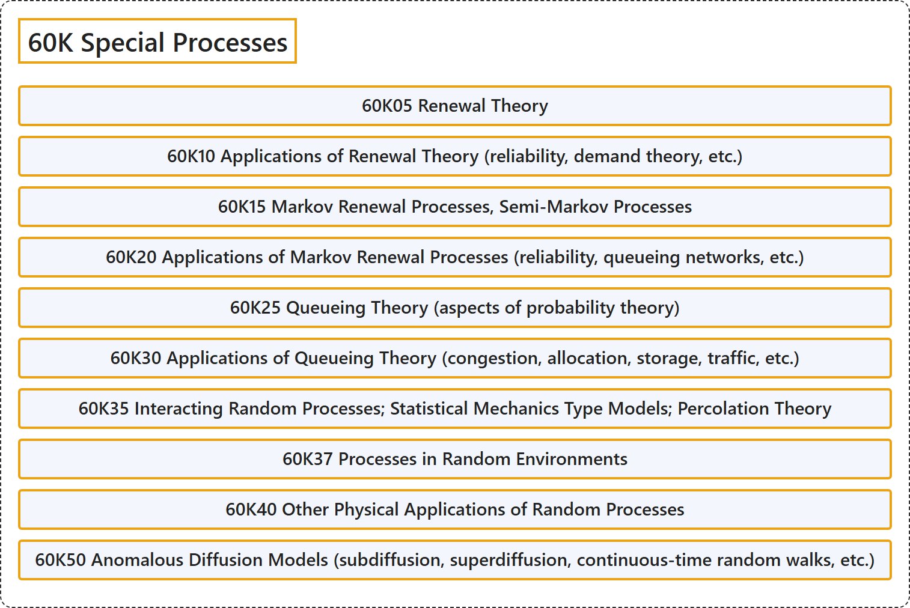

# 60K Special Processes

## Classification

## Glossary

| Term | Definition | 中文翻译 | Source |
|---|---|---|---|
| **60K Special Processes** 特殊过程 | (No definition) | （无定义） | [Associate Editors of Mathematical Reviews and zbMATH, 2020](https://msc2020.org/) |
| **60K05 Renewal Theory** 更新理论 | (No definition) | （无定义） | [Associate Editors of Mathematical Reviews and zbMATH, 2020](https://msc2020.org/) |
| **60K10 Applications of Renewal Theory (reliability, demand theory, etc.)** 更新理论的应用（可靠性、需求理论等） | (No definition) | （无定义） | [Associate Editors of Mathematical Reviews and zbMATH, 2020](https://msc2020.org/) |
| **60K15 Markov Renewal Processes, Semi-Markov Processes** 马尔可夫更新过程、半马尔可夫过程 | (No definition) | （无定义） | [Associate Editors of Mathematical Reviews and zbMATH, 2020](https://msc2020.org/) |
| **60K20 Applications of Markov Renewal Processes (reliability, queueing networks, etc.)** 马尔可夫更新过程的应用（可靠性、排队网络等） | (No definition) | （无定义） | [Associate Editors of Mathematical Reviews and zbMATH, 2020](https://msc2020.org/) |
| **60K25 Queueing Theory (aspects of probability theory)** 排队论（概率论方面） | (No definition) | （无定义） | [Associate Editors of Mathematical Reviews and zbMATH, 2020](https://msc2020.org/) |
| **60K30 Applications of Queueing Theory (congestion, allocation, storage, traffic, etc.)** 排队论的应用（拥塞、分配、存储、交通等） | (No definition) | （无定义） | [Associate Editors of Mathematical Reviews and zbMATH, 2020](https://msc2020.org/) |
| **60K35 Interacting Random Processes; Statistical Mechanics Type Models; Percolation Theory** 相互作用随机过程；统计力学型模型；渗流理论 | (No definition) | （无定义） | [Associate Editors of Mathematical Reviews and zbMATH, 2020](https://msc2020.org/) |
| **60K37 Processes in Random Environments** 随机环境中的过程 | (No definition) | （无定义） | [Associate Editors of Mathematical Reviews and zbMATH, 2020](https://msc2020.org/) |
| **60K40 Other Physical Applications of Random Processes** 随机过程的其他物理应用 | (No definition) | （无定义） | [Associate Editors of Mathematical Reviews and zbMATH, 2020](https://msc2020.org/) |
| **60K50 Anomalous Diffusion Models (subdiffusion, superdiffusion, continuous-time random walks, etc.)** 反常扩散模型（亚扩散、超扩散、连续时间随机游动等） | (No definition) | （无定义） | [Associate Editors of Mathematical Reviews and zbMATH, 2020](https://msc2020.org/) |

## References

Associate Editors of Mathematical Reviews and zbMATH. (2020). *MSC2020: Mathematics Subject Classification system*. Retrieved October 27, 2026, from <https://msc2020.org/>
