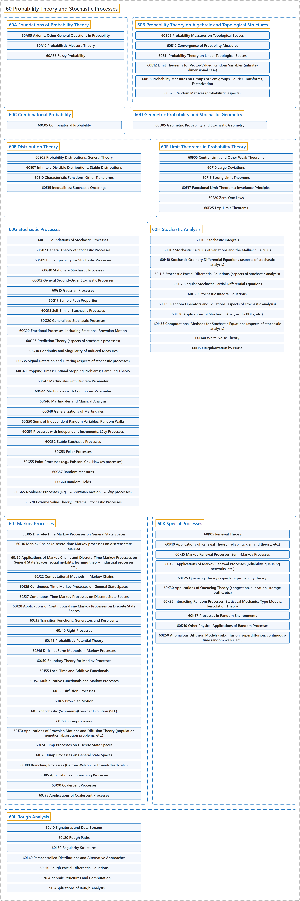

# 60 Probability Theory and Stochastic Processes

## Classification

## Glossary

| Term | Definition | 中文翻译 | Source |
|---|---|---|---|
| **60 Probability Theory and Stochastic Processes** 概率论与随机过程 | "Probability is the branch of mathematics that studies the **possible outcomes of given events** together with the outcomes' **relative likelihoods and distributions**." | 概率是数学的一个分支，研究**给定事件的可能结果**，以及这些结果的**相对可能性和分布**。 | [Weisstein, n.d., "Probability" entry, para. 1](https://mathworld.wolfram.com/Probability.html#:~:text=Probability%20is%20the%20branch%20of%20mathematics%20that%20studies%20the%20possible%20outcomes) |
| **[60A Foundations of Probability Theory](60a-foundations-of-probability-theory.md)** 概率论基础 | (No definition) | （无定义） | [Associate Editors of Mathematical Reviews and zbMATH, 2020](https://msc2020.org/) |
| **[60B Probability Theory on Algebraic and Topological Structures](60b-probability-theory-on-algebraic-and-topological-structures.md)** 代数与拓扑结构上的概率论 | (No definition) | （无定义） | [Associate Editors of Mathematical Reviews and zbMATH, 2020](https://msc2020.org/) |
| **[60C Combinatorial Probability](60c-combinatorial-probability.md)** 组合概率 | (No definition) | （无定义） | [Associate Editors of Mathematical Reviews and zbMATH, 2020](https://msc2020.org/) |
| **[60D Geometric Probability and Stochastic Geometry](60d-geometric-probability-and-stochastic-geometry.md)** 几何概率与随机几何 | (No definition) | （无定义） | [Associate Editors of Mathematical Reviews and zbMATH, 2020](https://msc2020.org/) |
| **[60E Distribution Theory](60e-distribution-theory.md)** 分布论 | (No definition) | （无定义） | [Associate Editors of Mathematical Reviews and zbMATH, 2020](https://msc2020.org/) |
| **[60F Limit Theorems in Probability Theory](60f-limit-theorems-in-probability-theory.md)** 概率论中的极限定理 | (No definition) | （无定义） | [Associate Editors of Mathematical Reviews and zbMATH, 2020](https://msc2020.org/) |
| **[60G Stochastic Processes](60g-stochastic-processes.md)** 随机过程 | (No definition) | （无定义） | [Associate Editors of Mathematical Reviews and zbMATH, 2020](https://msc2020.org/) |
| **[60H Stochastic Analysis](60h-stochastic-analysis.md)** 随机分析 | (No definition) | （无定义） | [Associate Editors of Mathematical Reviews and zbMATH, 2020](https://msc2020.org/) |
| **[60J Markov Processes](60j-markov-processes.md)** 马尔可夫过程 | (No definition) | （无定义） | [Associate Editors of Mathematical Reviews and zbMATH, 2020](https://msc2020.org/) |
| **[60K Special Processes](60k-special-processes.md)** 特殊过程 | (No definition) | （无定义） | [Associate Editors of Mathematical Reviews and zbMATH, 2020](https://msc2020.org/) |
| **[60L Rough Analysis](60l-rough-analysis.md)** 粗糙分析 | (No definition) | （无定义） | [Associate Editors of Mathematical Reviews and zbMATH, 2020](https://msc2020.org/) |

## References

Associate Editors of Mathematical Reviews and zbMATH. (2020). *MSC2020: Mathematics Subject Classification system*. Retrieved October 27, 2026, from <https://msc2020.org/>

Weisstein, E. W. (n.d.). *Probability*. MathWorld: A Wolfram Resource. Retrieved October 27, 2026, from <https://mathworld.wolfram.com/Probability.html>
