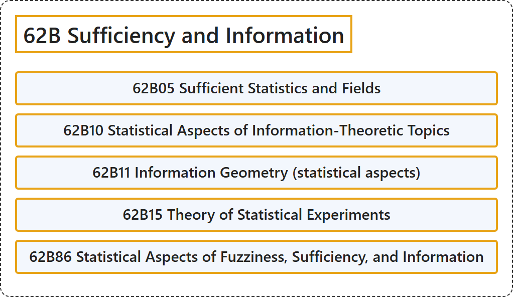

# 62B Sufficiency and Information

## Classification

## Glossary

| Term | Definition | 中文翻译 | Source |
|---|---|---|---|
| **62B Sufficiency and Information** 充分性与信息 | (No definition) | （无定义） | [Associate Editors of Mathematical Reviews and zbMATH, 2020](https://msc2020.org/) |
| **62B05 Sufficient Statistics and Fields** 充分统计量与充分域 | (No definition) | （无定义） | [Associate Editors of Mathematical Reviews and zbMATH, 2020](https://msc2020.org/) |
| **62B10 Statistical Aspects of Information-Theoretic Topics** 信息论主题的统计方面 | (No definition) | （无定义） | [Associate Editors of Mathematical Reviews and zbMATH, 2020](https://msc2020.org/) |
| **62B11 Information Geometry (statistical aspects)** 信息几何（统计方面） | (No definition) | （无定义） | [Associate Editors of Mathematical Reviews and zbMATH, 2020](https://msc2020.org/) |
| **62B15 Theory of Statistical Experiments** 统计试验理论 | (No definition) | （无定义） | [Associate Editors of Mathematical Reviews and zbMATH, 2020](https://msc2020.org/) |
| **62B86 Statistical Aspects of Fuzziness, Sufficiency, and Information** 模糊性、充分性与信息的统计方面 | (No definition) | （无定义） | [Associate Editors of Mathematical Reviews and zbMATH, 2020](https://msc2020.org/) |

## References

Associate Editors of Mathematical Reviews and zbMATH. (2020). *MSC2020: Mathematics Subject Classification system*. Retrieved October 27, 2026, from <https://msc2020.org/>
