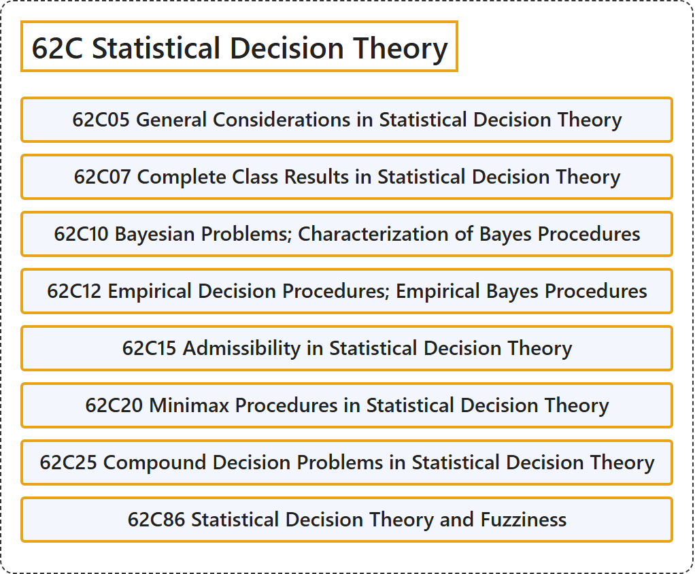

# 62C Statistical Decision Theory

## Classification

## Glossary

| Term | Definition | 中文翻译 | Source |
|---|---|---|---|
| **62C Statistical Decision Theory** 统计决策理论 | (No definition) | （无定义） | [Associate Editors of Mathematical Reviews and zbMATH, 2020](https://msc2020.org/) |
| **62C05 General Considerations in Statistical Decision Theory** 统计决策理论中的一般考虑 | (No definition) | （无定义） | [Associate Editors of Mathematical Reviews and zbMATH, 2020](https://msc2020.org/) |
| **62C07 Complete Class Results in Statistical Decision Theory** 统计决策理论中的完全类结果 | (No definition) | （无定义） | [Associate Editors of Mathematical Reviews and zbMATH, 2020](https://msc2020.org/) |
| **62C10 Bayesian Problems; Characterization of Bayes Procedures** 贝叶斯问题；贝叶斯程序的刻画 | (No definition) | （无定义） | [Associate Editors of Mathematical Reviews and zbMATH, 2020](https://msc2020.org/) |
| **62C12 Empirical Decision Procedures; Empirical Bayes Procedures** 经验决策程序；经验贝叶斯程序 | (No definition) | （无定义） | [Associate Editors of Mathematical Reviews and zbMATH, 2020](https://msc2020.org/) |
| **62C15 Admissibility in Statistical Decision Theory** 统计决策理论中的容许性 | (No definition) | （无定义） | [Associate Editors of Mathematical Reviews and zbMATH, 2020](https://msc2020.org/) |
| **62C20 Minimax Procedures in Statistical Decision Theory** 统计决策理论中的极小极大程序 | (No definition) | （无定义） | [Associate Editors of Mathematical Reviews and zbMATH, 2020](https://msc2020.org/) |
| **62C25 Compound Decision Problems in Statistical Decision Theory** 统计决策理论中的复合决策问题 | (No definition) | （无定义） | [Associate Editors of Mathematical Reviews and zbMATH, 2020](https://msc2020.org/) |
| **62C86 Statistical Decision Theory and Fuzziness** 统计决策理论与模糊性 | (No definition) | （无定义） | [Associate Editors of Mathematical Reviews and zbMATH, 2020](https://msc2020.org/) |

## References

Associate Editors of Mathematical Reviews and zbMATH. (2020). *MSC2020: Mathematics Subject Classification system*. Retrieved October 27, 2026, from <https://msc2020.org/>
