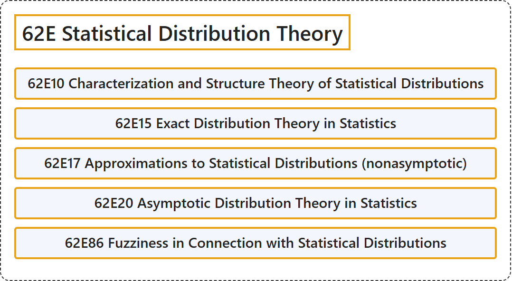

# 62E Statistical Distribution Theory

## Classification

## Glossary

| Term | Definition | 中文翻译 | Source |
|---|---|---|---|
| **62E Statistical Distribution Theory** 统计分布理论 | (No definition) | （无定义） | [Associate Editors of Mathematical Reviews and zbMATH, 2020](https://msc2020.org/) |
| **62E10 Characterization and Structure Theory of Statistical Distributions** 统计分布的刻画与结构理论 | (No definition) | （无定义） | [Associate Editors of Mathematical Reviews and zbMATH, 2020](https://msc2020.org/) |
| **62E15 Exact Distribution Theory in Statistics** 统计学中的精确分布理论 | (No definition) | （无定义） | [Associate Editors of Mathematical Reviews and zbMATH, 2020](https://msc2020.org/) |
| **62E17 Approximations to Statistical Distributions (nonasymptotic)** 统计分布的逼近（非渐近） | (No definition) | （无定义） | [Associate Editors of Mathematical Reviews and zbMATH, 2020](https://msc2020.org/) |
| **62E20 Asymptotic Distribution Theory in Statistics** 统计学中的渐近分布理论 | (No definition) | （无定义） | [Associate Editors of Mathematical Reviews and zbMATH, 2020](https://msc2020.org/) |
| **62E86 Fuzziness in Connection with Statistical Distributions** 与统计分布有关的模糊性 | (No definition) | （无定义） | [Associate Editors of Mathematical Reviews and zbMATH, 2020](https://msc2020.org/) |

## References

Associate Editors of Mathematical Reviews and zbMATH. (2020). *MSC2020: Mathematics Subject Classification system*. Retrieved October 27, 2026, from <https://msc2020.org/>
