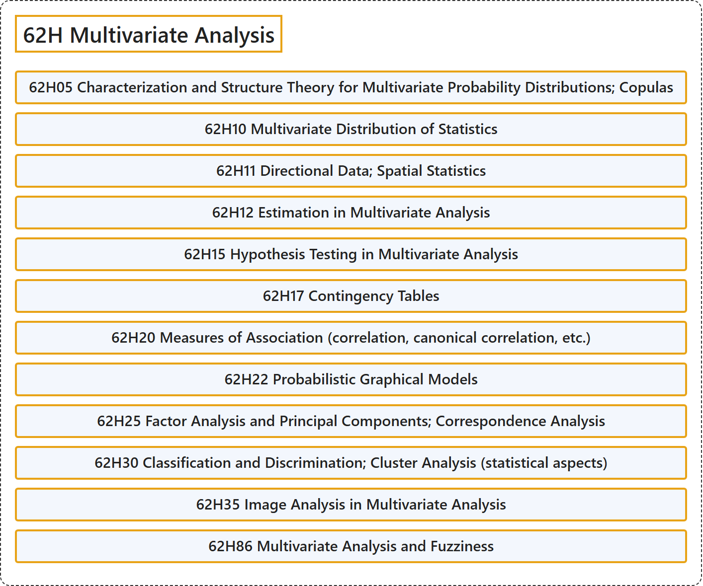

# 62H Multivariate Analysis

## Classification

## Glossary

| Term | Definition | 中文翻译 | Source |
|---|---|---|---|
| **62H Multivariate Analysis** 多元分析 | (No definition) | （无定义） | [Associate Editors of Mathematical Reviews and zbMATH, 2020](https://msc2020.org/) |
| **62H05 Characterization and Structure Theory for Multivariate Probability Distributions; Copulas** 多元概率分布的刻画与结构理论；Copula | (No definition) | （无定义） | [Associate Editors of Mathematical Reviews and zbMATH, 2020](https://msc2020.org/) |
| **62H10 Multivariate Distribution of Statistics** 统计量的多元分布 | (No definition) | （无定义） | [Associate Editors of Mathematical Reviews and zbMATH, 2020](https://msc2020.org/) |
| **62H11 Directional Data; Spatial Statistics** 方向数据；空间统计 | (No definition) | （无定义） | [Associate Editors of Mathematical Reviews and zbMATH, 2020](https://msc2020.org/) |
| **62H12 Estimation in Multivariate Analysis** 多元分析中的估计 | (No definition) | （无定义） | [Associate Editors of Mathematical Reviews and zbMATH, 2020](https://msc2020.org/) |
| **62H15 Hypothesis Testing in Multivariate Analysis** 多元分析中的假设检验 | (No definition) | （无定义） | [Associate Editors of Mathematical Reviews and zbMATH, 2020](https://msc2020.org/) |
| **62H17 Contingency Tables** 列联表 | (No definition) | （无定义） | [Associate Editors of Mathematical Reviews and zbMATH, 2020](https://msc2020.org/) |
| **62H20 Measures of Association (correlation, canonical correlation, etc.)** 关联度量（相关、典型相关等） | (No definition) | （无定义） | [Associate Editors of Mathematical Reviews and zbMATH, 2020](https://msc2020.org/) |
| **62H22 Probabilistic Graphical Models** 概率图模型 | (No definition) | （无定义） | [Associate Editors of Mathematical Reviews and zbMATH, 2020](https://msc2020.org/) |
| **62H25 Factor Analysis and Principal Components; Correspondence Analysis** 因子分析与主成分；对应分析 | (No definition) | （无定义） | [Associate Editors of Mathematical Reviews and zbMATH, 2020](https://msc2020.org/) |
| **62H30 Classification and Discrimination; Cluster Analysis (statistical aspects)** 分类与判别；聚类分析（统计方面） | (No definition) | （无定义） | [Associate Editors of Mathematical Reviews and zbMATH, 2020](https://msc2020.org/) |
| **62H35 Image Analysis in Multivariate Analysis** 多元分析中的图像分析 | (No definition) | （无定义） | [Associate Editors of Mathematical Reviews and zbMATH, 2020](https://msc2020.org/) |
| **62H86 Multivariate Analysis and Fuzziness** 多元分析与模糊性 | (No definition) | （无定义） | [Associate Editors of Mathematical Reviews and zbMATH, 2020](https://msc2020.org/) |

## References

Associate Editors of Mathematical Reviews and zbMATH. (2020). *MSC2020: Mathematics Subject Classification system*. Retrieved October 27, 2026, from <https://msc2020.org/>
