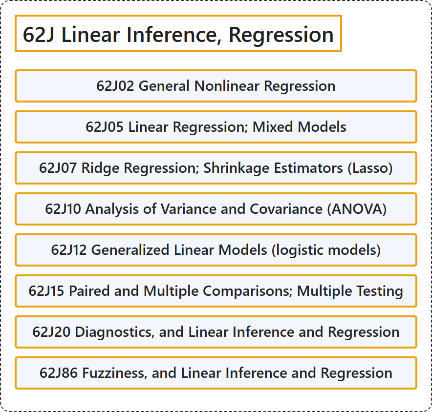

# 62J Linear Inference, Regression

## Classification

## Glossary

| Term | Definition | 中文翻译 | Source |
|---|---|---|---|
| **62J Linear Inference, Regression** 线性推断、回归 | (No definition) | （无定义） | [Associate Editors of Mathematical Reviews and zbMATH, 2020](https://msc2020.org/) |
| **62J02 General Nonlinear Regression** 一般非线性回归 | (No definition) | （无定义） | [Associate Editors of Mathematical Reviews and zbMATH, 2020](https://msc2020.org/) |
| **62J05 Linear Regression; Mixed Models** 线性回归；混合模型 | (No definition) | （无定义） | [Associate Editors of Mathematical Reviews and zbMATH, 2020](https://msc2020.org/) |
| **62J07 Ridge Regression; Shrinkage Estimators (Lasso)** 岭回归；收缩估计量（Lasso） | (No definition) | （无定义） | [Associate Editors of Mathematical Reviews and zbMATH, 2020](https://msc2020.org/) |
| **62J10 Analysis of Variance and Covariance (ANOVA)** 方差分析与协方差分析（ANOVA） | (No definition) | （无定义） | [Associate Editors of Mathematical Reviews and zbMATH, 2020](https://msc2020.org/) |
| **62J12 Generalized Linear Models (logistic models)** 广义线性模型（逻辑斯谛模型） | (No definition) | （无定义） | [Associate Editors of Mathematical Reviews and zbMATH, 2020](https://msc2020.org/) |
| **62J15 Paired and Multiple Comparisons; Multiple Testing** 成对比较与多重比较；多重检验 | (No definition) | （无定义） | [Associate Editors of Mathematical Reviews and zbMATH, 2020](https://msc2020.org/) |
| **62J20 Diagnostics, and Linear Inference and Regression** 诊断，以及线性推断与回归 | (No definition) | （无定义） | [Associate Editors of Mathematical Reviews and zbMATH, 2020](https://msc2020.org/) |
| **62J86 Fuzziness, and Linear Inference and Regression** 模糊性，以及线性推断与回归 | (No definition) | （无定义） | [Associate Editors of Mathematical Reviews and zbMATH, 2020](https://msc2020.org/) |

## References

Associate Editors of Mathematical Reviews and zbMATH. (2020). *MSC2020: Mathematics Subject Classification system*. Retrieved October 27, 2026, from <https://msc2020.org/>
