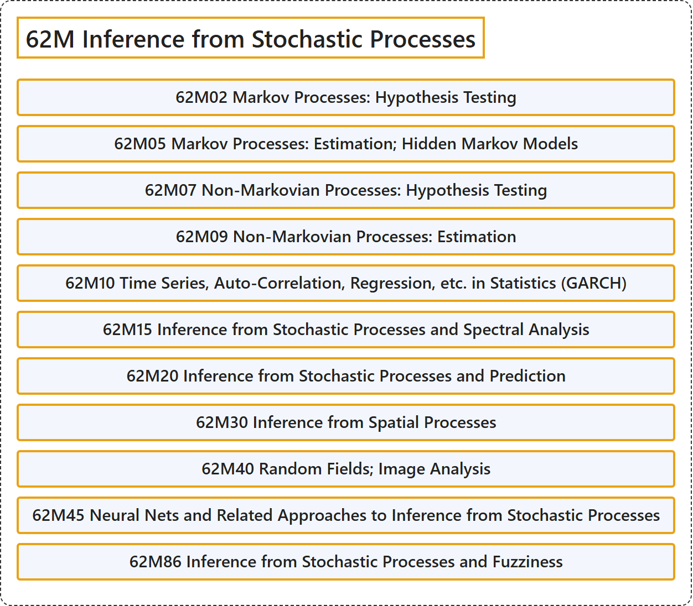

# 62M Inference from Stochastic Processes

## Classification

## Glossary

| Term | Definition | 中文翻译 | Source |
|---|---|---|---|
| **62M Inference from Stochastic Processes** 随机过程的推断 | (No definition) | （无定义） | [Associate Editors of Mathematical Reviews and zbMATH, 2020](https://msc2020.org/) |
| **62M02 Markov Processes: Hypothesis Testing** 马尔可夫过程：假设检验 | (No definition) | （无定义） | [Associate Editors of Mathematical Reviews and zbMATH, 2020](https://msc2020.org/) |
| **62M05 Markov Processes: Estimation; Hidden Markov Models** 马尔可夫过程：估计；隐马尔可夫模型 | (No definition) | （无定义） | [Associate Editors of Mathematical Reviews and zbMATH, 2020](https://msc2020.org/) |
| **62M07 Non-Markovian Processes: Hypothesis Testing** 非马尔可夫过程：假设检验 | (No definition) | （无定义） | [Associate Editors of Mathematical Reviews and zbMATH, 2020](https://msc2020.org/) |
| **62M09 Non-Markovian Processes: Estimation** 非马尔可夫过程：估计 | (No definition) | （无定义） | [Associate Editors of Mathematical Reviews and zbMATH, 2020](https://msc2020.org/) |
| **62M10 Time Series, Auto-Correlation, Regression, etc. in Statistics (GARCH)** 统计学中的时间序列、自相关、回归等（GARCH） | (No definition) | （无定义） | [Associate Editors of Mathematical Reviews and zbMATH, 2020](https://msc2020.org/) |
| **62M15 Inference from Stochastic Processes and Spectral Analysis** 随机过程推断与谱分析 | (No definition) | （无定义） | [Associate Editors of Mathematical Reviews and zbMATH, 2020](https://msc2020.org/) |
| **62M20 Inference from Stochastic Processes and Prediction** 随机过程推断与预测 | (No definition) | （无定义） | [Associate Editors of Mathematical Reviews and zbMATH, 2020](https://msc2020.org/) |
| **62M30 Inference from Spatial Processes** 空间过程推断 | (No definition) | （无定义） | [Associate Editors of Mathematical Reviews and zbMATH, 2020](https://msc2020.org/) |
| **62M40 Random Fields; Image Analysis** 随机场；图像分析 | (No definition) | （无定义） | [Associate Editors of Mathematical Reviews and zbMATH, 2020](https://msc2020.org/) |
| **62M45 Neural Nets and Related Approaches to Inference from Stochastic Processes** 神经网络及随机过程推断的相关方法 | (No definition) | （无定义） | [Associate Editors of Mathematical Reviews and zbMATH, 2020](https://msc2020.org/) |
| **62M86 Inference from Stochastic Processes and Fuzziness** 随机过程推断与模糊性 | (No definition) | （无定义） | [Associate Editors of Mathematical Reviews and zbMATH, 2020](https://msc2020.org/) |

## References

Associate Editors of Mathematical Reviews and zbMATH. (2020). *MSC2020: Mathematics Subject Classification system*. Retrieved October 27, 2026, from <https://msc2020.org/>
