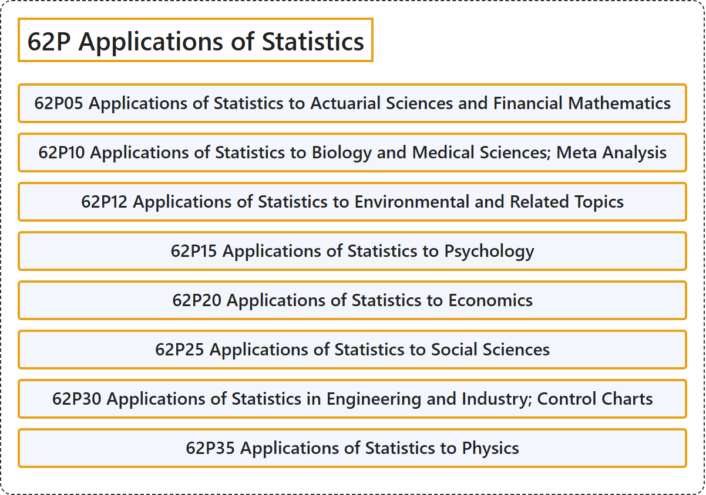

# 62P Applications of Statistics

## Classification

## Glossary

| Term | Definition | 中文翻译 | Source |
|---|---|---|---|
| **62P Applications of Statistics** 统计学的应用 | (No definition) | （无定义） | [Associate Editors of Mathematical Reviews and zbMATH, 2020](https://msc2020.org/) |
| **62P05 Applications of Statistics to Actuarial Sciences and Financial Mathematics** 统计学在精算科学与金融数学中的应用 | (No definition) | （无定义） | [Associate Editors of Mathematical Reviews and zbMATH, 2020](https://msc2020.org/) |
| **62P10 Applications of Statistics to Biology and Medical Sciences; Meta Analysis** 统计学在生物学与医学中的应用；元分析 | (No definition) | （无定义） | [Associate Editors of Mathematical Reviews and zbMATH, 2020](https://msc2020.org/) |
| **62P12 Applications of Statistics to Environmental and Related Topics** 统计学在环境及相关主题中的应用 | (No definition) | （无定义） | [Associate Editors of Mathematical Reviews and zbMATH, 2020](https://msc2020.org/) |
| **62P15 Applications of Statistics to Psychology** 统计学在心理学中的应用 | (No definition) | （无定义） | [Associate Editors of Mathematical Reviews and zbMATH, 2020](https://msc2020.org/) |
| **62P20 Applications of Statistics to Economics** 统计学在经济学中的应用 | (No definition) | （无定义） | [Associate Editors of Mathematical Reviews and zbMATH, 2020](https://msc2020.org/) |
| **62P25 Applications of Statistics to Social Sciences** 统计学在社会科学中的应用 | (No definition) | （无定义） | [Associate Editors of Mathematical Reviews and zbMATH, 2020](https://msc2020.org/) |
| **62P30 Applications of Statistics in Engineering and Industry; Control Charts** 统计学在工程与工业中的应用；控制图 | (No definition) | （无定义） | [Associate Editors of Mathematical Reviews and zbMATH, 2020](https://msc2020.org/) |
| **62P35 Applications of Statistics to Physics** 统计学在物理学中的应用 | (No definition) | （无定义） | [Associate Editors of Mathematical Reviews and zbMATH, 2020](https://msc2020.org/) |

## References

Associate Editors of Mathematical Reviews and zbMATH. (2020). *MSC2020: Mathematics Subject Classification system*. Retrieved October 27, 2026, from <https://msc2020.org/>
